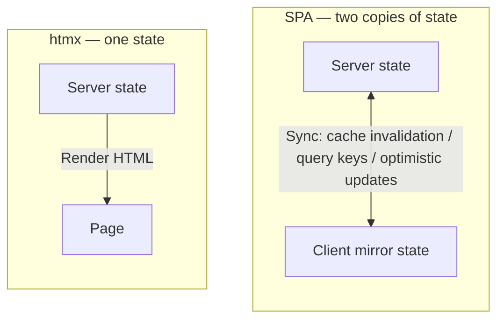
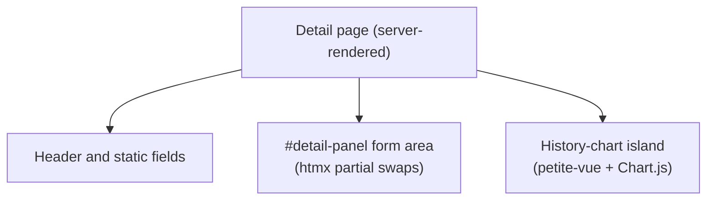





*Chinese original: [回到未来：我为什么用 htmx、模板引擎和 Tailwind 构建现代 Web 应用]()*

> A story about why "retro tools" still hold up today.

---

## 1. A Feeling of Déjà Vu

Recently I took on a real-time data dashboard. It needs user login, tiered permissions (admins, volunteers, and clients each seeing their own views), a live card grid refreshing every few seconds, and a pile of dense form operations. Sounds like a typical 2026 project.

My first reaction was the typical 2026 reaction too: React plus React Router, React Query for server state, Zustand for client state, some form library, some CSS-in-JS solution, plus a WebSocket client. I got as far as the `npm create` step — and stopped.

Because a solution from 20 years ago suddenly flashed through my mind. Back then, pages came from the server, forms were real `<form>`s, and errors were real HTTP status codes. The user submits, the page navigates — that simple. Of course, that era had its own hell — ViewState, postbacks, layers of unpredictably nested server controls — so I'm not nostalgic for it. What I miss is that **mental model**: the server understands the page, there is exactly one state, and HTML is a projection of that state.

Then I realized: over the past decade-plus we didn't "abandon" that model — we were **forced** away from it by what browsers couldn't do yet. Browsers back then only had crude full-page navigation — XHR existed, but mature, declarative partial updates didn't — so we invented client-side routing, client-side state, and client-side rendering, stuffing an entire application runtime into the browser just to avoid the primitiveness of "reloading the whole page on every interaction."

And today, htmx has patched that hole.

htmx isn't retro. htmx fulfills the promise HTML never delivered back then: letting **any element** fire a request, letting response HTML **replace a target fragment**, letting the server push **partial updates** instead of full-page refreshes. You don't need a heavyweight framework for it — you just add a few attributes to ordinary HTML.

What this post wants to explain is a design pattern: **why not build an SPA, why the htmx + template engine + Tailwind combo works, and how login/logout, error handling, live updates, and interactive components each land in practice**. It's language-agnostic — I used Rust and axum, but swap in Django, Rails, Phoenix, or ASP.NET and the argument still holds.

---

## 2. Why Not Build an SPA

I don't want to argue "SPAs are bad" — they're not; in many scenarios they're the right answer. My point is: **in this application, I pay twice for every layer of abstraction an SPA brings.**

### The Twins of State

This is the most fundamental one. In an SPA, you always maintain two copies of state: the true state on the server, and a mirror state in the browser. A user has 100 points — those 100 points live in the database, and also in some React component tree's state. To keep the two consistent, you need cache invalidation, query keys, optimistic updates, revalidation — a whole set of dedicated libraries and mental overhead to solve a synchronization problem **you created yourself**.

In a server-rendered app, there is only one state. The page is a projection of the state, nothing more. The server says "this card's state is now X," and the browser displays X. There is no second copy of state to synchronize, because there never was a second copy.



### The Twins of Routing

An SPA has two routing systems: client-side routing (the user clicks a link, the address bar changes, React Router decides which component to render) and server-side API routing (the endpoints the client fetches data from). Both routing tables need their own permission checks, their own error shapes, their own loading states. For an "admins only" page, you guard on the frontend (don't render) *and* on the backend (don't return the data) — because the frontend guard can always be bypassed.

A server-rendered app has exactly one routing table. Permissions are checked in one place, pages are assembled in one place, links are real links, and navigation is real HTTP requests.

### Build Cost

An SPA frontend is an independent production line: bundling pipeline, tree shaking, code splitting, type synchronization (frontend TypeScript types aligned with backend DTOs), API version negotiation. The essence of all this work is: **moving HTML away from the server, then moving data back.** If your goal was always "the server owns state, the browser displays state," what are you moving things around for?

> **An SPA treats the browser as an application runtime; htmx treats the browser as an HTML renderer. The former needs a framework; the latter just needs a web framework.**

To be fair, I should be clear about when an SPA is still the right call: offline-first apps, complex client-side state machines (e.g. an editor with dozens of drag interactions), rich-text/collaborative editing, and products where "the page itself is a local application." In those cases the client really is a runtime, not a renderer. But my dashboard isn't one of them.

---

## 3. htmx + Template Engine + Tailwind: Why the Trio Works

Looked at alone, none of these three tools is remarkable. Their power comes from the combination.

### Template Engines: Components on the Server

A template engine (Askama, Jinja, ERB, Tera — pick your favorite) gives you compile-time type checking and automatic HTML escaping, and more importantly: it lets you **assemble fragments on the server**.

There's a key insight here: in an SPA you write a `<Component>` that returns JSX; in htmx you write a template function that returns a chunk of HTML. **Same granularity, but the platform is now HTTP.** A "card component" is just a template; a handler calls it, fills in the data, and returns HTML.

### htmx: Declarative Requests and Replacement

htmx turns "fire a request, swap the content" into a few HTML attributes. Here's the most typical example:

```html
<form hx-post="/sessions/42/assignments"
      hx-target="#card-17"
      hx-swap="outerHTML">
    <input name="exercise" placeholder="exercise" required>
    <button>Assign</button>
</form>
```

The user clicks the button, htmx intercepts the submit and POSTs to the server. The server returns a **new card HTML** — the same card as before, but with updated content. htmx swaps that HTML into the `#card-17` slot. No JSON, no client store, no re-render scheduling, no diffing algorithm. The entire "update one card" interaction is three attributes plus one server-side template function.

### Tailwind: The Template Is the Component

Because styles live in the template, **the template becomes the component**. Every fragment carries its own styling; you no longer jump between CSS files, JS files, and component files. To restyle a card, you edit the template that renders that card.

And utility classes pay off infinitely here — they let you barely write CSS at all. No semantic class names, no BEM naming schemes, no selector hierarchies; `flex`, `gap-3`, `text-sm`, `font-mono` go straight on the element. Elsewhere that's just "fewer keystrokes"; but in the template world, your "component" is a server-side fragment, and the styling lives inside the fragment, rendered and swapped along with it. A card arrives from the server with its styles already complete; restyling a card means editing that card's template. **A fragment is self-contained** — structure, behavior, and styling in the same place. You no longer maintain a mental map of "where this class is defined and at which layer it gets overridden," which is far less mental overhead.

Even better is Tailwind's build model. It scans your template files at build time and compiles a static CSS file. The browser receives **one** fingerprinted, cacheable `app.css`. No runtime CSS-in-JS, no cost of injecting `<style>` at runtime, no hydration. Styling is fully resolved at build time; the runtime stays clean.

### Modern SSR: Tearing Down the House to Repaint a Wall

Someone might object: don't Next.js and Remix do server rendering too?

Of course they do. But their approach is **wanting both the framework and SSR, then stitching the two together**: you still write React/Vue components, maintain client state, and run a full bundling pipeline, and then the framework "hydrates" all of that onto the server-rendered HTML. Hydration itself is a cost; so Server Components, island partitioning, and similar mechanisms appear to **reduce** hydration — but the layers stack up, with more and more boundaries and rules, all to reconcile the natural tension between "client framework" and "server rendering."

That's what I mean by "tearing down the house to repaint a wall." You want a faster first paint and better SEO, and end up importing an entire hydration mechanism to rescue a client runtime **that could have not existed at all**. htmx takes the other road: **no client framework at all**, so "hydration" simply never comes up — HTML arrives from the server in its final form, with no second initialization and no handoff between two copies of state.

(Astro is the most clear-headed of that family: zero JS by default, islands mounted on demand. But it still asks you to embrace component frameworks and build chains; htmx's answer is more thorough — not even the component framework.)

### What's Retro Is the Mental Model, Not the Tools

This stack does feel like aspx and php at times. Because the ASPX and PHP generation wasn't dumb — they were right: **the server owns state, HTML owns expression.** They were just dragged down by their tools: no type-safe templates, no declarative partial updates, no genuinely usable CSS system, so they hand-wrote `Response.Write` and `echo` and struggled in the mud of full-page postbacks.

Today we use the same mental model, but with the tools 2026 deserves: type-safe templates, attribute-driven partial updates, build-time-compiled CSS. **What's retro isn't the tools — it's the idea that "the server understands the page." And it was never wrong.**

These ideas aren't mine — Carson Gross's *Hypermedia Systems* and the essays section of the htmx site explained "hypermedia as the engine of application state" (HATEOAS) far more thoroughly than I can. What I do here is just land those principles in a real project and honestly record where things went smoothly and where I had to supplement with JavaScript. Further reading is linked at the end.

---

## 4. Login and Logout: When a Form Becomes a Real Form Again

Login is where "traditional Web" and SPA diverge most — and the best illustration of "when to use htmx and when not to."

### A Counterintuitive Decision: Deliberately Not Using htmx for the Login Form

My login form is a plain `<form method="post">` with no `hx-*` attributes.

```html
<form method="post" action="/login" id="login-form">
    <label>Username
        <input name="username" autocomplete="username" required>
    </label>
    <label>Password
        <input name="password" type="password" autocomplete="current-password" required>
    </label>
    <button type="submit">Log in</button>
</form>
```

Why? Because what happens after a successful login — writing the session, redirecting to the dashboard — **is naturally a full page navigation**, not a partial fragment swap. Login isn't a "swap this HTML for that HTML" operation; it's an identity transition from "anonymous" to "logged in." Once the transition completes, the whole page should re-render, not swap one small fragment.

The more practical reasons come from browser behavior. A real form submission lets password managers correctly handle `autocomplete="current-password"` autofill, and lets the browser recognize "this is a login form." And — crucial for login — **an ordinary `<form>` still works with no JavaScript, or before htmx has finished loading**. Login is the first door into your system; you don't want that door to depend on a just-loaded JS library to open.

So the login form uses **real navigation**. **htmx is not "htmx everywhere" — it's "htmx where it belongs."** For login, the traditional form is the righter tool.

### One Endpoint, Two Response Shapes

But here's the catch: the same `/login` endpoint may be hit by browser navigation or by htmx (if you triggered it via htmx elsewhere). How does the server tell them apart?

The answer is the `HX-Request` header. htmx includes `HX-Request: true` on every request it sends, and the server branches on it:

```text
def login_redirect(headers, dest, cookie):
    if is_htmx(headers):
        # htmx call: 200 + HX-Redirect, let the browser do a real navigation
        return Response(200, {"HX-Redirect": dest, "Set-Cookie": cookie})
    else:
        # Ordinary browser navigation: classic 303
        return Response(303, {"Location": dest, "Set-Cookie": cookie})
```

Both sides end in the same real navigation; only the trigger differs. This branching pattern — **deciding the response shape from `HX-Request`** — runs through the entire error-handling chapter and is one of the cornerstones of this architecture.

### Tiered Permissions: Extractors, Not Middleware

After login comes authorization. This app has three roles seeing completely different pages. My approach is to make "who this is and what role they have" a request extractor, with each route declaring the identity it needs:

```text
class AdminPageAuth:
    # Resolve "admin identity" from the request, for full-page routes

    def from_request(state, request):
        match AdminAuth.from_request(state, request):
            case Ok(auth):
                return Ok(auth)
            case Err(Unauthorized(_)):
                # Unauthenticated page visit: 303 to /login, not a JSON 401
                return Err(Response(303, {"Location": "/login"}))
            case Err(e):
                return Err(e.into_response())
```

**The same "unauthorized" has two response shapes**: when a browser visits a page, it needs to be navigated to the login form; when an API client calls, it needs a `401` plus JSON. The reason is simple — the browser needs a page, the client needs structured data. The extractor does the right thing here: unauthorized on full-page routes becomes a 303, unauthorized on API routes becomes a 401 JSON, both derived from the same `Unauthorized` error.

Wrong role is a different matter. A volunteer visiting an admin page deserves not "please log in" but `403` — you're already logged in, you just lack permission. That distinction (401 unauthenticated vs. 403 unauthorized) gets blurred together in many systems; here it's kept explicit.

### Logout: That's All There Is

Logout is a POST: the server revokes the token, clears the cookie, and 303s back to the login page.

```text
def logout(state, request):
    if session_cookie(request):
        revoke_token(session_cookie(request))
    return Response(303, {"Location": "/login", "Set-Cookie": clear_session_cookie()})
```

That's it. No `localStorage.removeItem('jwt')`, no Redux reset, no "clear all client-side caches" ceremony. Because state lived on the server all along, logout is deleting that session record on the server and clearing the cookie in the browser.

### Security Details That Emerge Naturally

These details are utterly natural in the "traditional form" world, yet become awkward in the SPA + JWT world:

- **HttpOnly cookies**: the session token sits in an HttpOnly cookie that JavaScript can't read at all — XSS can't steal it.
- **Password hashing on a background thread**: argon2-style hashing takes ~half a second and must never block the event loop — throw it into a background task.
- **Rate limiting by (username, IP)**: against brute force, with the limiter gating before the hash runs.
- **Explicitly rendered CAPTCHA**: because login is a pure form (real navigation), the CAPTCHA widget is freshly rendered each time with single-use tokens — which fits exactly with the "re-render the login page on every failure" flow.

None of these is an htmx-exclusive feature, but they all become **natural again once you're back in the real-form model**.

### CSRF: An Old Threat with an Old Fix

Authenticating with session cookies means facing an old friend again: CSRF. An attacker lures the user's browser into firing a state-changing request at your site without the user knowing — because you use cookies, the browser attaches them automatically.

In the SPA + JWT world, this problem is mostly sidestepped: the token lives in localStorage and JavaScript manually stuffs it into headers, which the browser never sends automatically. But note this only moves the risk — XSS can now steal that token outright. On the cookie + HttpOnly path, the token is unreadable to JavaScript, so XSS can't steal it — though XSS can still operate on the victim's logged-in session as a proxy, just without carrying the credential away. The price is handling CSRF head-on.

The good news: the CSRF fix is old, mature, and lands especially naturally because forms are server-rendered:

- **`SameSite` attribute**: mark the cookie `SameSite=Lax` (the modern browser default) or `Strict`, and browsers won't attach it on cross-site requests — already blocking the vast majority of CSRF.
- **CSRF tokens**: a per-session secret the server writes into a hidden field when rendering the form, verified on submit. Because rendering is server-side, stuffing it into the field is one template variable — no client logic needed.

So this is another place where "back in the traditional-form world, things get easier": the threat is old, the fix is old, and both have been proven over decades.

---

## 5. Error Handling: htmx's Deepest Pit, and Its Most Valuable Contract

If you take one thing from this post, make it this section. Because htmx error handling hides a deeply counterintuitive pit — one that makes your app **silently fail** at certain moments, with the user seeing only a button that seemingly does nothing. Once you understand the problem, you also understand the most elegant part of this architecture: errors stop being chores scattered across the frontend and become a contract that lives in one function, shared by every endpoint.

### The Pit: htmx Only Swaps Successful Responses

Picture the most ordinary scenario. There's a card on the page with a form; the user clicks "Confirm" and expects the card to update. In an SPA, your `fetch` returns a Promise — success or failure, you can do something in `.catch`. In htmx, the flow is:

1. htmx intercepts the form submit and sends an XHR request to the server.
2. The server returns a response.
3. htmx replaces your target element with the response body.

Step three is the crux. htmx's default behavior: **only 2xx responses get swapped into the page**. If your endpoint returns a 400 or 500, htmx fires an `htmx:responseError` event and then… does nothing. The original DOM stays untouched; your error message sits in the response body, visible only in the browser devtools network panel.

For a "user clicked a button and stares at the screen waiting for feedback" form, that's catastrophic. No red hint, no toast, not even a console error. The user assumes the button is broken and clicks again, and again — the server correctly rejects the request every time, but every rejection vanishes into thin air.

The root cause: **htmx treats "errors" as something that shouldn't be shown to the user by default**. That default suits "background poll failed, retry quietly" scenarios, but completely fails "the user mistyped a field" scenarios.

### The Fix: Dual-Shape Responses

So I set myself one rule covering all htmx fragment endpoints:

> For htmx callers, always return 200 and put the outcome — success or failure — in the body; for everyone else, return the real status code.

Unpacked, the rule has two branches.

**On success**, return 200 with the fresh replacement HTML in the body, plus an `HX-Trigger` header telling the browser to pop a success toast. The user sees the card change, with a "saved" flash in the corner.

**On failure**, still return 200, but with an "something went wrong" hint in the body and an `HX-Reswap: none` header telling htmx **not to touch the target element**. The card isn't wiped, the user's input stays, and the error is written separately into the page's toast container via an out-of-band (OOB) patch.

And **non-htmx callers** — browsers without JavaScript, direct API clients, test code — should never know toasts exist. They want an honest HTTP status code and a structured JSON error body.

The core of the whole mechanism is converging the "how to present errors" decision into one function:

```text
def form_err(headers, error):
    if is_htmx(headers):
        # htmx fragment request: always 200, keep the original DOM, errors go via toast
        return Response(
            status=200,
            headers={
                "HX-Trigger": toast_trigger(error.message, "error"),
                "HX-Reswap": "none",
            },
            body=toast_oob(error.message, "error"),   # an OOB #toast HTML chunk
        )
    else:
        # Ordinary callers: real status code + JSON error body
        return error.into_response()
```

The 200 on the failure branch is **deliberate**, not lazy. Precisely because htmx only swaps 2xx, we must disguise "failure" as a "successfully fetched response" so htmx is willing to hand it to the page. The real failure information travels via the `HX-Trigger` header, not the status code.

### A Possible Objection: Does 200 Violate HTTP Semantics?

Seeing the "always return 200" rule, someone will frown: isn't that lying? An error is an error — why wrap it in 200?

That conflates two different things. The key question: **what is the "resource" this request asks for?**

For an htmx fragment request, what the client wants isn't the fact of "whether this operation succeeded," but a chunk of **HTML that fits into that div**. The server did successfully produce that HTML — it just happens to render an error message. From that angle, 200 is fully honest: the request succeeded, and the body is "rendered error DOM." The real business error ("a field was filled in wrong") travels in-band via `HX-Trigger` (the toast message).

And where status-code semantics truly matter — API clients, no-JS browsers, tests, monitoring — we **didn't** break them: those callers take the other branch and get real 400/401/422 codes plus JSON. HTTP semantics are fully preserved where they should apply, relaxed only in the one case of "the client explicitly wants an HTML fragment."

To be precise: this is **not** claiming HTTP semantics are void — 404, 409, 422 and friends exist for business outcomes and are still used as usual in the error enum. We're just making one pragmatic concession for "the client wants an HTML fragment": htmx only swaps 2xx (unless you tweak `htmx.config.responseHandling`), so "the business operation failed" goes in the body rather than the status code. An equally reasonable alternative is listening for `htmx:responseError` and swapping real 4xx bodies in; we just picked the plainer road.

### An Unexpected Detail: Latin-1 Headers

The `HX-Trigger` header looks simple but has a bite waiting — one that only shows on non-English content.

Browsers send requests via XHR underneath, and response headers XHR receives get decoded as **Latin-1 (ISO-8859-1)**. So if you stuff UTF-8 text into `HX-Trigger` — a Chinese hint, say, or an en-dash — it arrives at the browser as mojibake. A `Zone 60–120 bpm` becomes `Zone 60â120 bpm`.

I had no idea at first, until a toast containing non-ASCII characters rendered garbled in the browser. After a good while debugging I located it: my server encoding wasn't wrong — the response-header channel itself can only safely carry ASCII.

The fix is direct: after serializing the `HX-Trigger` JSON, escape every non-ASCII character into `\uXXXX` form. The structural JSON characters (quotes, colons, braces) are ASCII anyway, so the conversion is safe; and the client restores the true characters automatically with `JSON.parse`. Mojibake gone; what the server sends and what the client parses match exactly.

```text
# Server side: escape every non-ASCII character as \uXXXX
def toast_trigger(message, kind):
    payload = json.dumps({"toast": {"msg": message, "kind": kind}})
    return ascii_safe(payload)   # "Zone 60\u2013120 bpm \u00b7 done"

# Client side: JSON.parse restores automatically
# "Zone 60–120 bpm · done"
```

This detail really represents a whole category of experience in this kind of architecture: **you no longer wrestle with a framework's abstractions — you wrestle with HTTP's real constraints.** Those constraints are real, stable, and testable; and once you understand them, that class of bug never returns.

### A Single Source of Truth: The Error Enum

Once error handling converges on the single place `form_err`, the next need arises naturally: give the concept of "error" itself a single source of truth.

In SPAs, errors are usually loose parts — frontend error constants here, backend exception classes there, thinly joined by the HTTP-status-code layer in between. In a server-rendered architecture, one enum (or exception hierarchy) can decide three things at once:

- **Error code** (`bad_request`, `unauthorized`, `not_found`, `conflict`, …)
- **HTTP status code** (400, 401, 404, 409, …)
- **Human-readable message for the user**

The simplified enum below is a portrait of that thinking:

```text
enum AppError:
    case BadRequest(message)
    case Unauthorized(message)
    case Forbidden(message)
    case NotFound(message)
    case RateLimited(message)
    case Internal(message)

    def code(self):
        # "bad_request", "unauthorized", ...
    def status(self):
        # 400, 401, 403, 404, 429, 500
    def message(self):
        # Human-readable message
```

Then the whole chain connects: any handler anywhere `raise NotFound("no such session")`, and it automatically becomes — a red toast for htmx, a `404` plus `{"type": "error", "code": "not_found", "message": "no such session"}` for APIs, a re-rendered 404 page for no-JS browsers. **Three exits, one definition.**

Internal vs. user errors must be treated differently. `Internal` errors may hide database details, stack traces, internal paths — things that must **never** appear in response bodies. The right move is intercepting them at the response boundary: log them (let `Internal` details into the logs), and hand the client only a generic `"internal error"`.

```text
def into_response(self):
    status = self.status()
    if self is Internal(detail):
        log.error(detail)              # details go to logs only
        message = "internal error"     # the client only ever sees this
    else:
        message = self.message()
    return Response(status, json({"type": "error", "code": self.code(), "message": message}))
```

Putting that `log.error(detail)` at the response boundary has a bonus benefit: even if some handler forgot to log on error, as long as it returned `Internal`, the logs are guaranteed a record. You've turned "internal errors must be logged" from a discipline every developer must remember into something the architecture guarantees automatically.

### Why This Setup Holds Together Here

Looking back you might ask: couldn't SPAs do all this too? Pop a toast in `fetch`'s `.catch` and be done?

Of course they could. The difference isn't whether you can, but **how many times you do it**.

In an SPA, error handling belongs to each call site. You have a global interceptor, but every component still decides its own failure look — loading state, error state, retry button, boundary components. Errors are the easiest part of a frontend app to quietly drop.

In the htmx architecture, error presentation is pushed back to the server. The server **already knows** what went wrong, how badly, and what the user should see. And htmx's response contract lets you encode that knowledge **once** — in `form_err` and `AppError` — after which every endpoint, whether editing a card, bulk-assigning, or deleting a record, inherits the same behavior automatically.

This touches the deepest philosophy of the architecture: **keep decisions about "state" and "errors" on the server, and let HTML only express the outcome.** Error handling matters because it's where that philosophy first becomes concrete and tangible.

---

## 6. Live Updates: SSE Instead of WebSocket

The hardest part of the dashboard is liveness. Cards must refresh every few seconds to reflect data uploaded by on-site devices. The SPA standard answer is WebSocket plus a client rendering layer. Here, the answer is suspiciously simple.

```html
<body hx-ext="sse">
    <div id="grid" sse-connect="/stream" sse-swap="snapshot">
        {{ cards|safe }}
    </div>
</body>
```

htmx's SSE extension maintains a server-push connection to `/stream`. `sse-swap="snapshot"` declares: the server will push an event named `snapshot` whose data payload is the HTML to swap into `#grid`. So what the server pushes is **not JSON data, but already-rendered card HTML**:

```text
event: snapshot
data: <div id="grid">...complete card HTML...</div>
```

The client swaps it in on arrival. When live data is just "a projection of server state," rendering should happen on the side that owns the state — the server — not redone in a browser that must first rebuild the state. So you **drop an entire client rendering layer**: no more "receive JSON → update store → trigger re-render" chain, only "receive HTML → replace DOM."

The price sits on the server side: you must manage that long-lived connection's lifecycle — who's listening, whether to clean up on disconnect, how to broadcast to all listeners when data changes. That sounds scary, but it's essentially a "subscriber list + broadcast loop," an old trick every backend framework knows, in a few dozen lines (in production you also handle slow consumers, reconnect stampedes, and such edges — but that's another topic). And it's **one-way only** — data flows from server to browser; any client-initiated command (editing a card, say) still goes over ordinary HTTP POST. The live channel carries no "instructions back."

### Why SSE Instead of WebSocket

Because live updates in this app are **one-way** — data flows from server to browser, and the browser barely sends anything back. SSE is designed for exactly that shape: a long-lived connection over HTTP, with `EventSource` reconnecting automatically, and the connection naturally carrying same-origin cookies, so it seamlessly reuses your existing HTTP auth — an already-logged-in user's session cookie rides along with the SSE connection, no extra auth step needed.

WebSocket's cost is stuffing in "two-way" — a capability you don't even use — as a price you must pay: no auto-reconnect on drop, so you implement retries and heartbeats yourself; while it also upgrades from an HTTP handshake (so it can carry cookies too), it's more like an independent bidirectional pipe, living a separate life from the HTTP "request-response-push" lifecycle. When all you need is a one-way push stream, WebSocket is overkill.

### Being Honest: The DOM Is State Too

In section 2 I said "there is only one state." That was idealized.

Because the DOM itself is a second state. The user is filling in a form inside a card, has a dropdown expanded, focus sitting in some input — none of which the server knows, yet all of which is real state the user is holding. When the server pushes a `snapshot` that replaces the whole `#grid`, the input, the open menu, the focus — all gone. Far worse than a "stale card."

So the "implicit dual-state" problems — concurrent writes, multiple tabs, the back button — don't disappear in server-rendered architectures; they just change shape. The honest version: state synchronization goes from "the framework manages it" to "you manage it with HTTP primitives." SSE events, `hx-swap`, OOB patches are your primitives; and "when pushes should yield to what the user is doing" is your responsibility — no framework judges that for you.

Here's how we manage it: **when swapping, skip cards the user is editing.**

```text
# A card counts as "being edited" if either holds:
def card_is_editing(card):
    focus = document.active_element
    if focus is inside card and focus is an input (input / textarea / select):
        return true
    if card contains an open edit form:
        return true
    return false
```

So when each `card` event arrives, first check whether the target card is being edited — if so, `preventDefault()`, skip this swap, and let that second's update lapse. And the whole-grid `snapshot` is more cautious: if **any** card is being edited, stash this snapshot and apply it once editing ends — at the price of the whole grid staying stale during the edit. Broadcasts tick once a second, so an edited card never stays stale forever: the moment editing ends, the next tick brings a fresh one.

You do have to write a small piece of JavaScript arbitrating between "live pushes" and "what the user is doing." It's inelegant, but honest — it admits the DOM is state, then explicitly decides which state yields to which, and when. That's what this architecture really looks like: no magic, just HTTP primitives laid out one by one.

---

## 7. Islands: When a Chunk of Page Truly Needs to Be "Alive"

By now a reader will ask: all well and good, but what about a genuinely interactive component — a chart with tab switching and live refresh, where clicking a tab swaps datasets and hovering shows tooltips? htmx's partial replacement handles forms and lists, but not "a widget in the browser managing its own state."

The answer is admitting it, then carving out a small self-contained "island." That's not a betrayal of the argument so far — it's drawing the boundary clearly.

### Most Pages Are Server-Rendered; a Few Are Not

In my dashboard, the vast majority of pages follow one rule: the server renders HTML, htmx handles partial updates. With one exception — a participant history detail page with a chart. It has "this session / across sessions" tabs, a live-ticking frame count, a summary row, and a Chart.js line chart.

That widget needs something server rendering struggles to provide: **client state**. The user clicks a tab, the chart switches data sources, but the server doesn't need to know "which tab is showing" — that's purely presentational state, irrelevant to the server. Forcing it through htmx means a server round-trip per tab switch, interrupting the experience for a piece of local UI state. Not worth it.

So the chart is an island: a self-contained chunk on the page with its own little runtime, surrounded on all sides by server-rendered everything.



```html
<div
    v-scope="HistoryChart({ pid: 42, cutoff: 0.6 })"
    @vue:mounted="start"
    @vue:unmounted="stop"
>
    <button @click="setTab('session')" :disabled="tab === 'session'">This session</button>
    <button @click="setTab('all')" :disabled="tab === 'all'">Across sessions</button>
    <span v-if="headerCode">{{ headerCode }} · {{ frameCount }} frames</span>
    <canvas></canvas>
</div>
```

I used petite-vue here — a 6KB, no-build-step mini-Vue built for "adding reactivity to a small chunk of HTML." It's not a second full framework, just a small tool letting the island respond to user input internally.

### Islands Still Respect the Core Principle

Islands may hold client state, but **data still comes from the server**. The chart bootstraps with a same-origin fetch for history, carrying the existing session cookie — zero extra auth complexity. And its liveness rides the same EventSource (SSE) from the previous section — one stream carrying multiple named events: the grid gets `snapshot` and swaps HTML, the island gets `card` and refetches its own data. There is still exactly one source of data; the island is just a lively view of it.

That's a dividing line: islands hold **ephemeral, presentational state** — which tab is selected, which frame the chart is drawn up to. The server's state — the records themselves, quality thresholds, which frames are valid — remains the single source of truth, still owned by the server. You've introduced a small runtime, but no second truth to synchronize.

### Islands Must Live Outside the Swap

Islands have one easy-to-violate discipline: **they can't sit inside htmx's swap targets.**

The reason is mount timing. petite-vue's `createApp().mount()` runs once at page load, compiling the `[v-scope]` elements present in the DOM at that moment. htmx swaps new HTML into the page afterward — if that swapped-in HTML contains a `v-scope`, petite-vue knows nothing about it; it's just dead tags with no reactivity. To revive it you'd manually remount after every swap, while handling the previous mount's teardown, event listeners, and EventSource cleanup yourself. Once you walk that road, you've stitched two runtimes together, and complexity snaps back with a vengeance.

So in practice, swap targets and islands are **sibling neighbors in the DOM, never nested parent and child**. Back on that detail page: above sits a `#detail-panel` swap target with pure forms inside — setting ranges, assigning actions, all via htmx partial swaps; below sits a chart island that doesn't swap via htmx but refreshes itself via its own same-origin fetch plus EventSource. Two update channels, each minding its own, never nested.

That discipline is two faces of the same thing as the previous section: the island's data doesn't come from htmx response bodies, but from its own line. Precisely because of that, it can rest safely outside any swap, never uprooted by a partial replacement.

### A Familiar Price

Islands aren't free. You've reintroduced client state, a hand-written JS file, and a second runtime (petite-vue). "The cost of SPA" is back — just strictly confined to a small box of a few dozen lines, instead of suffusing the whole app.

And there are only-step-on-it-to-know pitfalls. petite-vue deep-wraps every property in its scope in a Proxy for reactivity — usually great; but if you put a Chart.js instance or an EventSource inside the reactive scope, their internal slots break under the Proxy and method calls throw outright. The fix is keeping those instances in closure-local variables, invisible to the reactivity system. Same category of experience as that Latin-1 header earlier: what you wrestle changes from "a framework's abstractions" to "some specific mechanism's boundary" — and once understood, never wrong again.

### Island Architecture, Not "All or Nothing"

If you know Astro, you'll recognize the "islands architecture" pattern in this. The only difference: Astro made it a first-class framework citizen, while here it's hand-rolled and smaller. The judgment behind both is the same — **deciding what needs a client runtime is done component by component, not for the whole app at once.**

The most important judgment is really this: htmx's value was never "refusing JavaScript," but "deferring JavaScript until it's truly needed." The vast majority of interactions — a form, a list refresh, an error hint — need only HTML and HTTP; only when you meet a widget that genuinely manages its own state do you carve out an island. Server-render by default, introduce runtimes on demand — not the other way around.

---

## 8. When This Pattern Is the Right One

I don't want to write this as an htmx hit piece or puff piece. It's a tool; tools belong in the right settings. This checklist is my judgment:

**This pattern fits you when:**

- The app is essentially "multiple views over server state" — dashboards, admin backends, content display.
- It's form-dense and CRUD-driven.
- Liveness is mostly pushes, without complex client-side interaction.
- The team is stronger on backend than frontend, or you just don't want to maintain two codebases and two build chains.
- You want "logout really logs out" and "there really is only one state."

**This pattern doesn't fit you when:**

- You need offline-first.
- The client has a complex local state machine (drag-and-drop, rich-text editing, collaborative editing).
- The page itself is a local application rather than a projection of server state.

In those settings the browser really is a runtime, and SPA is the right answer.

---

## Coda: The Mental Model Was Right All Along

The ASPX and PHP generation wasn't dumb — the right tools just hadn't grown yet. Their instinct — **the server owns state, HTML owns expression** — was never wrong; what was wrong were the tools in their hands: no type-safe templates, no declarative partial updates, no genuinely usable CSS system, no clean live-push channel.

htmx filled in partial updates, template engines filled in type safety, Tailwind filled in styling, SSE filled in liveness. When the tools arrived, that old mental model suddenly became modern again — not because the world regressed to 2005, but because the idea that "the server understands the page" had been waiting there to be redeemed all along.

If you've ever felt exhausted deep inside `node_modules`, between two routing tables, in the mire of cache invalidation — maybe look back. You'll find you're not stepping backward, but recovering a road that was right all along.

---

## Further Reading

- *Hypermedia Systems* — by Carson Gross, Adam Stepinski, and Denis Pashevsky, free to read online: hypermedia.systems. The systematic treatment of every idea above, far more complete than this post.
- The essays section of the htmx site (htmx.org/essays) — "hypermedia as the engine of application state" (HATEOAS), when to use hypermedia and when to use SPA, discussed more rigorously there.
- The htmx official docs (htmx.org/docs) — the authoritative reference for every attribute mentioned here: `hx-swap`, `HX-Trigger`, the SSE extension, and the rest.
