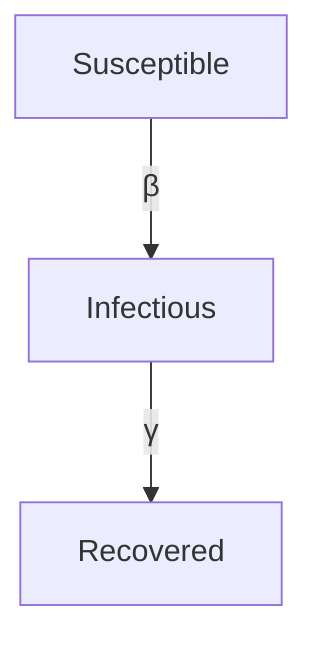
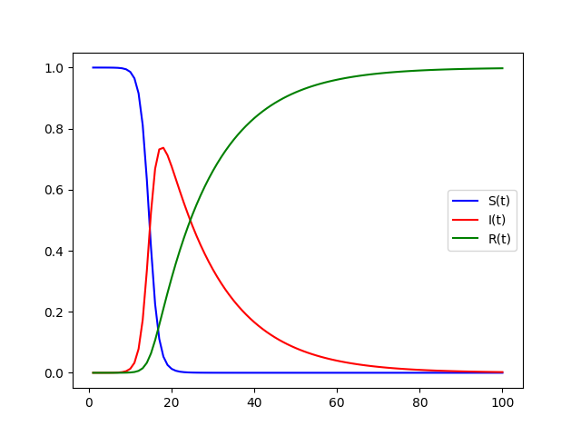
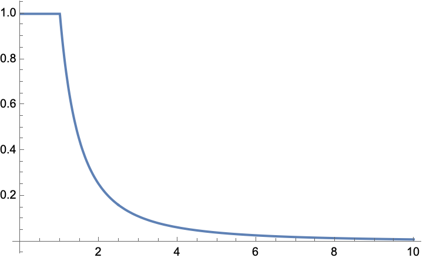
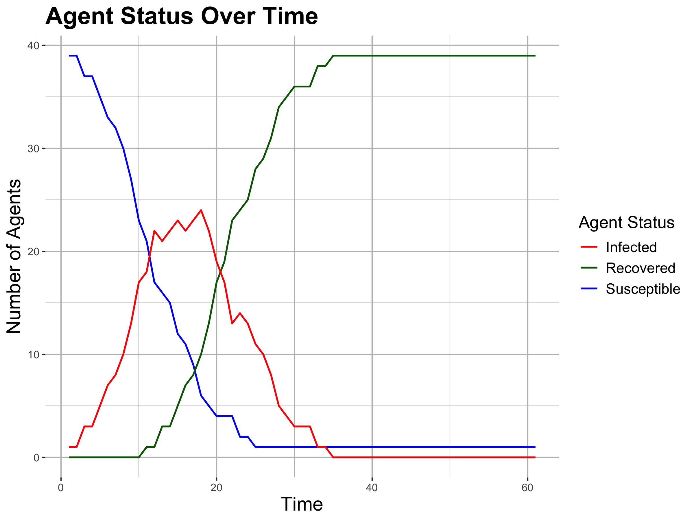
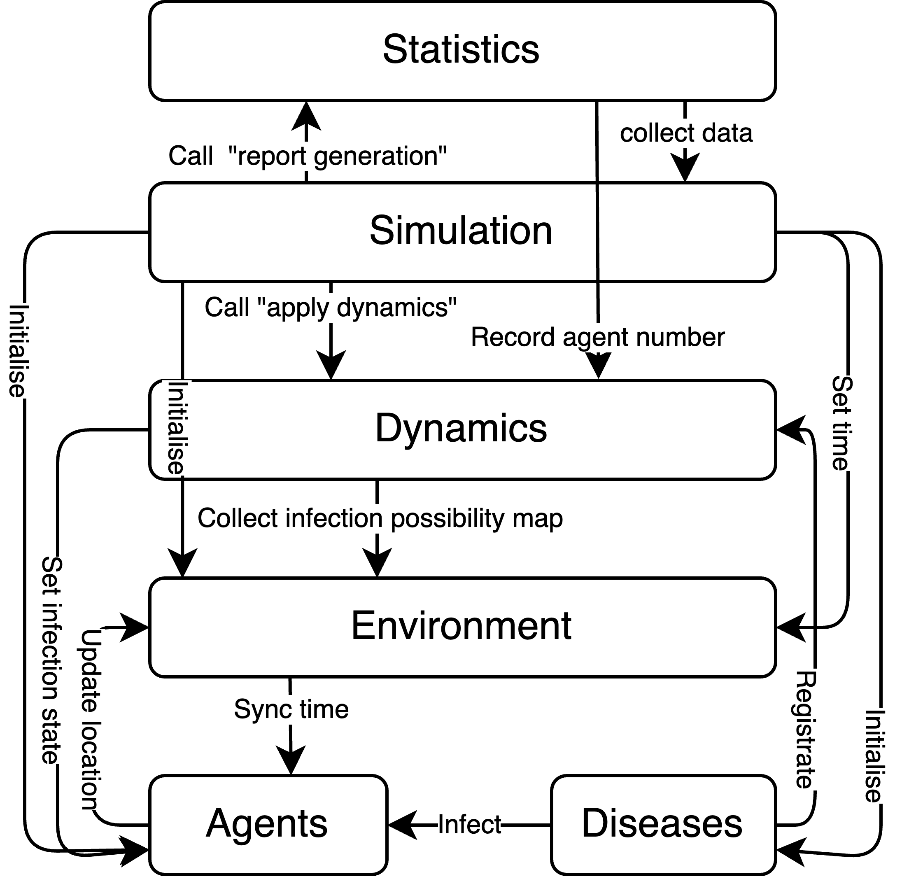
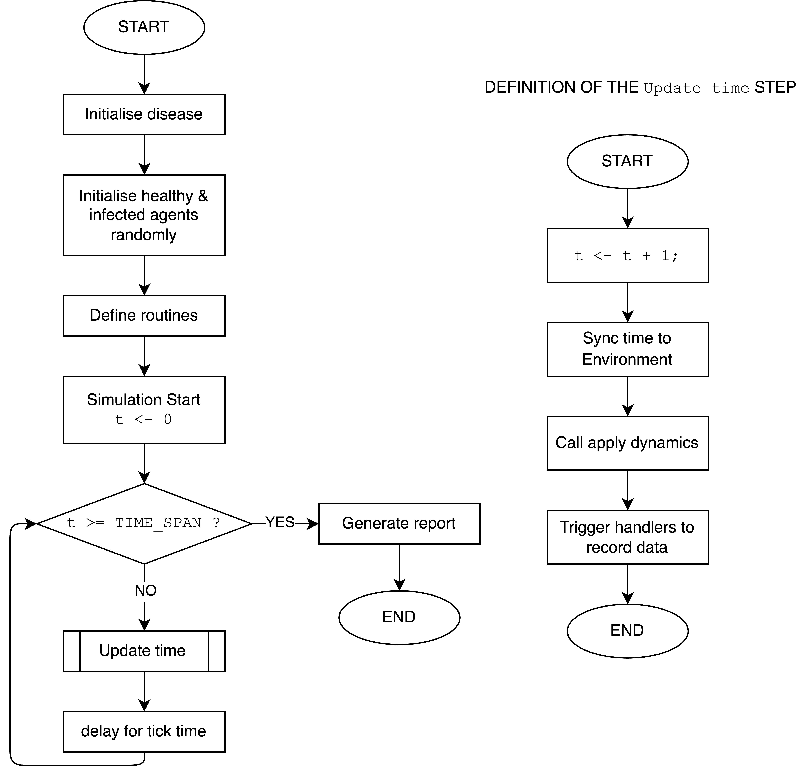

> This post is transcribed from my paper *A TypeScript Based Agent-based Disease Model*. The code of the model is available on GitHub: [Anson2251/camp-agent-base-model](https://github.com/Anson2251/camp-agent-base-model).

## Introduction

An agent-based model is a computer simulation of the interaction of agents (people) that is used to predict and demonstrate the spread of diseases ([Columbia University Irving Medical Center](https://www.publichealth.columbia.edu/research/population-health-methods/agent-based-modeling)). This post presents a TypeScript-based agent-based model that can partially simulate the spread of disease.

### Mathematics Theory of Spread of Disease

In the field of mathematics, there also exists a model known as the SIR model, which is a set of differential equations that describe the number of people who are susceptible ($S$, not infected), infected ($I$), and recovered ($R$, have recovered from the illness and are no longer susceptible to the same disease). The equations of the SIR model are as follows:

$$
\begin{aligned}
\frac{\mathrm{d} S}{\mathrm{d} t} &= -\beta S I \\
\frac{\mathrm{d} I}{\mathrm{d} t} &= \beta S I - \gamma I \\
\frac{\mathrm{d} R}{\mathrm{d} t} &= \gamma I
\end{aligned}
$$

The flow chart of the SIR model (after [Le Nguyen](https://medium.com/@ln8378/simulation-102-agent-based-disease-modeling-17307f2de2f3)) is:

*The diagram of the SIR model ($\beta=1$ and $\gamma=0.1$), after [Joaquin de Castro](https://pub.towardsai.net/graphing-the-sir-model-with-python-e3cd6edb20de).*

## Methodology

### Agent-based Model

In order to construct an agent-based model, it is necessary to define the agents, their behaviours, the interactions between them, and the environment in which the agents operate.
The agent-based model was implemented in TypeScript due to the author's familiarity with this programming language.
In general, agents are collections of properties, such as name, age, gender, health, and so on. They are used to represent the individuals, playing an important role in the simulation.
The behaviours of the agents in this model represent their daily routines and the locations of the agents at a specific time.

### Environment

The term "environment" is defined as the space in which the agents reside. The dynamics of the agents can be understood as the movement of the agents within this space, which is influenced by their routines.

### Dynamics

#### Infection Possibility

In order to simulate the spread of the disease, it is necessary to consider how healthy agents interact with infected agents and become infected. If infected agents move in close proximity to healthy agents, the risk of infection will be increased. A simple formula that can be used to roughly represent this is as follows.

$$
\mathbb{P}(\text{Infection}) =
\begin{cases}
\dfrac{1}{d^2} & \text{for } d > 1 \\
1 & \text{for } d \leq 1
\end{cases}
\quad \text{($d$ is the distance between the agents)}
$$

The graph of the above formula is shown in the figure below.

Where the $x$ is the distance between the agents, calculated by the formula.

$$
d = \sqrt{(x_1 - x_2)^2 + (y_1 - y_2)^2}
$$

Every agent will randomly get infected with a certain probability.

#### Restoration

Upon infection of the agents, a timer will commence a countdown. Upon reaching zero, the timer will initiate the restoration of the agents. It can be assumed that the restored agents will not become infected by the same disease.

### Implementation

This model is implemented in TypeScript for the purpose of type safety, which enables the model to be well structured in a logical and comprehensible manner. However, the graphing of the model is implemented in R due to the availability of the powerful plotting package `ggplot2`.

The model's graphical representation (see Appendix: model structure), which illustrates the design and the manner in which the modules interact with one another, can be found in the appendix.
The flow chart of the model (see Appendix: flow chart) is also included in the appendix.

## Results

The report generated by the model is appended in the Appendix. The graphic part of the report and the parameters are shown below.

- Simulation Time: 60
- Agent Number: 40
- Room Size: 40

The disease in this simulation model:

- Disease Name: Cold
- Disease Severity: 100
- Disease Time to Restore: 10

*The diagram of the created agent-based model.*

It is evident that this model is capable of partially simulating the spread of the disease with given parameters in relation to the agents and diseases, due to the similarity between the SIR diagram above and this figure, which depict outbreaks and extinctions.

## Discussion

This model is an effective tool for simulating the simple spread of the disease. It has been developed in TypeScript, a language chosen for its maintainability, but it lacks the ability to simulate the multiple diseases with complex dynamics. Some features that could facilitate the migration and control of parameters such as $\beta$ and $\gamma$ are missing and should be added in the future. And this model uses recover time to simulate, not the possibility to recover for the agents. The author has chosen to write in TypeScript, a language that is not commonly used for data analysis, due to its familiarity. This model also lacks simulation for some complex mechanisms between the infection possibility and the age, health of the agents, the severity of the disease, etc.

## Conclusion

The model described above is capable of accurately simulating the spread of the disease, including the occurrence of outbreaks and extinctions.

## References

- Columbia University Irving Medical Center, *Agent-Based Modeling*, [link](https://www.publichealth.columbia.edu/research/population-health-methods/agent-based-modeling) (Accessed: 2024-07-01).
- Le Nguyen, *Simulation 102: Agent-Based Disease Modeling* (2023), [link](https://medium.com/@ln8378/simulation-102-agent-based-disease-modeling-17307f2de2f3) (Accessed: 2024-07-01).
- Joaquin de Castro, *Graphing The SIR Model With Python* (2020), [link](https://pub.towardsai.net/graphing-the-sir-model-with-python-e3cd6edb20de) (Accessed: 2024-07-01).

## Appendix

### The Test Run Report for the Model

The content of the report can be found in the following URL (`JSON` format): [https://pastecode.io/s/twvh8go9](https://pastecode.io/s/twvh8go9)

### The Structure of the Agent-based Model

### The Flow Chart of the Agent-based Model

