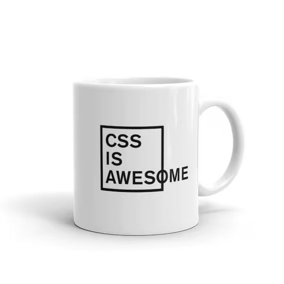
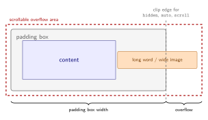
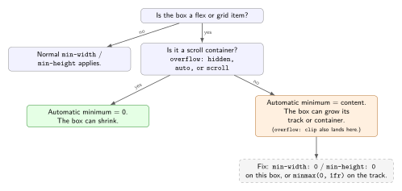
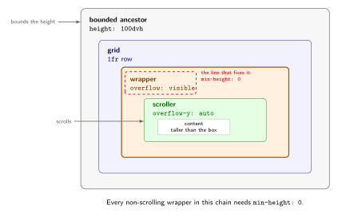

## 0x0: Introduction

When I was working on the Trackmaker project, the overflow behaviour of `grid` kept biting me. I had a side panel that was supposed to scroll, and instead it kept stretching the whole page. I added `overflow-y: auto` in a few places, nothing happened, and I started guessing.

The fix turned out to be one line on a wrapper, not on the panel. This note is what I wish I had at the time.



> CSS is awesome! [link](https://www.etsy.com/jp/listing/891486110/css-is-awesome-mug)

The short version: `overflow` needs a box with a bounded size. Grid and flex items have a content-based minimum that can stop that from happening. Setting `overflow` on the item itself removes that minimum, so `min-width: 0` and `min-height: 0` are usually for the non-scrolling wrappers around the scroller, not for the scroller itself.

## 0x1: The box model and what overflow means

An element is made up of content, padding, border, and margin.


> From "The box model", mdn web docs. [link](https://developer.mozilla.org/en-US/docs/Learn_web_development/Core/Styling_basics/Box_model)

`width` and `height` set the size of the content box by default. With `box-sizing: border-box` they set the size up to the border instead, so padding eats into the room left for content. Either way, once that size is fixed, content can still be larger.

`overflow` does not change whether content is too big. It only changes what the browser does with the extra part:

- `visible` paints it outside the box.
- `hidden` clips it. It also makes the box a scroll container, so you can still scroll it with script, focus, or `scrollIntoView`.
- `scroll` clips it and always shows a scrollbar. On platforms with overlay scrollbars, the scrollbar may only appear while you scroll.
- `auto` clips it and shows a scrollbar only when needed.
- `clip` clips it without making the box scrollable. That difference matters when grid or flex sizing is involved.

## 0x2: How the browser decides something has overflowed

It helps to think of layout as two passes.

First the browser works out how big each box is. For a plain block this comes from `width`, `height`, and the parent. For flex and grid it comes from flex sizing or track sizing, plus `min-width`, `max-width`, `min-height`, `max-height`.

Then it lays out the children and builds what the spec calls the scrollable overflow area. Roughly, that is the union of the box's own content and anything sticking out of it: long words, wide images, absolutely positioned descendants whose containing block is the box or a descendant of it, text with `white-space: nowrap`, and so on. Each child contributes its border box plus some extra cases like text shadows and floats.



*The scrollable overflow area can be larger than the padding box even when `overflow` is visible.*

If that overflow area is larger than the padding box, the box overflows. That is true even with `overflow: visible`. The property kicks in after the fact. It picks between painting the extra part, clipping it, or turning the box into a scroll container.

This is why `overflow: auto` sometimes looks broken. You added the scrollbar rule, but the box grew to fit the content, so from the browser's point of view nothing overflowed. If nothing overflows, no scrollbar appears.

A few things that tend to make the content side larger than people expect:

- `white-space: nowrap` stops text from wrapping, so the min content size becomes one very long line.
- Replaced elements like `img` or `video` keep an intrinsic width unless you constrain them with `max-width: 100%`.
- A block with `width: auto` fills the space it is given, but when it is a grid or flex item, its minimum size comes from its contents. A long unbreakable string or a wide nested grid can push that minimum up.

```css
.card {
  width: 200px;
  height: 100px;
  overflow: hidden;
}
```

```css
.card {
  width: auto;
  height: auto;
  overflow: visible;
}
```

In the first block the box stays 200 by 100 and extra content gets clipped. In the second the box grows with content, so nothing counts as overflow.

## 0x3: The automatic minimum in grid and flex

Flex items and grid items default to `min-width: auto` and `min-height: auto`. In practice, `auto` here means "no smaller than my content." The browser takes the min-content size of what is inside (the longest word, the image width, the nested track) and uses it as a floor.

There is an exception that the usual explanations skip: a scroll container's automatic minimum is `0`. In flexbox this applies to the main axis; in grid it applies on both axes. So an item with `overflow: hidden`, `auto`, or `scroll` on itself already has no content floor. It can shrink, and the overflow rule then clips or scrolls what does not fit.

That is why the common advice sounds contradictory. `min-width: 0` is not needed on the element that has `overflow: auto`. It is needed on a non-scrolling wrapper whose `overflow` is still `visible`, so that a scroller inside it gets a bounded box.

`overflow: clip` is the odd one out. It clips, but it does not create a scroll container, so it does not remove the content floor. A grid item with `overflow: clip` can still grow its track. If you want clipping and shrinking without a scroll container, pair `clip` with `min-width: 0` or `min-height: 0`.



*When the automatic minimum is content-based, the item can grow its track or container.*

Grid adds one more twist. `1fr` is shorthand for `minmax(auto, 1fr)`. That leading `auto` is the same automatic minimum. So a track written as `1fr` will not go narrower than the content of the items placed in it, unless you tell it otherwise or the item is a scroll container.

Say you have this:

```css
.grid-container {
  display: grid;
  grid-template-columns: 200px 1fr;
}

.grid-item {
  /* overflow: visible by default */
}
```

If the second column holds a long URL or a wide table, the item reports a large min-content size. The `1fr` track stretches to honor it. The page gets a horizontal scrollbar instead of the column getting one.

If the item itself should scroll, `overflow` is enough:

```css
.grid-item {
  overflow-x: auto;
}
```

The item becomes a scroll container, its automatic minimum becomes `0`, and the track stays at its share of the width. No `min-width: 0` needed.

If the scroller is a child of the item, the item keeps its content floor and needs the override:

```css
.grid-item {
  min-width: 0;
}

.grid-item .scroller {
  overflow-x: auto;
}
```

Same story vertically:

```css
.app {
  display: grid;
  grid-template-rows: auto 1fr;
  height: 100dvh;
}

.panel {
  /* overflow: visible by default */
}

.list {
  overflow-y: auto;
}
```

If the row is `auto` sized, it grows with the content by design. If it is a `1fr` row but the panel has its automatic minimum intact, the panel grows the row instead of letting the list scroll. Put the zero minimum on the panel:

```css
.panel {
  min-height: 0;
}
```

Or let the panel itself be the scroller:

```css
.panel {
  overflow-y: auto;
}
```

Then `min-height: 0` is redundant.

Flex behaves the same way, with one precision: the automatic minimum is special on the main axis. In a row, `min-width: auto` is the content floor; `min-height: auto` is not. A flex item with `flex: 1` and an inner scroller needs `min-width: 0`:

```css
.flex-container {
  display: flex;
  width: 300px;
}

.flex-item {
  flex: 1;
  min-width: 0;
}

.flex-item .scroller {
  overflow-x: auto;
}
```

If `.flex-item` itself has `overflow-x: auto`, it is a scroll container and the `min-width: 0` is unnecessary.

Other sizing knobs still apply. `flex-basis` sets the starting size before growing and shrinking. `min-width` and `max-width` win over it. Content-based tracks like `auto`, `min-content`, and `max-content` grow with content by design, so expect overflow there to paint outward unless you clip it:

```css
.grid-container {
  display: grid;
  grid-template-columns: max-content;
}

.grid-item {
  overflow: visible; /* content paints outside the grid area */
}
```

Nested layouts stack the problem. A grid inside a flex item, or a flex column inside a grid row, carries its own automatic minimum at each level:

```css
.app {
  display: grid;
  grid-template-rows: auto 1fr;
  height: 100dvh;
}

.middle {
  /* overflow: visible, and no min-height: 0 */
}

.inner-grid {
  display: grid;
  grid-template-rows: auto 1fr;
  height: 100%;
}

.list {
  overflow-y: auto;
}
```

Without `min-height: 0` on `.middle`, the middle box grows to its content height. The inner grid never gets a bounded height, so the list never scrolls. If any non-scrolling ancestor in the chain refuses to shrink, the inner scroller never sees a bounded box.

## 0x4: Where `min-width: 0` and `min-height: 0` actually go

Setting `min-width: 0` or `min-height: 0` removes the content-based floor on a box that is not already a scroll container. The box may now be narrower or shorter than its contents. On its own, that only bounds the box; the content still paints outside unless the box also has `overflow` set to clip or scroll.

It helps to separate the two jobs:

- `min-width: 0` or `min-height: 0` removes the floor.
- `overflow: auto`, `hidden`, `scroll`, or `clip` decides what happens to the content that no longer fits.

The scroller does both jobs with `overflow` alone. A wrapper only does the first job.

Here is the horizontal case with the scroller inside the item:

```css
.grid-container {
  display: grid;
  grid-template-columns: 1fr 1fr;
  width: 200px;
}

.grid-item {
  min-width: 0;
}

.grid-item .scroller {
  overflow: hidden;
}
```

Without `min-width: 0`, a long word forces the track wider than 200px. With it, the item stays in its cell and the inner scroller clips the extra text.

If the item itself is the scroller, the same markup needs one rule, not two:

```css
.grid-item {
  overflow: hidden;
}
```

`overflow: hidden` makes the item a scroll container, so its automatic minimum is already `0`, and it clips the content. Adding `min-width: 0` here is harmless but redundant. That is the part I had backwards for a while.

The vertical case is where I got stuck in Trackmaker. I had a full height app shell, a header plus a `1fr` row, and a list inside that row that should scroll:

```css
.app {
  display: grid;
  grid-template-rows: auto 1fr;
  height: 100dvh;
}

.panel {
  /* overflow: visible */
}

.list {
  overflow-y: auto;
}
```

`height: 100dvh` bounds the grid. `1fr` gives the second row the leftover space. But the panel reports its full content height as its minimum, the row grows past the viewport, and the page scrolls. With `min-height: 0` on the panel, it accepts the row height, the list gets a bounded box, and `overflow-y: auto` scrolls inside:

```css
.panel {
  min-height: 0;
}
```

If the panel itself has `overflow-y: auto`, the `min-height: 0` is unnecessary. The panel is a scroll container, so its minimum is already zero. The version that actually bit me had the overflow on the list, with the panel still `overflow: visible`.



*The zero minimum belongs on the non-scrolling wrapper, not on the scroller.*

Two details I keep forgetting:

First, every non-scrolling wrapper between the bounded height and the scroller needs the override. If `.panel` contains another grid and the list is one more level down, that middle wrapper also needs `min-height: 0`. One stubborn ancestor is enough to stretch the whole chain.

Second, `minmax(0, 1fr)` on the track does the same job from the other side. `grid-template-columns: minmax(0, 1fr) minmax(0, 1fr)` replaces the implicit `auto` minimum with `0`, so items in those tracks may shrink even if they still say `min-width: auto`. I put `min-w-0` on each wrapper that contains the scroller, and use `minmax(0, 1fr)` when the whole track should be allowed to shrink.

In flex the fix reads the same:

```css
.container {
  display: flex;
  width: 200px;
}

.item {
  flex: 1;
  min-width: 0;
}

.item .scroller {
  overflow: hidden;
}
```

Leave out `min-width: 0` and the item pushes past 200px to fit its content. Put it back and the item holds at 200px and the inner scroller clips. If the item itself has `overflow: hidden`, the item is already a scroll container and the `min-width: 0` is redundant.

So the rule I use: `overflow` needs a box with a bounded size to work against. In grid and flex, `min-width: 0` or `min-height: 0` keeps that bound intact on the boxes that are not scrolling. If the box that scrolls is the same box, `overflow` already does it.

## 0x5: The pattern I use now

For a scrollable pane inside a grid cell, I write three things:

1. A bounded ancestor: a fixed height, `h-screen`, `h-dvh`, or a `1fr` row inside one.
2. `overflow-y: auto` or `overflow-x: auto` on the element that should scroll.
3. `min-height: 0` or `min-width: 0` on every non-scrolling wrapper between the two.

In Tailwind that is usually `min-h-0` on the wrappers and `overflow-y-auto` on the scroller. If the scroller is the direct child of the grid, `overflow-y-auto` alone is enough; `min-h-0` on the same element is redundant.

| Where the overflow is | What removes the floor |
| --- | --- |
| On the item itself | `overflow` already removes it; `min-*: 0` is redundant |
| On a child of the item | `min-*: 0` on every non-scrolling wrapper between the bounded ancestor and the child |
| On the track | `minmax(0, 1fr)` instead of `1fr` |

Tailwind's `grid-cols-*` utilities already generate `repeat(n, minmax(0, 1fr))`, so grid children rarely blow out in Tailwind. Flex children still need `min-w-0` when the scroller is nested, because `flex: 1` keeps the content-based minimum on the main axis.

If it still does not scroll, I walk up the tree and look for the ancestor that grew. It is almost always a wrapper with `overflow: visible` and no `min-h-0` one level up.

## 0x6: Related behaviours worth knowing

### `hidden` is not the same as `clip`

`overflow: hidden` clips, but it still makes the box a scroll container. You can scroll it with `element.scrollTop`, `scrollIntoView()`, keyboard focus, and find-in-page. That can be surprising when a hidden panel jumps because something inside received focus. `overflow: clip` clips and does not create a scroll container, so none of those can scroll it. `overflow-clip-margin` lets the content paint a little past the clip edge before it is cut.

`hidden` being a scroll container is also why it removes the automatic minimum in grid and flex. `clip` does not, which is why it needs `min-width: 0` if you also want the box to shrink.

### One axis visible, one axis clipped

`overflow-x: hidden; overflow-y: visible` does not do what it looks like. When one axis is `hidden`, `scroll`, or `auto`, the other axis cannot stay `visible`; it computes to `auto`. If you need horizontal clipping with vertical overflow visible, use `overflow-x: clip; overflow-y: visible`.

### Clipping does not catch fixed or outside-positioned elements

An element with `position: fixed` is positioned relative to the viewport, so a scroll container's `overflow` does not clip it. That is why a tooltip or dropdown can escape a panel that is supposed to contain it. The exception is an ancestor with `transform`, `filter`, `perspective`, or `contain`, which makes that ancestor the containing block.

Absolutely positioned elements are clipped only when the scroll container is in their containing block chain. If their containing block is outside the scroller, they can paint outside the clip too.

The modern fix for menus and tooltips is the top layer: `popover` or `<dialog>`. Elements in the top layer are not clipped by ancestor overflow.

### Sticky headers and overflow

A `position: sticky` element sticks within its nearest scrollport. An ancestor with `overflow: hidden`, `auto`, or `scroll` becomes that scrollport. If the ancestor does not actually scroll, the sticky element has nothing to stick to, which is why adding `overflow: hidden` somewhere up the tree can break a sticky header. `overflow: clip` does not create a scroll container, so it does not have this effect.

### Nested scrolling

When a pane scrolls inside a page, reaching the end of the pane can start scrolling the page. `overscroll-behavior: contain` stops that. `scrollbar-gutter: stable` reserves space for the scrollbar so the layout does not shift when `auto` decides to show one.

### Viewport height

`height: 100vh` is taller than the visible viewport on mobile browsers with a collapsible address bar. Use `100dvh` for an app shell, or `100svh` if you want the small viewport size. Also, `height: 100%` needs a parent with a definite height; `min-height` does not give the parent one, so a percentage height often collapses to `auto` even when the parent looks tall.

### Debugging

Two checks answer most of these questions:

```js
const el = document.querySelector(".panel");
console.log(el.scrollHeight > el.clientHeight); // is it overflowing?
console.log(getComputedStyle(el).minHeight); // what floor is in play?
```

DevTools marks scrollable elements in the Elements panel, and you can toggle `min-width: 0` or `min-height: 0` live to see which box starts growing. If the scrollbar appears on the page instead of the pane, the pane is not the box with the bounded size.

## 0x7: Symptoms and fixes

| Symptom | Likely cause | Fix |
| --- | --- | --- |
| The whole page scrolls horizontally | A grid or flex item is growing its container because its automatic minimum is content-based | `min-width: 0` on the non-scrolling item, or `minmax(0, 1fr)` on the track |
| The scrollbar never appears | The box grew to fit its content, so nothing overflowed | Bound the box, then put `overflow` on the scroller |
| The scrollbar appears on the wrong element | `overflow` is on an ancestor of the intended scroller | Move `overflow` to the element that should scroll |
| Content is clipped instead of scrolling | `hidden` instead of `auto` or `scroll` | Use `overflow-y: auto` |
| Content is clipped closer than you want | `hidden` or `clip` on an ancestor | Remove the overflow, or use `overflow: clip` with `overflow-clip-margin` to allow some paint-out |
| A sticky header stopped working | An ancestor has `overflow: hidden`, `auto`, or `scroll` | Move the scroll container, or use `overflow: clip` if you only need clipping |
| A tooltip or dropdown is cut off | It is inside a scroll container | Use `popover` or `<dialog>`, or move it outside the clip |
| The pane scrolls, then the page scrolls at the end | Scroll chaining | `overscroll-behavior: contain` |
| The layout shifts when the scrollbar appears | `auto` adds a scrollbar only when needed | `scrollbar-gutter: stable` |

If the pane still does not scroll, the box that grew is the one to fix. It is usually one level above the scroller, with `overflow: visible` and no `min-height: 0`.
