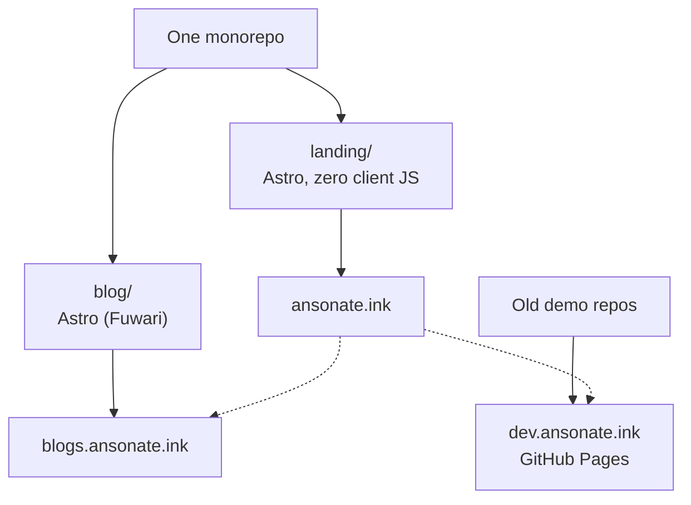
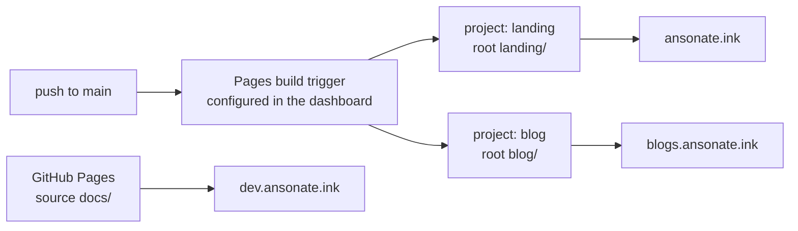

If you open ansonate.ink right now, what you see is no longer a bare index of blog posts but a landing page: the five most recent posts, a gallery of apps, and a badge that says I'm looking for a co-op. The blog itself has moved to blogs.ansonate.ink, and the dozen or so SPA demos I've accumulated over the years hang off dev.ansonate.ink. Behind those three domains are two Astro projects in one monorepo, plus a GitHub Pages site that exists only to host old things.



This post is the full account of the migration: why I left, why I landed on Astro, why the hardest part turned out to be deployment rather than the framework, and everything I did to keep the old links alive. There are two prequels: [in 2024 I wrote about why I chose Jekyll](/posts/new-blog-site/), and [the htmx piece from a few months ago](/posts/htmx-tailwind-en/).

## Three Requirements, One Moment

There were three motives for this migration: one push and two pulls.

The push: I didn't want to keep patching minima. The next section unpacks the bill, so here's just the conclusion. Over two years, every customization to the blog was pasted into the body as an include, and each layer of patches made the next one more expensive. The expected cost of "adding something to the blog" had overtaken the cost of "rewriting it."

Pull one: I needed a landing page. The blog index can't do that job. It only lists posts in reverse chronological order, and what I wanted was an entrance I could arrange freely: what I've written lately, what I've built, what I'm doing now. Implementing that in minima would mean forking the theme's home layout first, then pasting five more layers of patches on top.

Pull two was multilingual content. Content sites are static by default, but my blog is bilingual, and "bilingual" has a very specific meaning for me: when a recruiter clicks through from my résumé while I'm looking for a co-op, they cannot land on a screenful of Chinese write-up. That requirement splits in half. One half is that the content needs Chinese and English versions. Jekyll has plugins that can do this, but Jekyll hosted on GitHub Pages only runs whitelisted plugins, and the multilingual ones aren't on the list. Using them means building locally and pushing the output, which is moving CI's work back onto my own machine and back to the same old toolchain bill. The other half is filtering and switching content by the visitor's language. That's a runtime decision, and purely static hosting was never born with that organ; the only way to add it is another `<script>` pasted into the body, the same disease of patch debt. How it landed is in section 3.

There's also a cost that isn't a motive but has been accruing interest the whole time: Ruby isn't part of my toolchain. Every time I came back to this project, the opening act was `bundle install`, followed by some gem version problem, some strange PATH problem — and I was debugging in a language I don't write, with a package manager I don't know. Jekyll itself isn't slow. What's slow is the ticket price every time I walk in.

The direction was settled long before. When I wrote the htmx post, I spent a whole section on islands architecture and said Astro makes it a first-class citizen: zero JS by default, and only the components that need a runtime get one. A blog that is "content first, interaction on demand," a landing page that is "fully free-form, cut to fit," and a multilingual mechanism that is "static at the base, dynamic in patches" — three requirements pointing at the same framework. Any one of them alone would have produced a different answer. For the landing page alone, I could spin up a new repo and throw anything together. To escape minima alone, I could switch to another theme and keep going with Jekyll. For multilingual content alone, I could grit my teeth and build locally before pushing the output. But all three colliding at once made "one monorepo, one Astro setup, two kinds of output" the only reasonable shape.

## What I Hacked into minima

### The Two Lines at the Top of Every Post

The previous version of this site had 12 content files: seven posts, three drafts, the home page, and the about page. Eleven of them began their body with the same two lines of Liquid:

```liquid


```

Posts with math added `math-support.html` (five files); posts with diagrams added `mermaid-support.html` (three files). The busiest page collected all four, at the top of the impedance post:

```liquid




```

Fonts, code-block colors, math rendering, diagram rendering — these site-wide behaviors weren't configured in `_config.yml`, and they weren't written into any layout template either. They were **opted into page by page**: each page declared "I want these." Every time I started a new post, the first move before writing wasn't thinking of a title; it was reciting an incantation. Does this one have math? Does it have diagrams? Which lines do I paste?

A page that forgot to paste them got no warning. Without `math-support`, the reader sees a screenful of raw LaTeX; without `mermaid-support`, a diagram is a silent code block. Local preview passed, the build passed, the GitHub Pages deploy passed. Nowhere along that chain did any step consider "a few chunks of HTML in the body" to be something worth checking.

There was another layer of waste hiding in the output. `override-styles.html` had exactly one copy of its content, but Jekyll inlined it into every page's HTML: each page carried an identical `<style>` block, and the browser never had a chance to cache a shared stylesheet, because that stylesheet didn't exist. What existed was 11 inline copies.

### The Shapes a Patch Takes

Five includes, all different in content, all the same in shape: go around the theme, and stuff code that belonged somewhere else into the body.

The font line was the shortest: `<link href="/assets/fonts/barlow.css">`. That `barlow.css` was hand-written by me, 18 `@font-face` rules for the 18 `.ttf` files I downloaded from Google Fonts into `assets/fonts/`. No woff2, no `unicode-range`, no subsetting; every weight was an uncompressed original font file. That need has a standard answer today, and it's called `@fontsource`: one npm dependency, font files go into the build chain, the stylesheet is generated automatically, and upgrading is `pnpm update`. Instead, I was maintaining a hand-transcribed font directory and inviting it in with a Liquid tag in every page body.

The style block existed to push minima's defaults back down:

```css
*:not(code, .katex *) { font-family: 'Segoe UI', Tahoma, Geneva, Verdana, sans-serif; }
code, span:is(.highlight *) { /* … */ background-color: #f0f0f0 !important; }
```

The `!important` was there because it needed to override Jekyll's styles. Once the cascade war reaches that point, the selectors have lost their meaning. `*:not(code, .katex *)` means "change the font everywhere except these two special cases"; it doesn't modify a component, it modifies the entire document. `p { overflow: auto }` is the same: rules like that are almost always the relic of one specific overflow incident, and I had long forgotten which incident. Maybe at the time I just couldn't find the offending element, so every `<p>` in the world got dragged down too.

Math was three CDN tags: KaTeX 0.18.6, each tag carrying a sha384 hash, plus a config object written in an `onload` attribute, copied from the official tutorial at the time:

```html
<script defer src="https://cdn.jsdelivr.net/npm/katex@0.18.6/dist/katex.min.js"
    integrity="sha384-7jGyG5zFwmEamqNWdCbpsPn+GTWEis3lnV7X/jXHyhFpJG7ExABLyMapabg8F4+p"
    crossorigin="anonymous"></script>
<script defer src="https://cdn.jsdelivr.net/npm/katex@0.18.6/dist/contrib/auto-render.min.js" ...
    onload="renderMathInElement(document.body, { delimiters: [/* … */], throwOnError: false });"></script>
```

Those three lines hit every flaw of this kind of setup at once. The version number is locked into the URL, so upgrading means re-copying three lines of base64. Rendering happens in the reader's browser, its timing is `onload`, and its scope is `document.body`: KaTeX's CSS only takes effect after the body has downloaded and the script has loaded, so formulas flash as raw text first and then the whole page reflows. `throwOnError: false` guarantees that a mistyped formula won't bother anyone, including me.

The diagram include took the same shape: pull an ESM build of mermaid from jsdelivr, find `code.language-mermaid` in the browser (that's the output convention of the Rouge highlighter), and render on the spot. Two details say a lot. First, the URL says `mermaid@11`, which isn't version pinning but "give me the latest 11.x": the page's behavior depends on whatever 11.x was on jsdelivr the day the reader visited. That sat in the same repo, right next to KaTeX's pin-to-a-hash approach, so the hygiene standard was clearly not uniform. Second:

```js
mermaid.initialize({ startOnLoad: true, theme: 'neutral' });
mermaid.run({ querySelector: 'code.language-mermaid' });
```

`startOnLoad: true` makes mermaid look for elements with the `.mermaid` class, of which this site had exactly zero. The line actually doing the work is the manual `run()` below it. One of those two lines is dead configuration that stayed for two years because it was harmless — and harmless dead configuration lives the longest. The hardcoded `'neutral'` theme is also worth noting: there was no dark mode back then, and by the time there was, changing it meant hunting down three strings across three files.

The figures were `center-figure.html`, which appeared 18 times:

```liquid

```

For every image, I first decided on a display size, calculated the pixels by hand, filled in two parameters, and copied the alt text one more time. The output was an inline-styled `<div>` wrapping an `` with no `width`/`height` attributes: no lazy loading, no `srcset`, and layout shift thrown in free with every image. The image path was absolute too, so moving a directory once broke every link on the site.

### The Compound Interest of Patches

To be fair: Jekyll didn't lock anyone into the patching path. The theme's templates live in a gem, and you can copy `_layouts/post.html` into your repo, change it, and from that day on it's your own template. That's the door the official side leaves open. I never walked through it, because pasting was always cheaper in the moment: an include takes effect immediately, whereas forking the theme means every upstream fix in minima becomes something I have to follow by hand, and I'd have to maintain a directory structure I never designed.

So the problem isn't the first patch; the first patch was even reasonable. The cost starts showing from the third patch, or the fifth, onward: new changes land in the old patches' coordinate system, and every added layer requires remembering why the previous layers exist, which files they live in, and whether they depend on each other's order. But technical debt always comes due. **Patch interest compounds**, and the monthly payment two years later is that when I want to add something halfway decent, my first reaction is "forget it."

Three examples are enough to describe the situation of this codebase. Inside `override-styles.html` there's a line `box-shadow: inset 0 1px 1px rgb(255, 255, 2555, 0.3)`: 2555 is a typo, and the browser clamps it to 255 under CSS Color 4, so it has been quietly wrong for two years. KaTeX's `throwOnError: false` is the same species: errors are configured to be invisible. mermaid's `@11` is a third: the library floats, the page's behavior drifts, and nobody knows which day the drift happened. What they share is this: no type checking, no lint, no artifact that any CI would verify. This code doesn't live on a layer that can be checked. It lives in the markdown body.

By this point, "minima isn't enough" no longer explains much. Styles, fonts, math, diagrams, figures — every patch to those five things points at a structure that should have existed: fonts should be a dependency, math should happen at build time, figures should be one line of markdown, mermaid should be a component with a name, styles should belong to a system where I can write tokens. In "Jekyll plus somebody else's theme," those slots either don't exist, or you only get them by forking the theme first. And my actual situation for two years can be summed up in one sentence: **I had been maintaining a fork of a theme — just without the ownership of the fork.**

Where those things live now is worth a note here; I'll expand later. Fonts became `@fontsource/barlow`, a dependency sitting in `package.json`. Math became `remark-math` plus `rehype-katex`, rendered to HTML at build time, with its version and upgrade path managed by the lockfile. Figures went back to ordinary markdown image syntax, with relative paths resolved and hashed by the build. mermaid is the only thing left at runtime, and even its library still comes from jsdelivr, but the code driving it has moved: initialization, re-rendering, theme switching, and serialization across page changes are all handled by one explicit piece of code in the layout, so when something breaks I can trace it in the source. The runtime didn't disappear; it just moved into the layer where it belongs.

## Why Astro and Fuwari

There were three criteria for the migration, ordered by importance.

First, one tool had to answer all three requirements at once. The blog needs a content pipeline: content collections turn markdown into data with a schema, a remark/rehype plugin chain handles rendering, and RSS, sitemap, and reading time all have ready-made shapes. The landing page needs a free frontend: routing, components, and styles all under my control. Multilingual needs a third thing: pages generated statically, with the dynamic bits shrinking into a few isolated components. Astro happens to give all three.

Second, JS granularity has to reach the component level. The vast majority of the blog's content is static, but a few components always need to be alive — the two language switchers are the live ones; the landing page has zero lines of client JS, and that's all it needs. Astro's default is exactly "no JS unless you ask for it." The full version of that argument is in [section 7 of the htmx post](/posts/htmx-tailwind-en/), so I won't repeat it here.

Third, the toolchain has to be mine. npm, TypeScript, Vite — that's the stack I debug in daily, and when the build fails I can read every line of the error. That sounds obvious, but on the Jekyll side it was a wound that kept bleeding for two years.

The rejected options, briefly. Hugo is another patient with the same disease: a theme model, templates living elsewhere, customization by overriding, multilingual still assembled from plugins — only the template language changes from Liquid to Go templates. Next is heavy in the opposite direction: bringing a runtime and deployment assumptions to a mostly static site, in exchange for capabilities I would never use.

But this blog wasn't written from scratch. It started from [Fuwari](https://github.com/saicaca/fuwari), an Astro blog theme — or more precisely, material. I should be clear about the difference between "forking a theme" here and the "theme model" I spent a couple thousand words trashing in section 2.

The difference is where the code lives. minima's templates sit in a gem, and all I can do is override and inject. Fuwari's entire `src/` sits in my repo, including the theme mechanism itself: the remark plugin that handles mermaid, the plugin that computes excerpts and reading time, the rehype components that render cards — all named, diffable, editable files under `src/plugins/`. The day I forked it, the theme's maintainer became me. That's exactly the "ownership of the fork" from section 2 — except this time I took it.

What I've touched since taking over is roughly a list of plugins: fenced code blocks for mermaid become `<pre class="mermaid-src">` at build time and are handed to the frontend; `remark-excerpt` and `remark-reading-time` generate excerpts and durations for list pages; GitHub cards, link cards, and admonitions go through `rehype-components`; code blocks were switched to expressive-code, with fonts and colors adjusted. None of this is "configuring a theme"; all of it is writing my own build pipeline.

### A Table of Contents, Two Years Late

Having no table of contents on long posts was an old grievance from the Jekyll era. I always wanted one, but every route available there led to yet another layer of patches, so I never did anything about it.

Fuwari upstream has a TOC component: a `<table-of-contents>` custom element with scroll tracking and an indicator bar, sitting in a floating column to the right of the post body and appearing only at 2xl and above. I moved it into the sidebar and wrapped it in a card:

```html
<div id="toc-card" class="hidden lg:block sticky top-4 mt-4">
    <WidgetLayout id="toc-widget" ...>
        <div id="toc-inner-wrapper" class="max-h-[calc(100vh-12rem)] overflow-y-auto ...">
            <TOC headings={headings} />
```

`sticky` moved from `#sidebar-sticky` (the categories-and-tags blob) to this card; the card's height is capped at one screen minus 12rem, so a long TOC scrolls inside the panel. In `MainGridLayout` I deleted the whole floating right-hand block and left a comment for the next person reading the code: `#toc` now belongs to the sidebar, and swup needs this id to stick around. While I was there, I swapped `overflow-hidden` on `main` for `min-w-0`, otherwise the card's shadow would get clipped.

The component itself changed too. Upstream's scroll tracking uses IntersectionObserver to watch each section, but the sections produced by `remark-sectionize` are nested: a parent section's box contains all of its child sections, so when a child heading scrolls into view, the parent heading is also judged to be "being read," even though it scrolled off the top long ago. The fix is to ignore the boxes and compute by "between this heading and the next one," paired with rAF batching so it recomputes at most once per frame.

The amount of work here wasn't huge, but none of it was "configuration": which column to move it to, who owns `sticky`, how tracking is computed — the answers all live in my own layout and component files. Two years ago it stopped at "I want one"; now it's a card. And when upstream ships new features later, which ones I chase and which ones I don't is my call too.

### Multilingual: The Dynamic Part of a Content Site

The landing page is English-only; the blog is bilingual. In section 1 multilingual was a reason to migrate; here it's a concrete mechanism, in three layers.

The content layer. Each post's frontmatter carries `lang` and `translationKey`, and the two language versions of the same post recognize each other by key. When a post page detects its twin, it shows a cross-link, and the label follows the interface language: a Chinese interface says "English version," an English interface says "Chinese version."

The list layer. There's a language switch in the nav bar; once set, the home page and archive show only versions in that language. The filtering logic is collected in one shared function: group by `translationKey`, prefer the version in the chosen language, and fall back to whatever version exists. Better to show a post in the other language than to make it vanish.

The interface layer. Fuwari's built-in i18n is build-time: the site language is baked into the HTML at build. I moved it to runtime: server-rendered strings carry `data-i18n` markers, and on a switch one function scans the document and rewrites in place; Svelte components subscribe to the same CustomEvent, and after swup changes pages it replays once more. Interface language and content language are two independent switches and two localStorage keys, because "reading an English article in a Chinese interface" is a perfectly valid combination.

The defaults were weighed deliberately: both switches default to English. A first-time visitor — the recruiter, say — sees an English site; a Chinese reader clicks the switch once, the choice is remembered, and every return visit after that is in Chinese. I didn't implement Accept-Language negotiation, because "English default, one click, remembered long-term" already covers the scenarios I care about, and the extra correctness of negotiation isn't worth the extra surprise it brings.

The whole thing is islands: pages are static at build time, and the dynamic part is two switches, two localStorage keys, and a few CustomEvents. Section 1 said multilingual needs "a runtime decision." In practice it turned out to need two small islands, not a server.

### The Work at the Seams

The remaining problems all grow in the seams. Two representative ones.

Fuwari uses swup for page transitions: clicking a link doesn't reload the whole page, it replaces the main container and re-executes the scripts inside the page. That mechanism collided with mermaid and produced a race condition. On a page change, swup re-executes the scripts in the body, so mermaid's initialization code gets evaluated again; if state hangs off module scope, every navigation registers one more `page:view` hook, and after a few jumps two concurrent `mermaid.run()` calls rewrite the same `<pre>` that's still rendering. The symptom is a failed diagram render with only the code left behind.

The fix is to hang one-time state on `window` and serialize rendering:

```ts
const mermaidRuntime = (window as unknown as { __mermaidRuntime?: MermaidRuntime })
	.__mermaidRuntime ??= { mounted: false, queue: Promise.resolve() };

function scheduleMermaidRender(): void {
	mermaidRuntime.queue = mermaidRuntime.queue.then(renderMermaid);
}
```

`mounted` guarantees the hook is registered only once, and `queue` guarantees at most one `run()` in flight at any moment. Two other things got fixed along the way: clear the `data-processed` flag mermaid leaves behind before rendering, otherwise restoring the source on a dark-mode switch won't trigger a re-render; and the theme is no longer hardcoded, but follows the `dark` class on `<html>`, watched with a MutationObserver. The bill from section 2 — "changing the theme means hunting through three files" — gets settled here.

There's a smaller pit of the same kind: swup treats attachments under `/assets/` (the zip attached to the activation-function post, for example) as pages and tries to fetch them, fails to find a swap container, aborts, and leaves the page stuck in its transition class with all styles gone. The fix is to give swup an ignore list in its config, telling it which paths aren't pages.

Of course, neither of these bugs has anything to do with "a blog." Both are seams between "SPA-style navigation" and "third-party renderers and real downloads." The theme solves what a page looks like; the seams are always yours. That's what treating a theme as material actually means.

## One Repo, Two Projects, Three Domains

Choosing the framework was the easiest part of this migration. The hard part was deployment. Why it was hard starts with one small feature on the landing page.

The landing page has a "recent posts" list. Its simplest implementation is build-time generation: a script reads every post's frontmatter in `posts`, drops drafts, filters by tag, picks the English version of each Chinese/English pair, takes the five most recent by publish date, and writes out JSON. It's wired into the landing page's dev and build commands, re-syncing on every build:

```json
"dev": "node scripts/sync-posts.mjs && astro dev",
"build": "node scripts/sync-posts.mjs && astro build",
```

Build-time coupling is good coupling: the output is purely static, with no runtime fetch, no CORS, no loading state, and the list updates on the same day as the blog. But it comes with one hard constraint: **the landing page's build must be able to read the blog's source files**. Two sites, one repo, no other option. That's where the monorepo came from.

And that knocked GitHub Pages out. Its publishing model is one repository per site: one publish source, one custom domain. The requirement for two projects, each with its own domain, has no counterpart in that model.

I considered every alternative I could think of:

- Two repos, with the landing page checking out the blog at build time. Cross-repo checkout needs a token, the build order becomes a coordination problem between two repos, and pushing a post to the blog won't trigger a rebuild of the landing page, so the list stays stuck at the old state.
- The landing page fetching the blog's RSS or JSON at runtime. That adds a loading state above the fold, ties the landing page's availability to the blog's availability forever, and contradicts the whole premise of "static output, JS on demand."
- One site, with the blog under a path prefix. One site carrying two mental models, with the `base` path and CNAME to fiddle with, and the landing page and blog's lifecycles bound together from then on.

Cloudflare Pages' model happens to be shaped exactly like the requirement: one repo can host multiple projects, and each project specifies its own root directory, build command, and custom domain. So the topology now is:



The deployment chain got a new lead too. GitHub Actions in the repo only validates: `astro check`, then a build on Node 22 and another on Node 24, with no deploy step. The actual go-live happens on Cloudflare's side: the Pages build trigger is configured in the dashboard rather than in the repo, and a push to main starts the build and deploy of the corresponding project. CI owns "is the code right"; CF owns "is the site alive." The division of labor is clear, and the price is in section 6.

The division of domains:

| Domain | Points to | Hosting |
|---|---|---|
| ansonate.ink | landing | Cloudflare Pages |
| blogs.ansonate.ink | blog | Cloudflare Pages |
| dev.ansonate.ink | old demo repos | GitHub Pages |

The third domain deserves its own paragraph. Those dozen or so SPA demos are each their own repo, each with GitHub Pages enabled. GitHub has a handy mechanism: once a user site has a custom domain configured (with DNS pointed at GitHub Pages first), project sites under the same account hang off subpaths of that domain by default. So the user-site repo claims dev.ansonate.ink; every demo can live on as `dev.ansonate.ink/<repo>/`, and old links from the main site get 301'd there.

This Pages site publishes from `docs/`, which contains only a single redirect page with `noindex`. Strictly speaking it could hold nothing at all — the demos' survival doesn't depend on what's at the root path — but the root path itself needs somewhere to land, otherwise anyone visiting dev.ansonate.ink directly hits a 404. Now that redirect page sends this small crowd to the gallery at `ansonate.ink/apps`. Nothing old died; it just moved house.

## Wait! Old Links Must Not Die

The completion criterion for a migration is that every old URL has somewhere to land, <s>because I put the old links on my résumé</s>. The old site was small, but it had plenty of URL types: eight posts, a feed, an about page, and a dozen demo paths.

Posts first. Jekyll's default permalink is `/:categories/:year/:month/:day/:title.html`, so old post URLs look like this, and they're long:

```
/mathematics/deep-learning/2026/10/16/desmos-and-calu.html
```

The categories were whatever I felt like, and some contain spaces ("Web Development" on the htmx post). The browser actually requests the `%20`-encoded form. Cloudflare Pages' `_redirects` supports placeholders, so one rule matches both the decoded and the encoded form:

```
/:category/programming/2026/10/07/htmx-tailwind.html  https://blogs.ansonate.ink/posts/htmx-tailwind/  301
```

There are two copies of `_redirects`, because rules apply per project: the apex project can't see the blog's rules, and vice versa. The apex copy (`landing/public/_redirects`) uses absolute URLs: old posts and the feed 301 across domains to the blogs subdomain, and demo paths 301 to the dev subdomain. The blog copy (`blog/public/_redirects`) uses site-relative paths, catching old links that hit the blog domain directly. The feed is a separate line: jekyll-feed produced `/feed.xml`, and on the Astro side it's `/rss.xml`.

The demo paths are thirteen exact redirects plus two lowercase aliases — early repo names weren't consistently cased, and both spellings have to be caught:

```
/resume-tailor/*  https://dev.ansonate.ink/resume-tailor/:splat  301
/credicheck/*     https://dev.ansonate.ink/CrediCheck/:splat     301
```

Think carefully before you use a 301: browsers and CDNs cache it long-term, so once you get one wrong, the time it takes the fix to take effect is out of your hands. The safe order is to start with 302s for a few days, confirm every destination is right, and only then switch to 301.

`_redirects` also has places it can't reach: it only handles paths, not domains. A domain-level redirect like apps.ansonate.ink to `ansonate.ink/apps` has to be a Redirect Rule written in the Cloudflare dashboard. That's recorded in the landing page's README now, because I'll almost certainly look in the wrong place next time.

## Free Is Not Free

This topology isn't free. Here's the bill.

Two build chains. GitHub Actions validates once, and Cloudflare builds again when deploying. The direct consequence is that **green CI doesn't mean it's live**: a build failure on the CF side only appears in a different dashboard, and nothing turns red on GitHub. Versions have to be aligned in three places too: `engines` in `landing/package.json`, the pnpm version hardcoded in the workflow, and the one in the CF project settings. Any drift between them means "works locally, passes CI, explodes in production."

Two lockfiles, two sets of dependabot configs, DNS for the domains. `_redirects` is a table that needs maintenance, and site-level paths (the feed, the about page) have to be remembered and updated whenever the site is restructured. One thing is hard to place: the Pages project settings live in the Cloudflare dashboard, and that config is the only part of the setup that isn't under version control. There isn't much of it, but every time I want to say "all config is code," I have to add a caveat.

When does this become over-engineering? If all you need is a blog, GitHub Pages with Jekyll or Hugo is still the least fuss, and the story ends there — right up until you start reshaping the publishing pipeline so another page can read the content.

## Closing

In that announcement post from 2024, I wrote that Jekyll fit my preferences perfectly. That was true at the time, and it isn't exactly wrong now; the context just changed. Over two years my usage grew into the shape of a theme: a landing page, a set of reusable components, a bilingual convention — while the tool stayed where it was. Jekyll didn't get worse. My demands on it changed.

The substance of this migration is that I stopped renting the presentation layer. From markdown to DNS, every layer now has a name, a version, and an error message I can read. The price is doing my own plumbing: two build chains, three domains, a redirect table, and a bit of Pages config hiding in a dashboard.

Publishing a post now goes like this: write it, push, both projects build, the landing page's "recent posts" updates itself, and the old links stay where they are. Not a single step in that flow requires me to remember anything, which is probably what the person pasting includes into post bodies two years ago was after.

## Appendix: Migration Checklist

For anyone about to do the same thing, in order:

1. Inventory every URL on the old site first: posts, feed, about, attachments, demos. Put them in a table. Migration is done when that table is all green.
2. Order the criteria for choosing a framework: is the toolchain yours, JS granularity, ecosystem. Performance benchmarks come last.
3. Fork the theme; don't hack the theme, unless you know there won't be many new things later. There's only one test: are the theme's template files in your repo?
4. Content before styling: settle the frontmatter schema, where content collections live, and the multilingual conventions before you talk about how it looks.
5. Share content between sites with a build-time script — explicit and diffable. Don't use runtime fetch.
6. Confirm your host supports "multiple projects per repo, built by directory." That's the prerequisite for the monorepo.
7. Separate validation from deployment: CI only validates, deployment is triggered by the host on push, but accept that "green light doesn't mean live."
8. Redirects: 302 first, 301 later. Use placeholders for old paths with spaces, and test both encoded forms.
9. Learn `_redirects`' limits: it doesn't handle domains, there's a cap on rule count, and domain-level redirects go in the dashboard.
