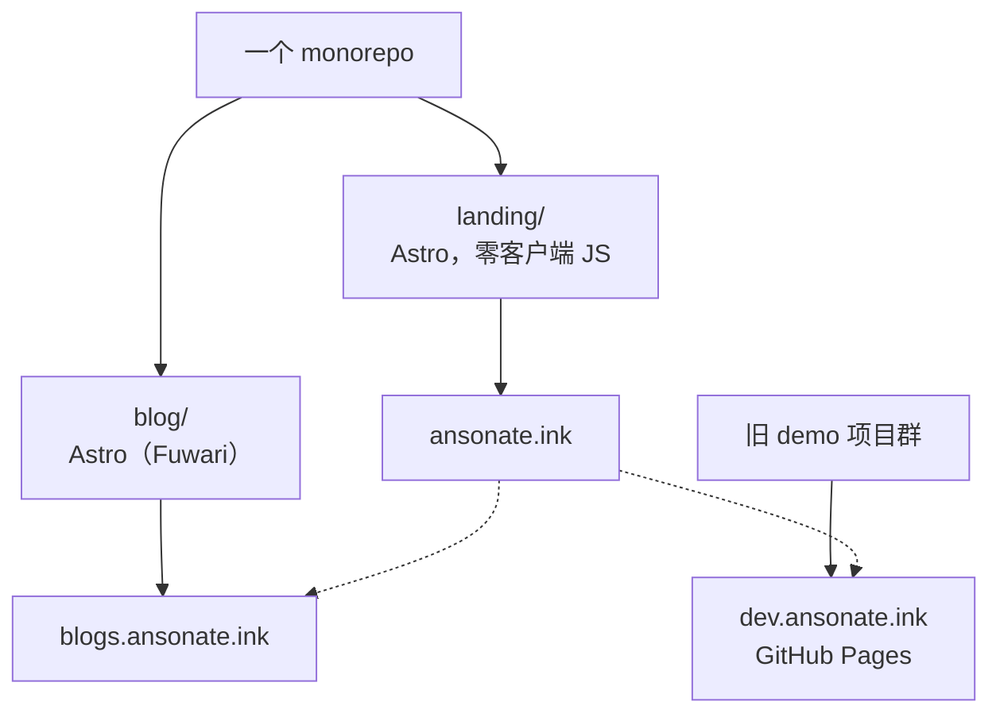
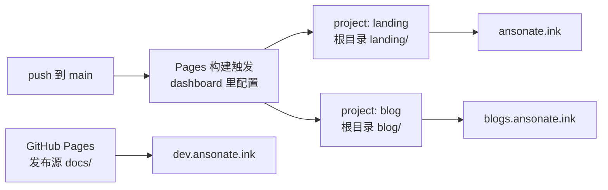

如果你现在打开 ansonate.ink，看到的不再是简陋的博客文章索引，而是一个 landing：最近更新的五篇文章、一个 apps 画廊、一个写着我找 coop 的 bage。博客本体搬到了 blogs.ansonate.ink，这些年攒下的十几个 SPA demo 挂在 dev.ansonate.ink。三个域名背后，是一个 monorepo 里的两个 Astro 项目，外加一个只用来托管旧物的 GitHub Pages。



这篇记录的是迁移的完整经过：为什么走，为什么落在 Astro，最难的部分为什么不在框架而在部署，以及为了让老链接活下来都做了什么。有两篇前情：[2024 年我写过为什么选 Jekyll](/posts/new-blog-site/)，[几个月前那篇 htmx](/posts/htmx-tailwind/) 。

## 三个需求，一个时间点

这次迁移有三个动机：一个推力，两个拉力。

推力：我不想再给 minima 打补丁了。下一节展开这笔账，这里只说结论：两年下来，博客的定制全部以 include 的形式贴在正文里，每一层补丁都让下一层更贵，"给博客加点东西"的预期成本已经超过了"重写"。

拉力一：我需要一个 landing page。博客索引页干不了这件事，它只会按时间倒序列文章，但是我要的是一个能自由排布的入口：最近写什么、做过什么、现在什么状态。在 minima 里实现它，需要先 fork 主题的 home layout，再往上贴五层补丁。

拉力二是多语言。内容网站默认是静态的，我的博客却是双语的，而且"双语"在我这里有一个很具体的含义：找 coop 的时候，recruiter 顺着简历点进来，看到的不能是一屏中文 write-up。这个需求拆开是两半。一半是内容要有中英两个版本，这半 Jekyll 有插件能做，但 GitHub Pages 托管的 Jekyll 只跑白名单插件，多语言插件不在名单上，想用就得本地构建再推产物，等于把 CI 的活搬回自己电脑，回到工具链那笔旧账。另一半是按访客的语言筛选和切换内容，这是个运行时的决定，纯静态托管天生没长这个器官，要补只能再往正文里贴一层 `<script>`，补丁债务的同一个病。落地放在第 3 节说。

还有一笔不算动机、但一直在计息的成本：Ruby 不在我的工具链里。每次回到这个项目，开场都是 `bundle install`，然后是某个 gem 的版本问题，某个奇怪的 PATH 问题，而我 debug 用的是一门我不写的语言和一个我不熟的包管理器。Jekyll 本身不慢，慢的是我每次进场的门票。

方向其实早就定了。写 htmx 那篇的时候，我用一整节讲岛屿架构，说 Astro 把它做成了一等公民：默认零 JS，哪个组件需要运行时哪个才有。一个"内容为主、交互按需"的博客，一个"高度自由、自行裁切"的 landing，一个"静态为底、动态按块"的多语言机制，三个需求指向同一个框架。只有其中任何一个，答案都不一样：只为了 landing，开个新仓库随便搭；只为了逃离 minima，换个主题继续 Jekyll 也能混；只为了多语言，硬着头皮本地构建再推产物也行。三个撞在一起，"一个 monorepo、一套 Astro、两种产物"才成了唯一合理的形状。

## 我在 minima 里 hack 了什么

### 正文开头的两行

这个站点的上一版有 12 个内容文件：七篇博文、三篇草稿、首页和关于页。其中 11 个的正文开头躺着同样的两行 Liquid：

```liquid


```

有数学的文章再追加 `math-support.html`（5 个文件），有图的文章再追加 `mermaid-support.html`（3 个文件）。最满的页面凑齐四行，排在阻抗那篇的开头：

```liquid




```

一个站点的字体、代码块配色、数学渲染、图表渲染，这些"全站行为"没有配置在 `_config.yml` 里，也没有写进某个布局模板，而是**逐页 opt-in**：每一页自己声明"我要这些"。每开一篇新文章，动笔之前的第一个动作不是想标题，是背咒语：这篇有数学吗，有图吗，该贴哪几行。

忘了贴的那一页不会得到任何警告。少了 `math-support`，读者看到的是一整屏原始 LaTeX；少了 `mermaid-support`，图表就是一个沉默的代码块。本地预览能过，构建能过，GitHub Pages 部署也能过。整条链路上没有一个环节认为"正文里的几段 HTML"是值得检查的东西。

还有一层浪费藏在输出里。`override-styles.html` 的内容只有一份，但 Jekyll 会把它内联进每一个页面的 HTML：每个页面自带一段一模一样的 `<style>`，浏览器没有机会缓存一份共享样式表，因为那份样式表不存在，存在的只是 11 份 inline 拷贝。

### 补丁的几种形状

五个 include，内容各不相同，形状是同一种：绕过主题，把本该属于别处的代码塞进正文。

字体那一行最短：`<link href="/assets/fonts/barlow.css">`。那份 `barlow.css` 是我手写的，18 个 `@font-face`，对应 `assets/fonts/` 目录下 18 份我从 Google Fonts 上下载的文件 `.ttf`。没有 woff2，没有 `unicode-range`，没有子集化，每个字重都是一份未压缩的原始字体文件。这个需求在今天有标准答案，叫 `@fontsource`：一个 npm 依赖，字体文件进构建链，样式表自动生成，升级就是 `pnpm update`。而当时的我在维护一个手抄的字体目录，并且要在每个页面的正文里用 Liquid 标签把它请进来。

样式那段 `<style>` 负责把 minima 的默认值压回去：

```css
*:not(code, .katex *) { font-family: 'Segoe UI', Tahoma, Geneva, Verdana, sans-serif; }
code, span:is(.highlight *) { /* … */ background-color: #f0f0f0 !important; }
```

用 `!important` 时因为需要覆盖 Jekyll 的样式。层叠战争打到这个地步，选择器已经失去语义了。`*:not(code, .katex *)` 的意思是"除了两种特殊情况，全站都换字体"，它修饰的不是某个组件，是整个文档。`p { overflow: auto }` 也一样，这类全局规则几乎总是某次具体溢出事故的遗物，但我早已遗忘了是哪次事故。当时也许只是当初没找到肇事元素，于是让全世界的 `<p>` 陪绑。

数学是三行 CDN 标签：KaTeX 0.18.6，每个标签带一段 sha384 哈希，外加一个写在 `onload` 属性里的配置对象，当时从官方教程里复制下来的：

```html
<script defer src="https://cdn.jsdelivr.net/npm/katex@0.18.6/dist/katex.min.js"
    integrity="sha384-7jGyG5zFwmEamqNWdCbpsPn+GTWEis3lnV7X/jXHyhFpJG7ExABLyMapabg8F4+p"
    crossorigin="anonymous"></script>
<script defer src="https://cdn.jsdelivr.net/npm/katex@0.18.6/dist/contrib/auto-render.min.js" ...
    onload="renderMathInElement(document.body, { delimiters: [/* … */], throwOnError: false });"></script>
```

这三行把这一类写法的毛病占齐了。版本号锁在 URL 里，升级意味着重抄三行 base64。渲染发生在读者的浏览器里，时机是 `onload`，范围是 `document.body`：KaTeX 的 CSS 要等正文下载完、脚本加载完才开始生效，公式先以原始文本闪一下，然后整页重排。`throwOnError: false` 保证写错的公式不会打扰任何人，包括我。

图表是同构的：从 jsdelivr 拉一份 mermaid 的 ESM，在浏览器里找 `code.language-mermaid`（那是 Rouge 高亮器的输出约定），现场渲染。两处细节很能说明问题。其一，URL 里写的是 `mermaid@11`，这不是版本锁定，是"给我 11.x 的最新版"：页面的行为取决于读者访问那天 jsdelivr 上的 11.x 是什么。它跟 KaTeX 那种锁到哈希的做法并排躺在同一个仓库里，卫生标准显然不统一。其二：

```js
mermaid.initialize({ startOnLoad: true, theme: 'neutral' });
mermaid.run({ querySelector: 'code.language-mermaid' });
```

`startOnLoad: true` 会让 mermaid 去找 `.mermaid` 类的元素，这个站点里一个都不存在；真正干活的是下面那行手动 `run()`。两行里有一行是死配置，写了两年没人删，因为它无害，而无害的死配置活得最久。主题硬编码成 `'neutral'` 也顺手记下来：那时还没有暗色模式，等到有的时候，改它意味着翻遍三个文件里的三处字符串。

插图是 `center-figure.html`，出场 18 次：

```liquid

```

每插一张图，先想好显示尺寸，手算像素，填进两个参数，把 alt 再抄一遍。产出是一个内联样式的 `<div>`，包着一个没有 `width`/`height` 属性的 ``：没有延迟加载，没有 `srcset`，布局偏移随图附赠。图片路径还是绝对路径，挪一次目录，全站死链。

### 补丁的复利

要公平地说一句：Jekyll 并没有把人锁死在补丁这条路上。主题的模板躺在 gem 里，把 `_layouts/post.html` 复制进仓库，改掉，从那天起它就是我自己的模板，这是官方留的门。我每次都没走那扇门，因为贴的当下永远更便宜：include 立刻生效，fork 主题则意味着 minima 上游的每个修复从此要我手动跟进，我要维护一份我没有设计过的目录结构。

所以问题不在第一条补丁，第一条补丁甚至是合理的。代价从第三条、第五条开始显形：新的改动落在旧补丁的坐标系里，每加一层，都要先记得前几层为什么存在、贴在哪些文件里、互相有没有顺序依赖。但技术债在某一天总是要还的。**补丁的利息是复利**，两年后的月供是：想加一个稍微像样的东西，第一反应都是"算了"。

这套代码的处境，三个例子就够了。`override-styles.html` 里有一行 `box-shadow: inset 0 1px 1px rgb(255, 255, 2555, 0.3)`：2555 是笔误，浏览器按 CSS Color 4 把它 clamp 成 255，于是它安静地错了两年。KaTeX 的 `throwOnError: false` 同理，错误被配置成不可见。mermaid 的 `@11` 是第三种：库在浮动，页面行为在漂移，没有人知道漂移发生在哪一天。它们的共同特征是：没有类型检查，没有 lint，不进任何会被 CI 验证的产物。这些代码不住在能被检查的那一层，它们住在 markdown 正文里。

到这里，"minima 不够用"已经解释不了什么了。样式、字体、数学、图表、插图，五件事的每个补丁都指向一个本该存在的结构：字体该是个依赖，数学该发生在构建期，插图该是一行 markdown，mermaid 该是个有名字的组件，样式该属于一个我能写 token 的系统。这些位置在"Jekyll + 别人的主题"里要么不存在，要么得先把主题 fork 出来才能拥有。而两年里我的实际处境是一句话：**我一直在维护一个主题的分叉，只是没有分叉的所有权。**

这几件事现在的去处，先记一笔，后面还会展开。字体成了 `@fontsource/barlow`，一个躺在 `package.json` 里的依赖；数学换成 `remark-math` 加 `rehype-katex`，构建期就渲染成 HTML，版本号和升级路径由 lockfile 管；插图退回一行普通的 markdown 图片语法，相对路径交给构建解析和哈希。mermaid 是唯一留在运行时的，连库都仍然来自 jsdelivr，但驱动它的代码换了位置：初始化、重渲染、主题切换、换页时的串行，都归布局里一段明确的代码管，出问题能在源码里查到出处。运行时没有消失，只是住进了该住的层。

## 为什么落在 Astro 和 Fuwari

迁移选型的判据有三个，按重要程度排。

第一，一个工具要能同时回答三个需求。博客要内容管线：content collections 把 markdown 收编成有 schema 的数据，remark/rehype 插件链管渲染，RSS、sitemap、阅读时长都有现成的形状。landing 要自由前端：路由、组件、样式全听我的。多语言要第三样：页面静态生成，动态收缩成几个孤立的组件。Astro 恰好三样都给。

第二，JS 的粒度要落到组件级。博客绝大部分内容是静态的，但总有几个组件要活，多语言的两个切换器就是活的那几个；landing 干脆一行客户端 JS 都没有，需求就到这。Astro 的默认值正好是"没有 JS，除非你要"。这个判断的完整版本在 [htmx 那篇的第 7 节](/posts/htmx-tailwind/)，这里不重复。

第三，工具链得是我自己的。npm、TypeScript、Vite，这是我日常 debug 的栈，构建出错时我读得懂每一行报错。这条听起来理所当然，但在 Jekyll 那边，它是两年里反复出血的伤口。

被否掉的简单说。Hugo 是同一个病的另一个患者：主题模型、模板在别处、定制靠覆盖，多语言一样要靠插件拼装，只是模板语言从 Liquid 换成 Go template。Next 是另一个方向的重：为一个以静态为主的站点引入运行时和部署假设，换来的能力我一样都用不上。

但是这个博客不是从零写的，起点是 [Fuwari](https://github.com/saicaca/fuwari)，一个 Astro 博客主题，或者更准确地说，材料。这里要说清楚，"fork 一个主题"和第 2 节骂了两千字的"主题模型"有什么区别。

区别在代码住在哪。minima 的模板躺在 gem 里，我能做的只有覆盖和注入；Fuwari 的整个 `src/` 躺在我的仓库里，主题机制本身，处理 mermaid 的 remark 插件、算摘要和阅读时间的插件、渲染卡片的 rehype 组件，全是 `src/plugins/` 下有名字、能 diff、能改的文件。fork 它的那天，主题的维护者就变成了我。这正是第 2 节说的"分叉的所有权"，只不过这次我拿走了所有权。

接管之后动过的地方，大致是一份插件清单：mermaid 的围栏代码块在构建期转成 `<pre class="mermaid-src">`，交给前端渲染；`remark-excerpt` 和 `remark-reading-time` 生成列表页的摘要和时长；GitHub 卡片、链接卡片、admonition 走 `rehype-components`；代码块换成 expressive-code，调了字体和配色。这些没有一样是"配置主题"，全是在写自己的构建管线。

### 目录：一个要了两年的功能

长文没有目录是 Jekyll 时代的旧怨。一直想要，但那边能做的路数都通向又一层补丁，于是一直没动。

Fuwari 上游有目录组件：一个 `<table-of-contents>` 自定义元素，带着滚动追踪和指示条，摆在正文右侧一列浮动的长条里，2xl 以上才出现。我把它搬进 sidebar，套成一张卡片：

```html
<div id="toc-card" class="hidden lg:block sticky top-4 mt-4">
    <WidgetLayout id="toc-widget" ...>
        <div id="toc-inner-wrapper" class="max-h-[calc(100vh-12rem)] overflow-y-auto ...">
            <TOC headings={headings} />
```

sticky 从 `#sidebar-sticky`（分类和标签那一坨）挪到了这张卡片上，卡片高度封顶一屏减 12rem，目录长了就在面板内部滚。`MainGridLayout` 里删掉右侧浮动的那一整块，留一行注释给下一个读代码的人：`#toc` 现在归 sidebar 所有，而 swup 需要这个 id 一直在。顺手把 `main` 上的 `overflow-hidden` 换成 `min-w-0`，不然卡片阴影会被裁掉。

组件本身也动过。上游的滚动追踪用 IntersectionObserver 观察每个 section，而 `remark-sectionize` 产出的 section 是嵌套的：父 section 的盒子包含所有子 section，于是子标题滚进视口时，父标题也被判成"正在读"，哪怕它早在屏幕上方。改法是不看盒子，按"本标题到下一个标题之间"的区间算，再配一个 rAF 合批，一帧最多算一次。

这件事的工作量不算太大，但没有一件是"配置"：搬到哪一栏、sticky 归谁、追踪怎么算，答案都在我自己的布局文件和组件文件里。两年前它停在"想要"，现在它是一张卡片。后面追上游的 feature，什么追什么不追，也由我自己决定。

### 多语言：一个内容网站的动态部分

landing 是纯英文的，博客是双语的。第 1 节里多语言是个迁移理由，这里它是一套具体机制，分三层。

内容层。每篇文章的 frontmatter 带 `lang` 和 `translationKey`，同一篇文章的两个语言版本靠 key 认亲。文章页检测到孪生时放一条互链，标签文案还跟着界面语言走：中文界面看到"英文版"，英文界面看到 "Chinese version"。

列表层。导航栏上有个语言开关，选定之后，首页和归档只显示该语言的版本。筛选逻辑收在一个共享函数里：按 `translationKey` 分组，有偏好语言的版本就给它，没有就退回任何一版，宁可显示另一语言的文章，也不让文章凭空消失。

界面层。Fuwari 自带的 i18n 是构建期的，站点语言在构建时烤进 HTML。我把它挪到了运行时：服务器渲染的字符串带 `data-i18n` 标记，切换时一个函数扫一遍文档就地改写，Svelte 组件订阅同一个 CustomEvent，swup 换页之后再重放一遍。界面语言和内容语言是两个独立的开关、两个 localStorage 键，因为"用中文界面读英文文章"是个完全成立的组合。

默认值是掂量过的：两个开关默认都是英文。第一次到访的人，比如那个 recruiter，看到的是一个英文站；中文读者点一下开关，选择被记住，之后每次回来都是中文。没做 Accept-Language 自动协商，因为"默认英文 + 一次点击 + 长期记住"已经覆盖了我在意的场景，自动协商多出来的那点正确性，抵不上它多出来的惊讶。

整套东西全是岛屿：页面构建期静态，动态的部分是两个开关、两个 localStorage 键、几个 CustomEvent。第 1 节说多语言需要一个"运行时的决定"，落地时发现它只需要两座小岛，不需要服务器。

### 边界上的工作量

剩下的问题都长在接缝上，讲两个有代表性的。

Fuwari 用 swup 做换页：点链接不整页刷新，只替换主容器，然后重新执行页面里的脚本。这套机制跟 mermaid 撞出了一个竞态。换页时 swup 会把 body 里的脚本再执行一遍，mermaid 的初始化代码随之被再求值一次；如果状态挂在模块作用域里，每导航一次就多注册一个 `page:view` 钩子，跳转几次之后，两个并发的 `mermaid.run()` 会同时改写同一个还在渲染中的 `<pre>`。症状是图表渲染失败，只剩下代码。

修法是把一次性状态挂到 `window` 上，再把渲染串行化：

```ts
const mermaidRuntime = (window as unknown as { __mermaidRuntime?: MermaidRuntime })
	.__mermaidRuntime ??= { mounted: false, queue: Promise.resolve() };

function scheduleMermaidRender(): void {
	mermaidRuntime.queue = mermaidRuntime.queue.then(renderMermaid);
}
```

`mounted` 保证钩子只注册一次，`queue` 保证任何时刻最多一个 `run()` 在飞。顺带修掉的还有两件事：渲染前清掉 mermaid 留下的 `data-processed` 标志，否则暗色模式切换时恢复源码不会触发重渲染；主题也不再硬编码，跟着 `<html>` 的 `dark` class 走，用 MutationObserver 盯着。第 2 节那个"改主题要翻三个文件"的账，在这里结了。

同一类的还有一个小坑：swup 会把 `/assets/` 下的附件（比如激活函数那篇配的 zip）当页面去 fetch，找不到换页容器，abort 之后页面卡在过渡 class 里，样式全丢。修法是在配置里给 swup 一张 ignore 清单，告诉它哪些路径不是页面。

当然，这两个 bug 没有一个跟"博客"有关，全是"SPA 化导航"和"第三方渲染器、真实下载"之间的接缝。主题解决页面长什么样，边界上的事永远归自己。这就是把主题当材料的实际含义。

## 一个仓库，两个 project，三个域名

框架选型是这次迁移里最容易的部分，难的在部署。难的原因要从 landing 的一个小功能说起。

landing 首页有一个"最近文章"列表。它最简单的实现是构建时生成：一个脚本读 `posts` 里每篇文章的 frontmatter，丢掉草稿，按标签过滤，中英文孪生取英文版，按发布日期取前五篇，写成一个 JSON。它被接进 landing 的 dev 和 build 命令里，每次构建都重新同步：

```json
"dev": "node scripts/sync-posts.mjs && astro dev",
"build": "node scripts/sync-posts.mjs && astro build",
```

构建期耦合是好耦合：产物是纯静态的，没有运行时 fetch，没有 CORS，没有加载态，列表和博客同一天更新。但它有一个硬约束：**landing 的构建必须读得到博客的源文件**。两个站点，一个仓库，没有别的选项。这就是 monorepo 的由来。

然后 GitHub Pages 就出局了。它的发布模型是一个仓库对应一个站点：一个发布源，一个自定义域名。两个 project、两个域名的需求，在这个模型里没有对应物。

能想到的替代方案我都想过：

- 两个仓库，landing 构建时把博客 checkout 进来。跨仓 checkout 要带 token，构建顺序变成两个仓库之间的协调，而且博客推一篇文章不会触发 landing 重建，列表会一直停在旧的样子。
- landing 运行时去 fetch 博客的 RSS 或 JSON。首屏多一个加载态，landing 的可用性从此挂在博客的可用性上，和"静态产物、按需 JS"的整个前提相反。
- 一个站点，博客加路径前缀。一个站点装两种心智，`base` 路径和 CNAME 要跟着折腾，landing 和博客的生命周期从此绑死。

Cloudflare Pages 的模型正好是这个需求的形状：一个仓库可以挂多个 project，每个 project 指定自己的根目录、构建命令和自定义域名。于是现在的拓扑是：



部署链也换了主角。仓库里的 GitHub Actions 只做验证：`astro check`，再在 Node 22 和 24 上各构建一遍，没有 deploy 步骤。真正上线的那一下在 Cloudflare 那边：构建触发配在 dashboard 里而不是仓库里，push 到 main 就触发对应 project 的构建和部署。CI 管"代码对不对"，CF 管"站点活没活"，分工是清楚的，代价留在第 6 节说。

域名的分工：

| 域名 | 指向 | 托管 |
|---|---|---|
| ansonate.ink | landing | Cloudflare Pages |
| blogs.ansonate.ink | blog | Cloudflare Pages |
| dev.ansonate.ink | 旧 demo 项目群 | GitHub Pages |

第三个域名值得单独说。那十几个 SPA demo 各自是独立仓库，各自开着 GitHub Pages。GitHub 有个顺手的机制：用户站配了自定义域名（先配好 DNS 解析到 GitHub Pages）之后，同账号的项目站默认挂在这个域名的子路径下，所以这个仓库的 Pages 占住 dev.ansonate.ink，所有 demo 就都能以 `dev.ansonate.ink/<repo>/` 的形式活着，主站的旧链接用 301 指过去。

这个 Pages 的发布源是 `docs/`，里面只有一个带 `noindex` 的跳转页。严格说它不放东西也行，demo 的存活不依赖根路径上有什么；但根路径本身总得有个着落，不然直接访问 dev.ansonate.ink 的人会撞上一个 404。现在这个跳转页把这一小撮人送去 `ansonate.ink/apps` 的 gallery。老东西一个没死，只是搬了家。

## 等等！老链接不能死

迁移的完成标准是每一个旧 URL 都有着落，<s>,因为我简历里填了老链接</s>。旧站虽然小，但 URL 的种类不少：八篇文章、一个 feed、一个 about、十几个 demo 路径。

先处理文章。Jekyll 的默认 permalink 是 `/:categories/:year/:month/:day/:title.html`，所以旧文章地址长这样，够长的：

```
/mathematics/deep-learning/2026/10/16/desmos-and-calu.html
```

category 是我自由发挥的，其中有带空格的（htmx 那篇的 "Web Development"），浏览器实际请求的是 `%20` 编码后的形态。Cloudflare Pages 的 `_redirects` 支持占位符，一条规则同时匹配解码和编码两种形态：

```
/:category/programming/2026/10/07/htmx-tailwind.html  https://blogs.ansonate.ink/posts/htmx-tailwind/  301
```

`_redirects` 有两份，因为规则按 project 生效，apex 的 project 看不到 blogs 的规则，反过来也一样。apex 那份（`landing/public/_redirects`）用绝对地址干活：旧文章和 feed 跨域 301 到 blogs 子域，demo 路径 301 到 dev 子域。blogs 那份（`blog/public/_redirects`）用站内相对路径，接住直接撞在博客域名上的旧链接。feed 单独一行：jekyll-feed 的产物是 `/feed.xml`，Astro 这边是 `/rss.xml`。

demo 路径是十三行精确跳转加两行小写别名，早年的仓库名大小写不规范，两种写法都得接住：

```
/resume-tailor/*  https://dev.ansonate.ink/resume-tailor/:splat  301
/credicheck/*     https://dev.ansonate.ink/CrediCheck/:splat     301
```

301 这个状态码要想清楚再用：浏览器和 CDN 会长期缓存它，写错一条，修复的生效时间就不归你管了。稳妥的顺序是先挂 302 跑几天，确认每个目的地都对，再改成 301。

`_redirects` 也有够不着的地方：它只管路径，不管域名。apps.ansonate.ink 到 `ansonate.ink/apps` 这种域名级跳转，得去 Cloudflare dashboard 写 Redirect Rule。这条现在记在 landing 的 README 里，因为后面大概率会找错地方。

## Free Is Not Free

这套拓扑不是免费的，账单如下。

两条构建链。GitHub Actions 验证一遍，Cloudflare 部署时再构建一遍。直接后果是 **CI 绿了不等于上线了**：CF 侧的构建失败只出现在另一个 dashboard 里，GitHub 上不会有任何红灯。版本也要在三处对齐：`landing/package.json` 的 `engines`、workflow 里写死的 pnpm 版本、CF 项目设置里的那一份。任何一处漂移，就是"本地能过、CI 能过、线上炸了"。

两份 lockfile，两组 dependabot，域名的 DNS。`_redirects` 是一张要维护的表，站点级路径（feed、about 这类）改版时要记得回来更新。还有一处不好安放的：Cloudflare 的 project 设置配在 dashboard 里，是整套东西里唯一不在版本控制里的一部分。它不多，但它让我每次想说"全部配置即代码"的时候都要打个折扣。

这套东西什么时候是过度设计：如果你只需要一个博客的话，GitHub Pages 加 Jekyll 或 Hugo 仍然是最省事的组合，故事到此为止，但直到当你开始为了"让另一个页面读到这些内容"而改造发布管道的时候。

## 结语

2024 年那篇公告里，我写 Jekyll 完美适合我的偏好。那句话当时是真的，现在也不算错，只是语境变了：两年里我的用法长出了主题的形状，一个 landing、一组复用组件、一套双语约定，而工具停在原地。Jekyll 没有变差，是我对它提的要求变了。

这次迁移的实质，是我停止租用展示层。从 markdown 到 DNS，每一层现在都有名字、有版本、有我读得懂的报错。代价是自己修水管：两条构建链、三个域名、一份 redirect 表，外加一点藏在 dashboard 里的配置。

现在发一篇文章的动作是这样的：写完，push，两个 project 各自构建，landing 的"最近文章"自动换一版，老链接原地不动。整套流程里没有一步需要我记着什么，这大概就是两年前那个在正文里贴 include 的人想要的东西。

## 附：迁移清单

给要做同样事情的人，按顺序：

1. 先盘点旧站的所有 URL：文章、feed、about、附件、demo，列成表。迁移完成的标准就是这张表全绿。
2. 选框架的判据排序：工具链是不是你的，JS 粒度，生态。性能 benchmark 排最后。
3. fork 主题，不要 hack 主题，除非你知道后面新东西不多。判断标准只有一个：主题的模板文件在不在你的仓库里。
4. 内容先于样式：先定 frontmatter schema、content collections 的位置、多语言约定，再谈好不好看。
5. 站点间共享内容用构建期脚本，显式、可 diff，不要用运行时 fetch。
6. 确认托管方支持"一个仓库多个 project、按目录构建"，这是 monorepo 的前提。
7. 验证和部署分开：CI 只验证，部署交给托管方的 push 触发，但要接受"绿灯不等于上线"。
8. redirects 先 302 后 301；带空格的旧路径用占位符，两种编码形态都要测。
9. 查清 `_redirects` 的能力边界：不管域名、有规则条数上限，域名级跳转移交 dashboard。
