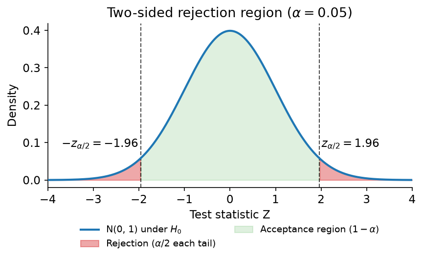
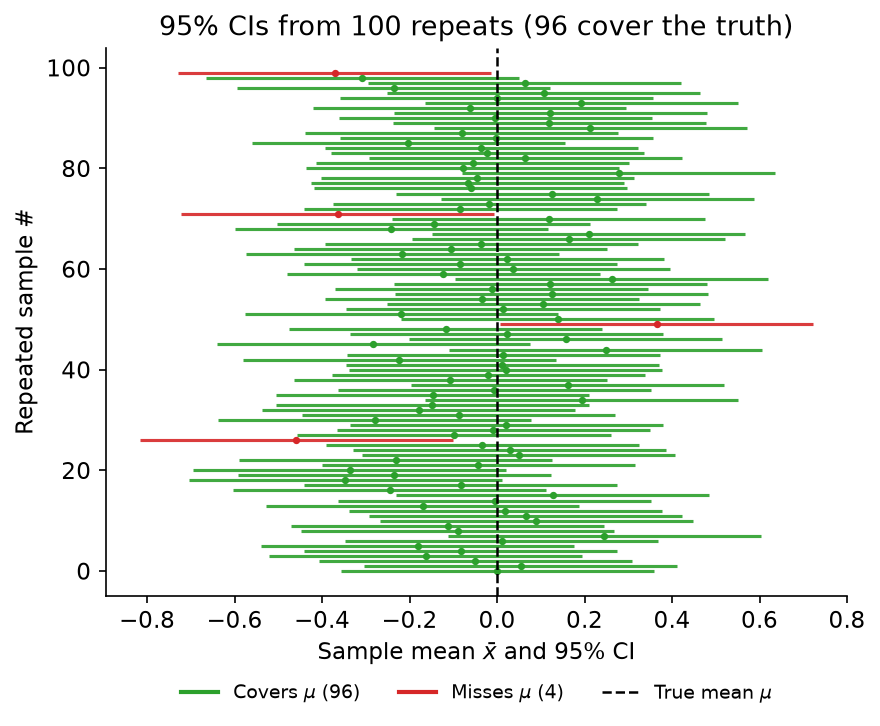
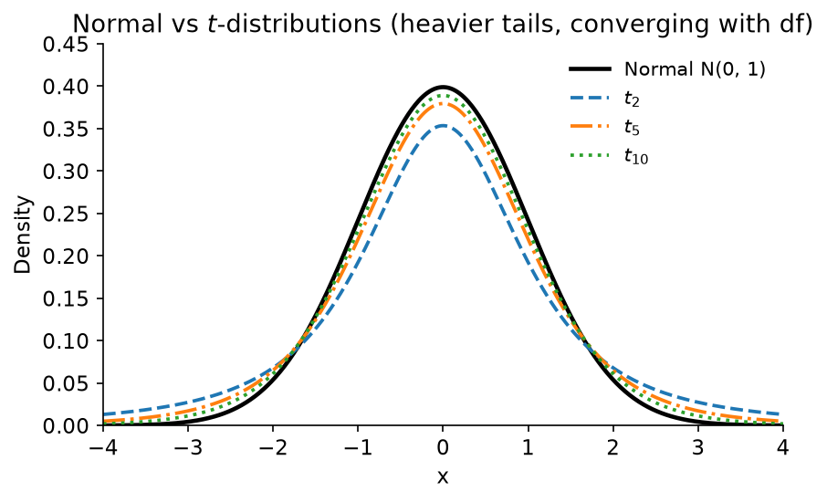
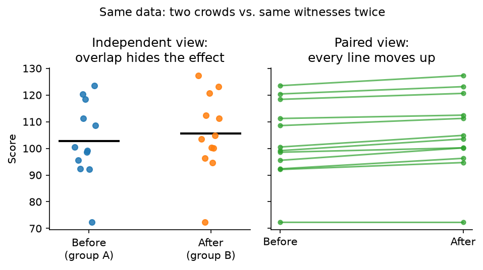
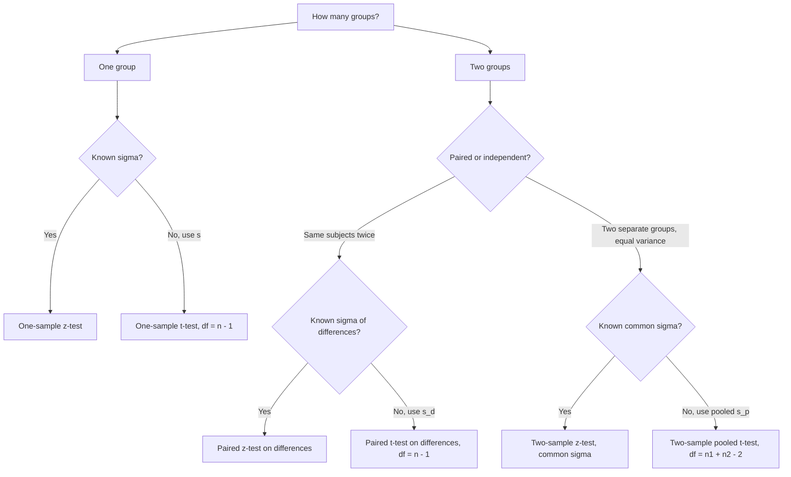

# Notes on inferential statistics (Part 1)

Imagine a courtroom. The judge listens to witnesses, looks at the evidence, then decides: guilty or not. A hypothesis test works the same way.

In inferential statistics we only have a small random sample, the witnesses. From it we guess something about the whole population. That guess either supports a new claim or leaves the old assumption standing.

## Hypothesis Test

In court, the defendant is presumed innocent. That is the starting point before any evidence is heard.

This default assumption is called the **null hypothesis** ($H_0$). It may or may not match reality. The judge looks at the evidence and the witness statements to decide whether it still holds.

To argue the defendant is guilty, we present evidence against that default. The competing claim is called the **alternative hypothesis** ($H_1$).

The judge then weighs what was presented and decides whether it is enough to convict, in other words whether it is enough to reject the assumption of innocence.

## Rejection/Critical Region & Acceptance Region

Back to the courtroom. The judge cannot just say "I feel he is guilty". There has to be a rule agreed beforehand: what kind of evidence is strong enough to convict?

That rule splits all possible evidence into two regions:

- Rejection region (critical region): if the evidence lands here, it is too extreme to believe under the assumption of innocence. The judge rejects $H_0$ and convicts.
- Acceptance region: if the evidence lands here, it is still compatible with innocence. The judge does not reject $H_0$. We say "fail to reject" here, since a lack of evidence is not proof of innocence.

The boundary between them is called the **critical value**. Where we draw the line depends on how strict we want to be. That strictness is the **significance level**, denoted $\alpha$.

> In most daily work, $\alpha = 0.05$. It means we accept a 5% risk of convicting an innocent person (a Type I error). In more serious cases, like medicine or criminal trials, we might use $\alpha = 0.01$ or even smaller.

There are two equivalent ways the judge reaches the decision:

1. Critical value approach: compute a test statistic from the sample, and check whether it falls into the rejection region.
2. $p$-value approach: compute how surprising the observed evidence is, assuming $H_0$ is true. If $p \le \alpha$, reject $H_0$.

The **$p$-value** is the probability of seeing evidence at least as extreme as what we observed, if the defendant were truly innocent. A tiny $p$-value says the observation would be almost impossible for an innocent person, so we stop believing in innocence.

Judges make mistakes, and there are two kinds:

- **Type I error:** reject a true $H_0$. Convict an innocent person. Its probability is $\alpha$.
- **Type II error:** fail to reject a false $H_0$. Let a guilty person walk free. Its probability is denoted $\beta$. $1 - \beta$ is called the **power** of the test.

| Reality \ Decision | Fail to reject $H_0$ | Reject $H_0$ |
|---|---|---|
| $H_0$ is true | Correct ($1-\alpha$) | Type I error ($\alpha$) |
| $H_0$ is false | Type II error ($\beta$) | Correct / Power ($1-\beta$) |

## Confidence Interval: How Large Is the Doubt?

So far the judge only gives a yes or no verdict: convict or not. That feels thin. A good judge would also say something like "based on the witnesses, I believe the true height is around 175 cm, give or take 3 cm."

That "give or take" range is the **confidence interval (CI)**.

Formally, a $(1-\alpha)\times 100\%$ confidence interval is a range computed from the sample that we use to trap the unknown population parameter (usually the mean $\mu$). Its general shape is always:

$$\text{estimate} \pm \text{(critical value)} \times \text{(standard error)}$$

For example, if $\sigma$ is known, a 95% CI for $\mu$ is $\bar{x} \pm 1.96 \cdot \sigma/\sqrt{n}$. If $\sigma$ is unknown, replace $1.96$ with $t_{n-1,\,0.025}$ and $\sigma$ with $s$. Each $z$ and $t$ test below has a matching CI. Just rearrange its test statistic into $\text{estimate} \pm \text{critical} \times \text{SE}$. The full list is in the cheat sheet at the end.

What does "95% confident" actually mean? Two readings are common, and both are wrong:

> "Take 100 samples, and 95 times the sample mean falls into the CI." ❌
>
> "There is a 95% probability that the true population mean sits inside this particular interval." ❌

The first reverses the roles. The CI moves with each sample while the true $\mu$ stays fixed. The second sounds almost right, but it treats the truth as if it were rolling dice. In the frequentist view, $\mu$ is a fixed though unknown number. It either sits inside our computed interval or it does not. Once the witnesses have spoken and the interval is on paper, the probability is 0 or 1, just unknown to us.

The correct reading is about the procedure, not this particular interval:

> If we take 100 different random samples and build 100 CIs, about 95 of those intervals will contain the true population mean $\mu$. ✅

In courtroom words: if 100 different witness groups each give their own "give or take" range, about 95 of those ranges will trap the truth. We just do not know whether our one is among the lucky 95 or the unlucky 5.

The CI and the hypothesis test are two sides of the same verdict (this is called **duality**):

- If the claimed value $\mu_0$ falls inside the $(1-\alpha)$ CI, the evidence is still compatible with it, so fail to reject $H_0$ at level $\alpha$.
- If $\mu_0$ falls outside the CI, it is too extreme to believe, so reject $H_0$.

So the test gives the verdict while the CI gives the plausible size of the effect. Report both.

The two judges we use most for means are the $z$-test and the $t$-test.

## Big Picture: $z$-test vs. $t$-test

Both tests ask about means: is the average what we claimed it to be?

The only difference is how much we know about the population:

- **$z$-test:** we know the population standard deviation $\sigma$. It is like knowing exactly how reliable our witnesses are. The sampling distribution follows the standard normal $N(0,1)$.
- **$t$-test:** we do not know $\sigma$, so we estimate it from the sample with $s$. It is like judging witness reliability from the witnesses themselves. This extra uncertainty gives heavier tails, so we use Student's $t$-distribution instead of the normal.

In practice, large sample with known $\sigma$ points to $z$, while unknown $\sigma$ points to $t$. Even with large $n$, $t$ is fine because it is almost identical to $z$ there. Either way we assume a normal population, or a large enough $n$ for the Central Limit Theorem to help (the usual rule of thumb is $n \ge 30$).

Each test below comes in three flavours:

1. **One-sample:** one group vs. a claimed value. "Is this defendant's height really 180 cm?"
2. **Two-sample (independent):** two separate groups. "Do defendants from city A and city B have the same average height?" In this note, we assume both groups share the same variance (pooled version).
3. **Paired:** same subjects measured twice. "Did the same defendant grow taller after one year?" This reduces to a one-sample test on the differences.

## $z$-test: When $\sigma$ Is Known

Assumptions:

- Data are randomly sampled.
- Population is normal, or $n$ is large enough for CLT.
- Population standard deviation $\sigma$ is **known**.

General logic: under $H_0$, construct

$$Z = \frac{\text{(sample estimate)} - \text{(hypothesised value)}}{\text{standard error}} \sim N(0,1)$$

and reject $H_0$ if $Z$ is too far out in the tails.

### 1. One-Sample $z$-test

Courtroom version: one witness group disputes a claimed town average $\mu_0$. We measure $n$ random people and get sample mean $\bar{x}$. Is the claim believable?

Hypotheses (two-sided version; one-sided just takes one side):

$$H_0: \mu = \mu_0 \quad \text{vs.} \quad H_1: \mu \ne \mu_0$$

Test statistic:

$$Z = \frac{\bar{x} - \mu_0}{\sigma / \sqrt{n}}$$

Decision at level $\alpha$:

- Two-sided: reject $H_0$ if $|Z| > z_{\alpha/2}$.
- Right-tailed ($H_1: \mu > \mu_0$): reject if $Z > z_{\alpha}$.
- Left-tailed ($H_1: \mu < \mu_0$): reject if $Z < -z_{\alpha}$.

Here $z_{\alpha}$ is the upper-$\alpha$ quantile of $N(0,1)$ (e.g. $z_{0.025} \approx 1.96$).

### 2. Two-Sample $z$-test (Independent, Equal Variance)

Courtroom version: two separate witness groups, $n_1$ from town A and $n_2$ from town B. Do the two towns share the same mean? We know both towns have the same known spread $\sigma$.

Hypotheses (usually $\Delta_0 = 0$):

$$H_0: \mu_1 - \mu_2 = \Delta_0 \quad \text{vs.} \quad H_1: \mu_1 - \mu_2 \ne \Delta_0$$

Test statistic (pooled / common-$\sigma$ version):

$$Z = \frac{(\bar{x}_1 - \bar{x}_2) - \Delta_0}{\sigma \sqrt{1/n_1 + 1/n_2}}$$

The denominator is the standard error of the difference of two independent means. The decision rule matches the one-sample case: compare $|Z|$ (or one-sided $Z$) with $z_{\alpha/2}$ (or $z_{\alpha}$).

> Note: if the two known variances differ ($\sigma_1 \ne \sigma_2$), the denominator simply becomes $\sqrt{\sigma_1^2/n_1 + \sigma_2^2/n_2}$. The equal-variance version here is the special case $\sigma_1 = \sigma_2 = \sigma$.

### 3. Paired $z$-test

Courtroom version: the same $n$ people are measured twice, before and after. Each pair is linked, so the two samples are not independent. Think of asking the same witness twice.

Trick: reduce it to a one-sample problem. Define differences:

$$d_i = x_{1i} - x_{2i}, \quad \bar{d} = \text{mean of } d_i$$

Let the known standard deviation of the differences be $\sigma_d$. Then test the mean difference $\mu_d = \mu_1 - \mu_2$:

$$H_0: \mu_d = \Delta_0 \quad \text{vs.} \quad H_1: \mu_d \ne \Delta_0$$

$$Z = \frac{\bar{d} - \Delta_0}{\sigma_d / \sqrt{n}}$$

Same rejection rule. Pairing removes the between-person noise, which is why a paired design is often more powerful than two independent samples. The judge hears the same witness change their story instead of comparing two different crowds.

## $t$-test: When $\sigma$ Is Unknown

Real data rarely come with $\sigma$ attached. We estimate spread from the sample itself with $s$, and that estimate wobbles from sample to sample. The test statistic therefore varies more than a $z$ statistic, and Student's $t$-distribution describes that extra wobble.

A $t$-distribution looks like a normal curve with heavier tails: symmetric, centred at 0, but more willing to produce far-out values. The heaviness is controlled by degrees of freedom ($df$). Small $df$ means a rough estimate of $\sigma$ and very heavy tails. Large $df$ means $s$ is close to $\sigma$, and the curve settles toward $N(0,1)$.

Think of $df$ as the independent pieces of information left after estimating means. Estimating one mean costs one piece, estimating two means costs two. That is where the $n-1$ and $n_1 + n_2 - 2$ below come from.

Assumptions:

- Random sampling with independent observations.
- Roughly normal population. This matters more than for $z$, especially when $n$ is small. Plot the data and watch for strong skew or outliers. With large $n$ the CLT covers small departures.
- $\sigma$ unknown, estimated by $s$. The pooled two-sample version also assumes the two groups share one common variance.

General logic:

$$T = \frac{\text{(sample estimate)} - \text{(hypothesised value)}}{\text{estimated standard error}} \sim t_{df}$$

In practice the $t$ critical values are larger than the $z$ ones, so small samples need a larger effect before we convict. With $df = 10$ and $\alpha = 0.05$ two-sided, the cutoff is about 2.23 instead of 1.96. Past $df = 30$ or so the difference is small enough to ignore. When in doubt with unknown $\sigma$, just use $t$. For large $n$ it agrees with $z$ anyway, and for small $n$ it keeps the error rate honest.

One more habit worth keeping: never plug $s$ into the $z$ formula and call it a $z$-test. If the denominator was estimated, the reference distribution is $t$.

### 1. One-Sample $t$-test

Courtroom version: same setting as the one-sample $z$, except witness reliability is unknown and estimated from the sample.

$$H_0: \mu = \mu_0 \quad \text{vs.} \quad H_1: \mu \ne \mu_0$$

$$T = \frac{\bar{x} - \mu_0}{s / \sqrt{n}} \sim t_{n-1}$$

Reject $H_0$ at level $\alpha$ if $|T| > t_{n-1,\,\alpha/2}$ (two-sided), or $T > t_{n-1,\,\alpha}$ / $T < -t_{n-1,\,\alpha}$ for one-sided tests.

The denominator $s / \sqrt{n}$ is the estimated standard error of the mean. A large $|T|$ means the gap between $\bar{x}$ and $\mu_0$ is big relative to the noise we see in the data. The $df = n - 1$ reflects that one mean was spent to compute $s$. The matching CI is $\bar{x} \pm t_{n-1,\,\alpha/2}\, s / \sqrt{n}$, so the duality from before still holds: reject exactly when $\mu_0$ lies outside the interval.

I find this the easiest $t$-test to sanity check. If $s$ is large or $n$ is small, the denominator grows and $|T|$ shrinks, which matches intuition: noisy or few witnesses should not convict.

### 2. Two-Sample $t$-test (Independent, Equal Variance / Pooled)

Courtroom version: two separate towns again, but neither tells us its spread. We assume both are equally noisy ($\sigma_1 = \sigma_2 = \sigma$, unknown), so we pool the two samples into one estimate of that common $\sigma$.

Pooled sample variance:

$$s_p^2 = \frac{(n_1-1)s_1^2 + (n_2-1)s_2^2}{n_1 + n_2 - 2}$$

This is a weighted average of the two sample variances, weighted by their degrees of freedom. The larger sample gets more weight because its variance estimate is more stable.

Hypotheses:

$$H_0: \mu_1 - \mu_2 = \Delta_0 \quad \text{vs.} \quad H_1: \mu_1 - \mu_2 \ne \Delta_0$$

Test statistic:

$$T = \frac{(\bar{x}_1 - \bar{x}_2) - \Delta_0}{s_p \sqrt{1/n_1 + 1/n_2}} \sim t_{n_1+n_2-2}$$

Reject if $|T| > t_{n_1+n_2-2,\,\alpha/2}$ (two-sided). The $df = n_1+n_2-2$ comes from two estimated means, one per group.

Pooling only makes sense if the equal-variance assumption is plausible. A casual check is whether one sample standard deviation is more than about twice the other, or simply plot both groups. If the spreads look clearly different, skip pooling and use Welch's $t$-test instead (unpooled standard error with approximated $df$). That is a story for another note.

### 3. Paired $t$-test

Courtroom version: the same subjects measured twice, with $\sigma_d$ unknown. Before-after studies and matched pairs land here, which makes this the $t$-test I run into most.

Form differences $d_i = x_{1i} - x_{2i}$, with mean $\bar{d}$ and standard deviation $s_d$:

$$H_0: \mu_d = \Delta_0 \quad \text{vs.} \quad H_1: \mu_d \ne \Delta_0$$

$$T = \frac{\bar{d} - \Delta_0}{s_d / \sqrt{n}} \sim t_{n-1}$$

So a paired $t$-test is a one-sample $t$-test on the differences. The $df = n - 1$ counts the $n$ pairs minus the one mean difference we estimated.

Pairing pays off when the two measurements on the same person move together. Differencing then cancels the person-to-person baseline noise, and $s_d$ ends up much smaller than the spread across unrelated people. The standard error shrinks and the test gains power. Never run an independent two-sample test on paired data. It ignores the pairing and throws that advantage away, like asking two different crowds instead of asking the same witness what changed.

## Cheat Sheet

| Test | Knows $\sigma$? | Statistic | Distribution under $H_0$ | Matching $(1-\alpha)$ CI |
|---|---|---|---|---|
| One-sample $z$ | Yes ($\sigma$) | $(\bar{x}-\mu_0)/(\sigma/\sqrt{n})$ | $N(0,1)$ | $\bar{x} \pm z_{\alpha/2}\,\sigma/\sqrt{n}$ |
| Two-sample $z$ (equal $\sigma$) | Yes ($\sigma$) | $((\bar{x}_1-\bar{x}_2)-\Delta_0)/(\sigma\sqrt{1/n_1+1/n_2})$ | $N(0,1)$ | $(\bar{x}_1-\bar{x}_2) \pm z_{\alpha/2}\,\sigma\sqrt{1/n_1+1/n_2}$ |
| Paired $z$ | Yes ($\sigma_d$) | $(\bar{d}-\Delta_0)/(\sigma_d/\sqrt{n})$ | $N(0,1)$ | $\bar{d} \pm z_{\alpha/2}\,\sigma_d/\sqrt{n}$ |
| One-sample $t$ | No (use $s$) | $(\bar{x}-\mu_0)/(s/\sqrt{n})$ | $t_{n-1}$ | $\bar{x} \pm t_{n-1,\,\alpha/2}\,s/\sqrt{n}$ |
| Two-sample $t$ (pooled) | No (use $s_p$) | $((\bar{x}_1-\bar{x}_2)-\Delta_0)/(s_p\sqrt{1/n_1+1/n_2})$ | $t_{n_1+n_2-2}$ | $(\bar{x}_1-\bar{x}_2) \pm t_{n_1+n_2-2,\,\alpha/2}\,s_p\sqrt{1/n_1+1/n_2}$ |
| Paired $t$ | No (use $s_d$) | $(\bar{d}-\Delta_0)/(s_d/\sqrt{n})$ | $t_{n-1}$ | $\bar{d} \pm t_{n-1,\,\alpha/2}\,s_d/\sqrt{n}$ |

Decision rule in one sentence: reject $H_0$ at level $\alpha$ if the statistic lands in the tails beyond the $\alpha$-critical value, equivalently if $p \le \alpha$.

Which test should the judge call? Follow the chart:

## Closing: What the Judge Cannot Do

A hypothesis test never proves $H_0$ or $H_1$. It only says whether the evidence is surprising enough to drop the default assumption. Failing to convict is not a certificate of innocence. It may just mean there were too few witnesses (small $n$) or the witnesses were too noisy (large variance).

Report the interval with the verdict. One gives the decision, the other gives the plausible size. In a next note we can go further: power and sample-size planning, Welch's $t$ for unequal variances, and tests for proportions and counts.
