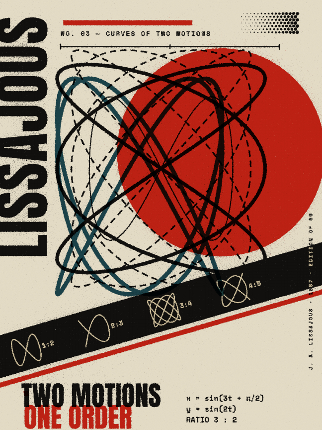

import ScreenPrintLab from "../../components/widget/ScreenPrintLab.svelte";

Imaginus, the poster sale at UWaterloo, opened a few days ago, so I went to look around. My target was specific: a screen-printed poster on a math or physics subject, ideally a Lissajous figure, the curve you get by adding two perpendicular simple harmonic motions, $x = \sin(at + \delta)$ and $y = \sin(bt)$, where changing the frequency ratio changes the whole pattern. The French physicist Lissajous tied a small mirror to a tuning fork in 1857 and used reflected light to draw both vibrations on one wall. That is the thing. The figure follows a rule and still turns out differently every time, which makes it a natural subject for a poster.

My taste in posters comes down to two rules: it has to look unlike something common, or it has to be something I can't see through. A poster hangs there every day, so once the first glance wears off, what keeps it alive is the detail you find up close. "Can't see through" means every step back shows another layer: under the composition are the marks of printing, and under the marks you can still tell how it was made. Computer-drawn posters do the opposite. Their vector lines are so clean that you see the bottom at a glance, with nothing hidden.

## Why screen printing

I met screen printing in elementary school art class. I can't remember what we printed, only the feel of the squeegee pulling ink across the mesh. I have liked the retro look ever since, because the print keeps all these small marks, and each one is evidence that this copy came off the screen exactly this way. Each mark has a cause with a name: the exposure was off, the squeegee pressed too hard, a few mesh openings clogged, the plates didn't line up. I'll set those aside for now and take them one at a time later.

Before printers and influencer illustration took over the world, screen printing was one of the few ways to reproduce an image at scale, and a poster is made to be printed in quantity. How it works decides how it looks: one plate per color, so a poster's colors are limited by how many plates you make. That scarcity is the medium's temperament, not a stingy designer. Plates also misregister. They don't line up, the error is a millimeter or two, and the more colors you print the more error accumulates. It's a limitation that hardly deserves the name, because it forces you to do everything with three or four colors.

Maybe Soviet Constructivism is to blame, but brightly colored pictures have never done much for me. They can be good work, and still something about them feels wrong on a wall. Constructivism was a Russian movement around the October Revolution; Tatlin and his circle argued that artists should put down the brush and become engineers. Rodchenko and Lissitzky translated that into two dimensions: geometric shapes, big blocks of color, heavy sans-serif type and diagonal compositions, often printed in nothing but red, black and white. Posters were their main battleground, since a poster is printed for the street and is reproduction art from birth. For the Constructivists a small palette was not a budget problem; it was the design language. Lissitzky's 1919 *Beat the Whites with the Red Wedge*, a red triangle driven into a white circle, uses three colors and still holds a whole wall today.

## The one that isn't on paper

At the sale there were none. Not a single screen-printed math poster, and almost nothing in physics. I came home with *Astronomical Zenith* from The Drammis Collection. Drammis is a series of reproduction prints from Rosenstiels, an old London print dealer, covering vintage scientific plates: astronomy, botany, zoology. The aging is done by someone who knows the craft. But it's printed as a giclée, so it can carry as many colors as it likes in a single pass. No plate, so none of those marks. It can hang on the wall, but I know it only looks the part; it wasn't made that way.

That idea didn't last long. Up close on the wall, under the title there is a line of small type: *Total eclipse of the Sun, 7th September 1858, as seen by Lieut. Gilliss, near Olmos, Peru*. That line is from a real observation report. On 7 September 1858 the path of totality crossed northern Peru, and the man who went to Olmos to observe it was Lieutenant James M. Gilliss of the US Navy, who had set up the US Naval Observatory a dozen years earlier. The party camped on a ridge in the foothills of the Andes. On the morning of the 7th, cloud nearly ruined the observation; then at `7:15` the whole bank of cumulus lifted toward the zenith, and at `7:30:42` totality began, with four "luminous clouds" appearing at the edge of the Sun.

Gilliss's own account is vivid. The clouds were visible to the naked eye, which surprised him. Two villagers nearby dropped to their knees and cried *La Gloria*. The church bells rang throughout to drive off evil. Pregnant women stayed indoors all day, and the mules bunched together and stopped grazing. Even he, a veteran sky-watcher, admitted it shook him. The four glowing clouds are where the real story is. They were prominences, and in 1858 nobody knew what a prominence was. Part of the Sun? Mountains on the Moon? An illusion in the atmosphere? The question was argued from 1842 to 1860, and only after De la Rue photographed them in Spain did people accept that they belonged to the Sun. In 1868 Janssen and Lockyer turned a spectroscope on them and found an unknown line beside the bright hydrogen lines, so they named it helium after the Sun god. It took another 27 years to find helium on Earth.

So this giclée has a better provenance than "looks like the part." The aging is printed on, but the content is real. The sketch Gilliss made on the spot became a print, the print was copied into astronomy books round after round, and Drammis is the nearest link in that chain to me. By coincidence, Lissajous demonstrated his tuning-fork curves to the French Academy in 1857, and Gilliss drew his eclipse sketch on a Peruvian ridge in 1858. What I went looking for and what I took home are a year apart.

The Lissajous print never showed up, and it kept bothering me. I had seen that poster; it just wasn't on paper.

Around those days I heard that Claude Opus 5.5 was good at graphics, animation in particular. Worth a try? I wasn't expecting much. An LLM is still an LLM, and a poster is an open problem with no answer key, tied closely to personal taste, so I assumed it couldn't handle one.

The prompt was as short as a text message:

> 使用多个李萨如图形绘制一个静态海报，使用 html，英文，构成主义，版画/丝印质感

In English: "Draw a static poster with several Lissajous figures, in HTML, in English, Constructivist, with a print/screen-print texture."

The first version made me take back half of that doubt. It was nowhere near perfect, but the skeleton was right. A few rounds later, the final one looks genuinely good: a red disc, a black bar cutting diagonally across the sheet, LISSAJOUS set vertically, with the Lissitzky reference visible at a glance; a row of small frequency-ratio diagrams from `1:2` to `4:5` along the bar; and in the bottom right corner, neatly printed, x = sin(3t + π/2) and y = sin(2t), plus a line it made up for itself: "J. A. LISSAJOUS · 1857 · EDITION OF 60."



So my curiosity moved from whether it looked good to how it was made. I opened the file. SVG. No bitmap, not one line of canvas; the whole poster is vectors and filters. What the filters did was the surprise: each one targets a stage of screen printing, how ink spreads, how mesh clogs, how plates misregister, how paper takes ink.

I copied the approach out of the poster's filters and built a component with live parameters. I didn't reuse the Lissajous curves, instead, I took the pattern back to its ingredients. A Lissajous figure is just two sine waves added at right angles, so the demo draws four sine waves at same frequency but different phases, one each for K, M, C and Y, arranged from dark to light into a field with foreground and background. Thin lines are also the most sensitive carrier for defects: one clogged opening or one misregistered plate shows more on a line than on a solid block. I dropped the poster's red, black and white because that was a Constructivist choice and the demo is about the process, so it uses the printer's default four plates. CMYK is the color set printing actually uses, and every extra plate adds its own direction and distance of misregistration, which gives that part of the process enough to do. The panel can also show a single plate, with its own rough edges and specks. That is the second half of this post: translating each "defect" of screen printing into an SVG filter, to see what gets reproduced when you reproduce an old poster digitally.

## Try it first

<ScreenPrintLab client:load lang="en" />

One practical matter while we're here: SVG filters are slow. `feTurbulence` is procedural noise computed per pixel, and displacement, thresholding and blur are all full-frame pixel operations. Four plates times three passes makes twelve layers, each with its own ink filter, plus four bleed filters, so the first paint makes the CPU compute the whole image, and one slider drag recomputes the entire stack. Chromium caches results for static filters; Safari rasterizes SVG filters in software, so even scrolling can set off a recompute. The component defends itself a few ways: it mounts only when it comes near the viewport, watched by an IntersectionObserver, with the container's size reserved in advance so the page doesn't jump; isolating one plate skips rendering the other three groups, which is both a viewing mode and a performance switch; and on Safari it draws nothing by default, so you click Play, the button spins for half a second, and then the image appears.

## One screen printing press, seven computable moves

Putting each defect into computation gives this table:

| Printing stage | What happens on paper | SVG method |
| --- | --- | --- |
| Ink spread | Paper fibers pull the edge open and the outline goes fuzzy | `feTurbulence` + `feDisplacementMap` + `feComponentTransfer` |
| Mesh | Pigment only passes through the openings, leaving a regular or semi-random dot pattern | Threshold high-frequency noise into a mask, then subtract it from the ink layer |
| Clogged mesh | Overexposure cures areas that should stay open, or dry ink and dust block openings, so white dots appear in solid areas | Raise the threshold on the same mask |
| Edge bleed | With underexposure the non-image area doesn't cure fully and the edge goes soft, and the squeegee forces ink outward | Multi-scale `feGaussianBlur` halo + noise threshold |
| Ragged type | The squeegee drags, thin strokes go soft and the edge turns jagged | Blur, displace, then threshold again |
| Misregistration | The four plates don't line up | Give each plate a different `translate` |
| Paper | Fiber relief makes ink sit unevenly | Desaturate `feTurbulence`, then `multiply` |

The key method: **break the shape with noise first, then use an alpha threshold to harden the soft edge again.** Blur without a threshold and you get a cheap drop shadow. Add noise without displacement and you get TV static. Only with both does it look like ink.

Now I'll go through that list of marks I set aside.

## Step one: making the ink edge go fuzzy

Start with a minimal working ink filter. It takes any shape and returns an ink layer with an irregular edge and patchy transparency; the `id="ink"` filter in the poster is this one.

```xml
<filter id="ink" x="-10%" y="-10%" width="120%" height="120%"
        color-interpolation-filters="sRGB">
  <feTurbulence type="fractalNoise" baseFrequency="0.55"
                numOctaves="2" seed="7" result="warp"/>
  <feDisplacementMap in="SourceGraphic" in2="warp" scale="3.4"
                     xChannelSelector="R" yChannelSelector="G" result="d0"/>
  <feComponentTransfer in="d0">
    <feFuncA type="linear" slope="40" intercept="-19"/>
  </feComponentTransfer>
</filter>
```

`feTurbulence` is not here as a texture; it is a **displacement field**. The red channel sets how far each pixel moves sideways and green sets the vertical shift. A larger `scale` tears the edge further open, and that is the ink-spread slider.

`feFuncA` in `feComponentTransfer` squares up that soft alpha again. With `type="linear"` the output is `alpha × slope + intercept`. To cut exactly at `alpha = t`, set `intercept = -slope × t`:

- `slope="40"` and `intercept="-19"` put the threshold at about `0.475`
- Too low and the edge swells outward; too high and thin lines break


## Step two: mesh and clogging

A real screen is a stretched polyester mesh. Pigment passes through the openings, so even a solid area has a fine grain, and if a patch of openings is sealed with dried ink you get white dots on the paper. A second layer of high-frequency noise can stand in for the mesh: turn it into a mask, then subtract it from the ink layer.

```xml
<feTurbulence type="fractalNoise" baseFrequency="0.55"
              numOctaves="1" seed="18" result="meshNoise"/>

<!-- 把噪声的红色通道复制到 alpha：alpha = R -->
<feColorMatrix in="meshNoise" type="matrix"
  values="0 0 0 0 0
          0 0 0 0 0
          0 0 0 0 0
          1 0 0 0 0" result="meshAlpha"/>

<!-- 阈值化：R 高于 cut 的地方，遮罩变成不透明白点 -->
<feComponentTransfer in="meshAlpha" result="holes">
  <feFuncA type="linear" slope="22" intercept="-13.2"/>
</feComponentTransfer>

<feComposite in="ink" in2="holes" operator="out" result="screened"/>
```

The last row of `feColorMatrix`, `1 0 0 0 0`, means "output alpha equals the red channel of the input." The noise's color means nothing; we only borrow its random field.

`operator="out"` keeps the part of the first layer that the second layer doesn't cover, so the white noise dots get dug out of the ink. Lowering the threshold from `0.9` to `0.6` increases the removed area sharply, which is what the ink-clogging slider does. `baseFrequency` sets the mesh count: higher frequency, finer and denser dots.

Dried ink is only one source of clogging. Overexposure cures areas that should stay open, and incomplete development, dust and bubbles all take up openings. Their effect on the image collapses into one parameter, a drop in the open fraction.

A second, finer noise layer keeps the image from having only one grain size:

```xml
<feTurbulence type="fractalNoise" baseFrequency="1.15"
              numOctaves="1" seed="24" result="fine"/>
<feColorMatrix in="fine" type="matrix"
  values="0 0 0 0 0  0 0 0 0 0  0 0 0 0 0  1 0 0 0 0" result="fineAlpha"/>
<feComponentTransfer in="fineAlpha" result="fineHoles">
  <feFuncA type="linear" slope="30" intercept="-28.95"/>
</feComponentTransfer>
<feComposite in="screened" in2="fineHoles" operator="out"/>
```

The two noise layers need different `seed` values, or the grains line up into the same pattern.

## Step three: soft type edges

Type suffers more from an even blur than solid areas do. In a real print the squeegee softens the edge of a thin stroke first, and paper fibers then pull out small bites. So the order is **blur, displacement, threshold**.

```xml
<filter id="edge" x="-15%" y="-15%" width="130%" height="130%"
        color-interpolation-filters="sRGB">
  <feGaussianBlur in="SourceGraphic" stdDeviation="0.6" result="soft"/>
  <feTurbulence type="fractalNoise" baseFrequency="0.42"
                numOctaves="2" seed="12" result="edgeNoise"/>
  <feDisplacementMap in="soft" in2="edgeNoise" scale="1.38"
                     xChannelSelector="R" yChannelSelector="G" result="warped"/>
  <feComponentTransfer in="warped">
    <feFuncA type="linear" slope="30" intercept="-14"/>
  </feComponentTransfer>
</filter>
```

`stdDeviation` is the type-edge blur slider, and `scale` grows with it. Without that, the letters turn into a smear instead of something blurred that still has an edge. The final `feFuncA` cuts the soft edge into a jagged one: blur supplies the shape, the threshold supplies the feel.

The filter can go on the type group alone, or on the curves and grid lines. Put one on the whole black plate and another on the type inside it, and the plate has its own rough edge with the type's rough edge on top.

## Step four: edge bleed and ink mist

Making a screen works like a **negative**: coat the mesh with emulsion, expose it through a positive (the image area blocks light), the areas reached by ultraviolet light cross-link and cure, and development washes away the uncured image area, leaving open mesh.

Bad exposure is **asymmetrical**:

- **Underexposure**: the non-image area (background that should cure) doesn't cure enough, part of it washes away in development, and the openings end up too wide with a soft edge. Ink seeps out through those weak edges during printing. The image area was going to wash out anyway, so its openings stay open and don't clog.
- **Overexposure**: light scatters in the emulsion and cures the image area too, sealing the openings that should stay clear, so thin lines and halftone dots close up and disappear.

Clogging has a second source, the ink itself. Dried ink, high viscosity, dust and bubbles all seal openings, so the component combines two values into one clogging probability:

```js
clog = min(1, 0.7 * overExposure + 0.9 * inkClog)
```

The ring of misty specks along the plate edge comes mostly from the soft edge of underexposure plus bleed and spatter: too little exposure leaves the non-image area undercured and the edge soft; too much squeegee pressure, ink that's too thin, or a screen too close to the paper squeezes ink outside the openings; then capillary action in the paper fibers pulls it further. Its statistical signature is that the closer you are to the plate edge, the more likely a speck is, so the plate's own alpha makes a good halo for the model. There's no need to pretend it's light.

The method is to build a field that falls off with distance, then let noise decide where anything actually bleeds through. The decay here uses $\frac{1}{r^2}$, about as physical as decay gets, approximated by summing several scales so the specks can grow all the way around the plate edge.

```xml
<!-- 四个尺度的模糊，叠成一个近似的 1/r² 衰减光晕 -->
<feGaussianBlur in="SourceAlpha" stdDeviation="3"    result="b1"/>
<feGaussianBlur in="SourceAlpha" stdDeviation="12"   result="b2"/>
<feGaussianBlur in="SourceAlpha" stdDeviation="24"   result="b3"/>
<feGaussianBlur in="SourceAlpha" stdDeviation="34"   result="b4"/>

<feComposite in="b1" in2="b2" operator="arithmetic"
             k1="0" k2="0.15" k3="0.25" k4="0" result="c1"/>
<feComposite in="b3" in2="b4" operator="arithmetic"
             k1="0" k2="0.3" k3="0.25" k4="0" result="c2"/>
<feComposite in="c1" in2="c2" operator="arithmetic"
             k1="0" k2="1" k3="1" k4="0" result="halo"/>

<!-- 光晕复制到 RGB，再与噪声混合后阈值化 -->
<feColorMatrix in="halo" type="matrix"
  values="0 0 0 1 0
          0 0 0 1 0
          0 0 0 1 0
          0 0 0 0 1" result="H"/>
```

The `arithmetic` mode of `feComposite` computes `k1·A·B + k2·A + k3·B + k4`. Chained together, that adds blurs of different radii with weights, giving a field with a soft edge that decays slowly. It looks more like real scatter than a single large blur.

Then mix the noise with the halo and threshold it into ink dots with a color matrix:

```xml
<feTurbulence type="fractalNoise" baseFrequency="0.8"
              numOctaves="2" seed="47" result="n1"/>
<feColorMatrix in="n1" type="matrix"
  values="1 0 0 0 0  1 0 0 0 0  1 0 0 0 0  0 0 0 0 1" result="N1"/>
<feComposite in="N1" in2="H" operator="arithmetic"
             k1="0" k2="1" k3="0.5" k4="0" result="S1"/>

<!-- RGB 固定成油墨色，alpha 由阈值决定 -->
<feColorMatrix in="S1" type="matrix"
  values="0 0 0 0 0.83
          0 0 0 0 0.16
          0 0 0 0 0.10
          70 0 0 0 -60.9" result="D1"/>
```

The three constants at the end of the first three rows, `0.83 / 0.16 / 0.10`, are this plate's ink color (red, in this example). The last row scales the red channel of the mixed field (noise + 0.5 × halo) by 70 and subtracts `60.9`, putting the threshold near `0.87`, so only pixels with a strong halo and high noise become opaque ink dots. Pull exposure negative and underexposure rises, the threshold drops, and more specks bleed through. Back near `0`, the edge is clean enough and the specks disappear.

One more detail: solid areas shouldn't bleed **inside**. The poster's title and footer are solid blocks of ink, and adding the halo directly would put dots inside them. The fix is to cut out the plate's core:

```xml
<feMorphology in="SourceAlpha" operator="dilate" radius="1" result="m"/>
<feGaussianBlur in="m" stdDeviation="1.5" result="mb"/>
<feColorMatrix in="mb" type="matrix"
  values="0 0 0 0 0  0 0 0 0 0  0 0 0 0 0  0 0 0 20 -9" result="cut"/>
<feComposite in="D1" in2="cut" operator="out"/>
```

`dilate` grows the plate a little, then blurs it, then thresholds it into a mask slightly larger than the original. `operator="out"` subtracts that mask from the bleed dots, so specks stay outside the plate. The order matters: subtract with the raw alpha and a ring gets chewed off the plate edge.

Each plate needs its own bleed filter, since the color differs and the `seed` should too. The component generates them from an array:

```js
const plates = [
  { id: "k", rgb: [0.08, 0.08, 0.08], freq: 2, seed: 31 },
  { id: "m", rgb: [0.85, 0.11, 0.38], freq: 2, seed: 47 },
  { id: "c", rgb: [0.04, 0.56, 0.66], freq: 2, seed: 53 },
  { id: "y", rgb: [0.87, 0.66, 0.00], freq: 2, seed: 61 },
];
```

The color goes into the constant terms of `feColorMatrix` and the `seed` into `feTurbulence`. All four plates use `freq = 2`; what actually changes is the phase. Waves at one frequency with different phases read as a continuous field of ripples, while four unrelated curves never will.

The CMYK layer can be generated again, and each pass further back thins the stroke and widens the gaps in the dash:

```js
const passes = 3;
const layers = Array.from({ length: passes }, (_, pass) =>
  plates.map((ink, i) => {
    const z = pass * 4 + i;
    return {
      ...ink,
      z,
      phase: (z * Math.PI) / 6,
      stroke: ink.stroke * (1 - (0.42 * pass) / 2),
      dash: pass === 0 ? "none" : `${9 - 4 * (pass / 2)} ${6 + 14 * (pass / 2)}`,
    };
  }),
).flat();
```

Each layer further back adds `π/6` to the phase, so the K plate at z=0 has phase 0, the M plate at z=1 has `π/6`, and so on to the Y plate at z=11 with `11π/6`. The frequency never changes; only the phase moves.

This `layers` array drives the `<use>` elements and the filters. Larger z gives a thinner `stroke` and a larger second number in `dash`, so the image picks up aerial perspective on its own: solid in front, faint at the back. The phase steps by `π/6` per layer, which makes waves of one frequency recede as they go back.

## Step five: registration, overprinting and paper

Misregistration only needs a `transform` per plate:

```xml
<g transform={`translate(${reg.k.x} ${reg.k.y})`} style="mix-blend-mode: multiply">…K 版…</g>
<g transform={`translate(${reg.m.x} ${reg.m.y})`} style="mix-blend-mode: multiply">…M 版…</g>
<g transform={`translate(${reg.c.x} ${reg.c.y})`} style="mix-blend-mode: multiply">…C 版…</g>
<g transform={`translate(${reg.y.x} ${reg.y.y})`} style="mix-blend-mode: multiply">…Y 版…</g>
```

The four offsets in `reg` come from the `seed`, each with its own direction and magnitude, so they don't shift in neat up-down-left-right steps. Click Re-plate and the four plates get a new set of registration errors; the registration marks in the top right spread apart or close up with them.

`multiply` lets the inks layer like transparent pigment: magenta over cyan darkens, white paper stays white. That is closer to printing than `opacity`, which washes out the color underneath, while `multiply` absorbs it.

Paper fiber is the last layer, and the simplest:

```xml
<filter id="paper">
  <feTurbulence type="fractalNoise" baseFrequency="0.72"
                numOctaves="3" seed="2"/>
  <feColorMatrix type="saturate" values="0"/>
</filter>

<rect width="640" height="880" filter="url(#paper)"
      opacity="0.14" style="mix-blend-mode: multiply"/>
```

`feTurbulence` outputs colored noise by default; `feColorMatrix type="saturate" values="0"` turns it gray, and it multiplies over the image at low opacity. That opacity is the paper-grain strength. Lower frequency gives coarser fibers; more `numOctaves` gives more detail and costs more to compute.

## One last thing

What makes these filters work is that they model a **process**, not an appearance. Nobody pasted an aged texture onto the poster; each plate goes through displacement, clogging, bleed, misregistration and paper grain in turn. Move a parameter and the whole image changes in a way that makes physical sense: each plate's specks follow its own curves, and the K plate's type goes fuzzy along with the K plate's edges.

The code is in `src/components/widget/ScreenPrintLab.svelte`, and every filter is inline SVG. Swap the four sine waves for any path or type and the pipeline keeps working as it is. The next poster could use a different frequency, or a different phase step. As long as it is a plate, it can be printed.

Back to that "can't see through" from the start. The marks on a screen print were left by a process that really happened; the marks here come from the same process run as arithmetic. The difference is smaller than I expected. Move a parameter and the four plates print again, obediently, and the specks regrow along their own curves. That is what reproducing a vintage poster with digital tools comes down to: the marks stop being a by-product of printing and become something the parameters hold directly.

If Imaginus comes back next year and I actually run into a screen-printed Lissajous, I'll buy it. Until then, I'll go back to the component, set the frequency ratio to `4:3`, and print another one.
