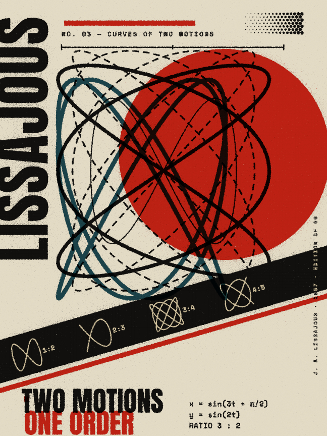

import ScreenPrintLab from "../../components/widget/ScreenPrintLab.svelte";

前几天滑大开了 Imaginus poster sale，我去转了一圈。目标很具体：一幅数学或物理题材的丝网版画海报，最理想是李萨如图形，两个互相垂直的简谐振动叠出来的曲线，$x = \sin(at + \delta)$、$y = \sin(bt)$，频率一变换花样就换。法国物理学家李萨如 1857 年把小镜子绑在音叉上，用反射光把两个振动画在同一面墙上，就是这么个东西。这种图既守规矩又出花样，当海报题材怎么看都合适。

我对海报的口味说来只有两条：要么跟别的不一样，要么"看不透"。贴在墙上的东西天天见，第一眼的新鲜劲过去以后，全靠凑近看的细节续命。"看不透"意味着退远一层有一层：构图的下面有印刷的痕迹，痕迹的下面还能看出它是怎么被做出来的。满街的电脑绘制海报正好反着来，矢量线条干干净净，一眼看到底，没有秘密。

## 为什么是丝网版画

丝网版画是小学美术课接触的，那会儿印过什么已经记不清，只记得油墨刮过网面那一下的手感。我一直喜欢这种复古的风格，因为画面上留着各种有趣的印记，每一枚都是"这一版就是这样印出来的"的证据。印记背后的原因都有名有姓：曝光差了、刮刀重了、网孔堵了几颗、版没对齐——这里按下不表，后面逐个交代。

在打印机和网红插画占领世界之前，丝网印刷是大规模复制图像为数不多的手段，而海报天生就需要被大量印刷。它的工作方式决定了画面的长相：一版一色，想要几个颜色就得制几块版，所以颜色有限。这不是设计师抠，是媒介本身的脾气。版与版之间还会套色错位——版没对齐，差出一两毫米，颜色印得越多，错位攒得越狠。这是一种不太好叫局限的局限，因为它逼着你用三四个颜色做完所有的事。

可能也是受苏联构成主义的影响，我对颜色艳丽的画一直不太感冒。它们是很好的作品，贴在墙上总觉得哪里有点怪。构成主义是十月革命前后俄国的运动，塔特林带着一帮人主张艺术家放下画笔去当工程师；罗琴科和利西茨基把这套主张落到平面上，就是几何形状、大色块、粗重的无衬线字、对角线构图，颜色常常红黑白三色打完。海报是他们的主战场，因为海报是印给大街看的，生来就是复制的艺术。配色少在构成主义那里不是预算问题，因为这是设计语言。利西茨基 1919 年那张《红楔子攻打白军》，一个红三角捅进白圆，三种颜色，今天看还是压得住整面墙。

## 不在纸上的那张

结果现场没有。丝印的数学海报一幅都没有，物理的也几乎没有。最后买了一幅 The Drammis Collection 的 Astronomical Zenith：Drammis 是伦敦老牌版画商 Rosenstiels 旗下的复刻画系列，专做复古科学图，天文、植物、动物图谱都有，做旧的功底是在的。只是它是 giclée 喷墨印的，颜色想上多少上多少，一次成像。没有版，也就不会有那些印记。挂当然能挂，就是心里知道，它是"看起来像"，不是"做出来"。

这想法出来没多久就被打脸。贴上墙凑近看，标题底下还有一行小字：Total eclipse of the Sun, 7th September 1858, as seen by Lieut. Gilliss, near Olmos, Peru。这行字抄自一份真实存在的观测报告。1858 年 9 月 7 日，日全食的全食带扫过秘鲁北部，跑去 Olmos 观测的是美国海军中尉 James M. Gilliss，美国海军天文台就是他十几年前张罗起来的。他们在安第斯余脉的山脊上扎营，7 日清晨差点毁在云上，7 点 15 分整片积云向天顶抬走，7 点 30 分 42 秒全食开始，太阳边缘冒出四团"发光的云"。

Gilliss 自己写的记录相当生动：那些"云"肉眼直接可见，出乎他的意料；旁边两个村民当场跪下，喊了一声 La Gloria；教堂钟声从头响到尾，用来驱邪；孕妇一整天不出屋；骡子挤成一团不吃草。连他这种见惯天象的老手，都承认自己被震到了。真正有故事的是那四团"发光的云"：它们就是日珥，但在 1858 年没人知道日珥是什么。太阳的一部分？月亮上的山？大气里的幻影？这桩案子从 1842 年吵到 1860 年，德拉鲁在西班牙拍下照片才认定它属于太阳；1868 年让桑和洛克耶把分光镜对上去，在氢的亮线旁边认出一条来历不明的线，给它起名 helium，取自太阳神，27 年后才在地球上找到。

所以这张 giclée 的底细比"看起来像"体面：做旧是印上去的，内容是真的。Gilliss 当场画的写生先变成版画，又被天文书翻印了一轮又一轮，Drammis 是这条复制链上离我最近的一环。巧的是，李萨如 1857 年把音叉上的曲线演示给法国科学院，Gilliss 1858 年在秘鲁山脊上画下他的全食写生。我想找的和最后买回家的，前后脚差一年。

李萨如那张还是没影，心里一直不平。我看见了那张海报，只是它不在纸上。

那几天正好听说 Claude Opus 5.5 做图形很在行，动画尤其出名。那就试试？本来没抱什么希望——LLM 毕竟只是 LLM，海报这种没有既定答案、跟个人审美高度绑定的开放问题，我默认它处理不了。

提示词短得像发一条消息：

> 使用多个李萨如图形绘制一个静态海报，使用 html，英文，构成主义，版画/丝印质感

第一版出来，我把"没抱希望"收回了一半。离完美差得远，但骨架全对。几轮迭代之后，最后这版挺能看的：红圆盘、斜穿版面的黑条、竖排的 LISSAJOUS，利西茨基的影子一眼可见；斜杠上一排 `1:2` 到 `4:5` 的频率比小图，右下角工工整整印着 x = sin(3t + π/2)、y = sin(2t)，还给自己编了一行 "J. A. LISSAJOUS · 1857 · EDITION OF 60"。



好奇于是从"好不好看"挪到了"怎么做的"。打开文件看了一眼，好家伙，SVG。没有一张贴图，没有一行 canvas，整张海报是矢量加滤镜。滤镜的分工倒是在意料之外：每一个都对准丝印的一个环节，油墨怎么渗、网眼怎么堵、版怎么错位、纸怎么吃墨。

我从海报的滤镜里把套路抄出来，写了个能实时调参的组件。图案没有沿用李萨如曲线，而是拆回它的原料：李萨如本来就是两条正弦波垂直叠出来的，demo 干脆直接画四条相同频率不同相位的正弦波，K、M、C、Y 各占一条，从暗到亮排成有前后景的波场。细线也是对缺陷最敏感的载体，堵一颗网孔、错一次套色，在线上总比在色块上显眼。颜色没沿用海报的红黑白，那是构成主义的设计选择，而 demo 要演示的是工艺本身，所以直接换成印厂默认的四色版：CMYK 本来就是印刷用的颜色，版多一块，错位就多一组独立的方向和距离，套色错位这个环节才有足够的戏份。面板上还可以单看一块版，它的毛边和斑点都是自己的。这就是这篇的后半部分：把丝印的每一步"缺陷"翻译成 SVG 滤镜，看看用数字技术复刻一张老海报，复刻的到底是什么。

## 先玩一下

<ScreenPrintLab client:load lang="zh" />

顺手交代一件现实的事：SVG 滤镜的性能很差。`feTurbulence` 是逐像素的程序化噪声，位移、阈值、模糊每个原语都是整帧的像素运算；四块版乘三层叠印一共十二层，每层都套一组 ink 滤镜，外加四组渗墨，首屏等于让 CPU 把整张图算一遍，拖一下滑块更是整套重算。Chromium 还会把静态滤镜的结果缓存住，Safari 对 SVG filter 基本是纯软件光栅，随时可能连滚动都触发重算。所以组件做了几层防御：重组件只在滚进视口附近才挂载，IntersectionObserver 盯着，容器尺寸提前占好，页面不跳；单看一块版时其他三块整组不渲染，既是观察功能也是性能开关；Safari 默认干脆不出图，要点一下「玩一玩」才解锁，按钮先转半秒再出图。

## 一台丝网印刷机，七个可计算的动作

把这些缺陷逐个落到计算上，是这张表：

| 印刷环节 | 物理表现 | SVG 手段 |
| --- | --- | --- |
| 油墨扩散 | 边缘被纸纤维吸开，轮廓发毛 | `feTurbulence` + `feDisplacementMap` + `feComponentTransfer` |
| 网眼 | 颜料只从网孔通过，出现规则/半随机的点 | 高频噪声阈值化成遮罩，再从墨层里减掉 |
| 网眼堵塞 | 过曝时光把本该开孔的区域固化，或干墨、灰尘堵孔，实色区出现白点 | 抬高同一张遮罩的阈值 |
| 版边渗墨 | 欠曝时非图像区固化不足、边缘发虚，刮刀把油墨挤出去 | 多尺度 `feGaussianBlur` 做光晕 + 噪声阈值 |
| 文字毛边 | 刮刀拖拽，细笔画变软、边缘锯齿 | 先模糊，再位移，最后重新阈值化 |
| 套色错位 | 四块版没对齐 | 给每块版一个不同的 `translate` |
| 纸张 | 纤维起伏，油墨附着不均 | `feTurbulence` 去饱和后 `multiply` |

关键方法是：**先用噪声破坏形状，再用 alpha 阈值把软的边重新变硬**。只模糊不阈值，会得到廉价的投影；只加噪声不位移，会得到电视雪花。两者叠在一起，才像墨。

前面按下不表的那串印记，现在我逐个交代。

## 第一步：让油墨边缘发毛

先做一个最小可用的"油墨滤镜"。它接收任意图形，输出一张边缘不规则、局部半透明的墨层，海报里那个 `id="ink"` 的滤镜就是它。

```xml
<filter id="ink" x="-10%" y="-10%" width="120%" height="120%"
        color-interpolation-filters="sRGB">
  <feTurbulence type="fractalNoise" baseFrequency="0.55"
                numOctaves="2" seed="7" result="warp"/>
  <feDisplacementMap in="SourceGraphic" in2="warp" scale="3.4"
                     xChannelSelector="R" yChannelSelector="G" result="d0"/>
  <feComponentTransfer in="d0">
    <feFuncA type="linear" slope="40" intercept="-19"/>
  </feComponentTransfer>
</filter>
```

`feTurbulence` 在这里不是拿来当纹理看的，它是**位移场**。红色通道决定每个像素横向挪多少，绿色通道决定纵向挪多少。`scale` 越大，边缘被撕得越开——滑块里的"油墨扩散"就是它。

`feComponentTransfer` 的 `feFuncA` 负责把模糊的 alpha 重新切齐。`type="linear"` 时输出是 `alpha × slope + intercept`。想让它恰好在 `alpha = t` 处切开，令 `intercept = -slope × t` 即可：

- `slope="40"`、`intercept="-19"` → 阈值约为 `0.475`
- 阈值太低，边缘会胀出去；阈值太高，细线会断


## 第二步：网眼和堵塞

真实的网版是一张绷紧的聚酯网。颜料从网孔穿过，所以实色区也有细微的颗粒；如果某片网孔被干墨封住，纸上就会出现白点。我们可以用第二层高频噪声模拟网孔，把它变成遮罩，然后从墨层里"减掉"。

```xml
<feTurbulence type="fractalNoise" baseFrequency="0.55"
              numOctaves="1" seed="18" result="meshNoise"/>

<!-- 把噪声的红色通道复制到 alpha：alpha = R -->
<feColorMatrix in="meshNoise" type="matrix"
  values="0 0 0 0 0
          0 0 0 0 0
          0 0 0 0 0
          1 0 0 0 0" result="meshAlpha"/>

<!-- 阈值化：R 高于 cut 的地方，遮罩变成不透明白点 -->
<feComponentTransfer in="meshAlpha" result="holes">
  <feFuncA type="linear" slope="22" intercept="-13.2"/>
</feComponentTransfer>

<feComposite in="ink" in2="holes" operator="out" result="screened"/>
```

`feColorMatrix` 最后一行 `1 0 0 0 0` 的意思是"输出 alpha = 输入的红色通道"。噪声的颜色本来没有意义，我们只是借用它的随机场。

`operator="out"` 的效果是"保留第一层里不被第二层覆盖的部分"，所以白色噪声点会从墨层里挖掉。把阈值从 `0.9` 降到 `0.6`，被挖掉的面积急剧增加——这就是滑块里的"网眼堵塞"。`baseFrequency` 则控制网目的粗细：频率越高，白点越细密。

现实里的堵塞不只有干墨：曝光过度会把本该开孔的区域固化、显影不彻底、灰尘和气泡都会占住网孔。它们对画面的贡献都可以合并成同一个"开孔率下降"的参数。

再加一层更细的噪声，可以避免画面看起来只有一种颗粒尺度：

```xml
<feTurbulence type="fractalNoise" baseFrequency="1.15"
              numOctaves="1" seed="24" result="fine"/>
<feColorMatrix in="fine" type="matrix"
  values="0 0 0 0 0  0 0 0 0 0  0 0 0 0 0  1 0 0 0 0" result="fineAlpha"/>
<feComponentTransfer in="fineAlpha" result="fineHoles">
  <feFuncA type="linear" slope="30" intercept="-28.95"/>
</feComponentTransfer>
<feComposite in="screened" in2="fineHoles" operator="out"/>
```

两层噪声的 `seed` 要错开，否则颗粒会叠成同一张图。

## 第三步：文字边缘模糊

文字比色块更怕"均匀的模糊"。真实印刷里，细笔画的边缘会先被刮刀拉软，再被纸纤维吸出小缺口。所以顺序是：**模糊 → 位移 → 阈值**。

```xml
<filter id="edge" x="-15%" y="-15%" width="130%" height="130%"
        color-interpolation-filters="sRGB">
  <feGaussianBlur in="SourceGraphic" stdDeviation="0.6" result="soft"/>
  <feTurbulence type="fractalNoise" baseFrequency="0.42"
                numOctaves="2" seed="12" result="edgeNoise"/>
  <feDisplacementMap in="soft" in2="edgeNoise" scale="1.38"
                     xChannelSelector="R" yChannelSelector="G" result="warped"/>
  <feComponentTransfer in="warped">
    <feFuncA type="linear" slope="30" intercept="-14"/>
  </feComponentTransfer>
</filter>
```

`stdDeviation` 是"文字边缘模糊"滑块，`scale` 跟着它一起增长，否则字会糊成一团而不是"糊了但还有边"。最后的 `feFuncA` 把软边切成锯齿：模糊提供形状，阈值提供手感。

这个滤镜可以单独套在文字组上，也可以套在曲线和网格线上。把整个黑版套一层，再在内部给文字套一层，就得到"版有版的毛边，字有字的毛边"的层次。

## 第四步：版边渗墨与墨雾

丝网制版是**负片**逻辑：涂布感光胶 → 盖正片（图像区不透光）曝光 → 紫外线照到的区域交联固化 → 显影时未固化的图像区被冲掉，留下网孔

曝光异常的影响是**不对称**的：

- **曝光不足**：非图像区（本应固化的背景）固化不够，显影时被冲掉一部分，网孔变得过开、边缘发虚。刮印时油墨就从这些薄弱边缘渗出去。图像区本来就要洗掉，所以孔是开的，不会堵。
- **曝光过度**：光在胶层里散射，连图像区也被固化，本该开孔的地方被堵死；细线和网点因此闭合、消失。

网眼堵塞还有第二个来源：油墨本身。干墨、黏度过高、灰尘和气泡都会把网孔封住，所以组件的堵网概率由两个值合成：

```js
clog = min(1, 0.7 * overExposure + 0.9 * inkClog)
```

版边那圈雾状斑点，主要是欠曝的软边加上渗墨/溅墨：曝光不足让非图像区固化不够、边缘发虚；刮刀压力过大、油墨黏度太低、网版离纸太近，油墨会被挤到网孔之外；纸纤维的毛细作用再把它吸开。它的统计特征是"离版边越近，出现概率越高"，所以我们完全可以用版本身的 alpha 做光晕来建模，但不必假装那是光。

做法是先造一个随距离衰减的场，再让噪声决定哪些位置真的渗出来。这里我们使用 $\frac{1}{r^2}$ 这个很物理的方式进行衰减，但是同时使用多尺度叠加进行近似，这样斑点可以围着版边长。

```xml
<!-- 四个尺度的模糊，叠成一个近似的 1/r² 衰减光晕 -->
<feGaussianBlur in="SourceAlpha" stdDeviation="3"    result="b1"/>
<feGaussianBlur in="SourceAlpha" stdDeviation="12"   result="b2"/>
<feGaussianBlur in="SourceAlpha" stdDeviation="24"   result="b3"/>
<feGaussianBlur in="SourceAlpha" stdDeviation="34"   result="b4"/>

<feComposite in="b1" in2="b2" operator="arithmetic"
             k1="0" k2="0.15" k3="0.25" k4="0" result="c1"/>
<feComposite in="b3" in2="b4" operator="arithmetic"
             k1="0" k2="0.3" k3="0.25" k4="0" result="c2"/>
<feComposite in="c1" in2="c2" operator="arithmetic"
             k1="0" k2="1" k3="1" k4="0" result="halo"/>

<!-- 光晕复制到 RGB，再与噪声混合后阈值化 -->
<feColorMatrix in="halo" type="matrix"
  values="0 0 0 1 0
          0 0 0 1 0
          0 0 0 1 0
          0 0 0 0 1" result="H"/>
```

`feComposite` 的 `arithmetic` 模式计算 `k1·A·B + k2·A + k3·B + k4`。串起来就是把不同半径的模糊按权重相加，得到一个边缘很软、衰减很慢的场。它比单个大半径模糊更像真实的散射。

接着把噪声和光晕混合，再用颜色矩阵阈值化成墨点：

```xml
<feTurbulence type="fractalNoise" baseFrequency="0.8"
              numOctaves="2" seed="47" result="n1"/>
<feColorMatrix in="n1" type="matrix"
  values="1 0 0 0 0  1 0 0 0 0  1 0 0 0 0  0 0 0 0 1" result="N1"/>
<feComposite in="N1" in2="H" operator="arithmetic"
             k1="0" k2="1" k3="0.5" k4="0" result="S1"/>

<!-- RGB 固定成油墨色，alpha 由阈值决定 -->
<feColorMatrix in="S1" type="matrix"
  values="0 0 0 0 0.83
          0 0 0 0 0.16
          0 0 0 0 0.10
          70 0 0 0 -60.9" result="D1"/>
```

前三行末尾的三个常数 `0.83 / 0.16 / 0.10` 是这块版的油墨色（这里以红版为例）。最后一行把混合场（噪声 + 0.5 × 光晕）的红色通道放大 70 倍再减 `60.9`，阈值约在 `0.87`，于是只有光晕足够强、且噪声足够高的像素才会变成不透明的墨点。曝光往负方向拖，欠曝量增加，阈值降低，渗墨点变多；回到 `0` 附近，边缘足够利落，斑点就消失。

还有一个小细节：**实色区内部不应该渗墨**。海报里的标题和页脚是实心墨块，如果直接叠加光晕，实心区内部会出现一堆不该有的点。做法是把版心挖掉：

```xml
<feMorphology in="SourceAlpha" operator="dilate" radius="1" result="m"/>
<feGaussianBlur in="m" stdDeviation="1.5" result="mb"/>
<feColorMatrix in="mb" type="matrix"
  values="0 0 0 0 0  0 0 0 0 0  0 0 0 0 0  0 0 0 20 -9" result="cut"/>
<feComposite in="D1" in2="cut" operator="out"/>
```

`dilate` 先把版心向外扩一点，再模糊，然后阈值化成一张略大于原版的遮罩。用 `operator="out"` 把这张遮罩从渗墨点里减掉，斑点就只留在版外。这个"先扩再减"的顺序很重要：如果直接用原始 alpha 去减，版边会被啃掉一圈。

四块版各需要一份自己的渗墨滤镜，因为颜色不同、`seed` 也应该不同。可以像组件里那样用一个数组批量生成：

```js
const plates = [
  { id: "k", rgb: [0.08, 0.08, 0.08], freq: 2, seed: 31 },
  { id: "m", rgb: [0.85, 0.11, 0.38], freq: 2, seed: 47 },
  { id: "c", rgb: [0.04, 0.56, 0.66], freq: 2, seed: 53 },
  { id: "y", rgb: [0.87, 0.66, 0.00], freq: 2, seed: 61 },
];
```

颜色进 `feColorMatrix` 的常量项，`seed` 进 `feTurbulence`。四块版的 `freq` 统一为 `2`，真正变化的是相位——同频不同相的波叠在一起，才会读成连续的波纹场，而不是四条互不相干的曲线。

重复的 CMYK 层可以再生成一次，每往后退一遍，就把笔画收细、把 dash 的间隙拉大：

```js
const passes = 3;
const layers = Array.from({ length: passes }, (_, pass) =>
  plates.map((ink, i) => {
    const z = pass * 4 + i;
    return {
      ...ink,
      z,
      phase: (z * Math.PI) / 6,
      stroke: ink.stroke * (1 - (0.42 * pass) / 2),
      dash: pass === 0 ? "none" : `${9 - 4 * (pass / 2)} ${6 + 14 * (pass / 2)}`,
    };
  }),
).flat();
```

每往后退一层，相位就增加 `π/6`，所以 z=0 的 K 版相位是 0，z=1 的 M 版是 `π/6`，一直到 z=11 的 Y 版是 `11π/6`。频率始终一样，只有相位在推进。

这组 `layers` 直接驱动 SVG 里的 `<use>` 和滤镜。z 越大，`stroke` 越小，`dash` 的第二个数字越大，于是画面自动获得空气透视：近处实、远处虚；相位则每层加 `π/6`，让同一频率的波慢慢向后退。

## 第五步：套色、叠印和纸

套色错位只需要每块版有一个自己的 `transform`：

```xml
<g transform={`translate(${reg.k.x} ${reg.k.y})`} style="mix-blend-mode: multiply">…K 版…</g>
<g transform={`translate(${reg.m.x} ${reg.m.y})`} style="mix-blend-mode: multiply">…M 版…</g>
<g transform={`translate(${reg.c.x} ${reg.c.y})`} style="mix-blend-mode: multiply">…C 版…</g>
<g transform={`translate(${reg.y.x} ${reg.y.y})`} style="mix-blend-mode: multiply">…Y 版…</g>
```

`reg` 里的四个偏移量由 `seed` 生成，方向和大小都不同，所以不是简单的上下左右错开。点一下"重新制版"，四块版会换一组套色误差，右上角的对位标记也会跟着散开或合拢。

`multiply` 让油墨像透明颜料一样叠色：洋红盖在青上会变暗，白纸保持不变。这比用 `opacity` 更接近印刷，因为 `opacity` 会把底下的颜色"洗淡"，而 `multiply` 是"吸收"。

纸张纤维是最后一层，也是最简单的一层：

```xml
<filter id="paper">
  <feTurbulence type="fractalNoise" baseFrequency="0.72"
                numOctaves="3" seed="2"/>
  <feColorMatrix type="saturate" values="0"/>
</filter>

<rect width="640" height="880" filter="url(#paper)"
      opacity="0.14" style="mix-blend-mode: multiply"/>
```

`feTurbulence` 默认输出彩色噪声，`feColorMatrix type="saturate" values="0"` 把它变成灰度，再以很低的透明度正片叠底。透明度就是"纸纹强度"。频率越低，纤维越粗；`numOctaves` 越多，细节越丰富，但计算也越贵。

## 最后一点

这套滤镜之所以成立，是因为它模拟的是**过程**而不是**样式**。你没有给海报贴一张"做旧纹理"，而是让每一块版依次经历位移、堵网、渗墨、错位和纸纹。参数一变，整张图会以一种物理上说得通的方式一起变——每块版渗出的斑点会跟着它自己的曲线走，K 版的文字会跟着 K 版的边缘一起发毛。

代码就在 `src/components/widget/ScreenPrintLab.svelte` 里，所有滤镜都是内联 SVG。你可以把四条正弦波换成任何路径或文字，整条管线会原样工作。下一张海报也许可以换一个频率，或者改变相位步长。只要它是一块"版"，就能被印出来。

回到开头那个"看不透"。丝印海报的印记，是一个真实发生过的过程留下的；这张的印记，是同一个过程被算了一遍。差别比我预想的小：参数一拖，四块版就老老实实重新印一遍，斑点跟着各自的曲线重新长。用数字技术复刻复古海报，说的就是这件事——印记不再是印刷的副产品，而是被参数直接拿在手里的东西。

如果 Imaginus 明年还来，而且真让我撞上一幅李萨如的丝印海报，我还是会买的。不过在那之前，先回组件里把频率比换成 `4:3`，重新印一张。
