SolidWorks 我早就想装回 Mac 上，一直拖着。新版在 Wine 里根本起不来，翻 archive.org 才找到 SolidWorks 2000 的安装包，下下来又发现它的安装向导里套着一个 16 位程序。macOS 上的 Wine 从苹果砍掉 32 位支持那天起就跑不了 16 位代码，这条路堵死了，剩下的选择只有虚拟机。

UTM 我装过，跑过 arm 上的 Manjaro，也跑过 Windows 95。95 都能装，2000 应该更省事。老系统占的地方也小，虚拟磁盘给了 32 GB，装完 SP4、IE6 和 SolidWorks 之后 C 盘只用了 2.14 GB，我这台 Mac 的硬盘一直很紧。还有一个更实际的理由：我真正要用的那些功能，四分之一个世纪前就定型了。Windows 2000 和 SolidWorks 2000 之后加进来的东西，我一样也用不上。

## 建一台 1996 年的机器

UTM 新建虚拟机第一件事是选 Emulate 还是 Virtualize。Virtualize 走苹果的虚拟化框架，快，但只能跑同架构的系统，我这台是 M3 的 Mac，要跑 x86 的 Windows 只能选 Emulate，让 QEMU 一条指令一条指令地翻译。架构选 i386，机型用默认的 pc，就是 QEMU 里那个 i440FX 加 PIIX 的 1996 年组合。

安装阶段有两处默认值要动。USB 干脆关掉，Windows 2000 在 SP4 之前没有 EHCI 驱动，USB 2.0 控制器在设备管理器里只会变成一个带感叹号的未知设备，而整个流程里我一次也没用到 USB 设备，关掉之后就没再打开。输入设备要强制走 PS/2，UTM 默认给的是 USB 键盘和 USB 平板，SP0 的安装程序认不出来，装到一半鼠标就不动了。这两条是装 95 的时候踩出来的，属于老系统通用的开场白。

装的过程本身没什么可说的，复制文件、重启、进图形界面、填用户名和序列号、设网络。

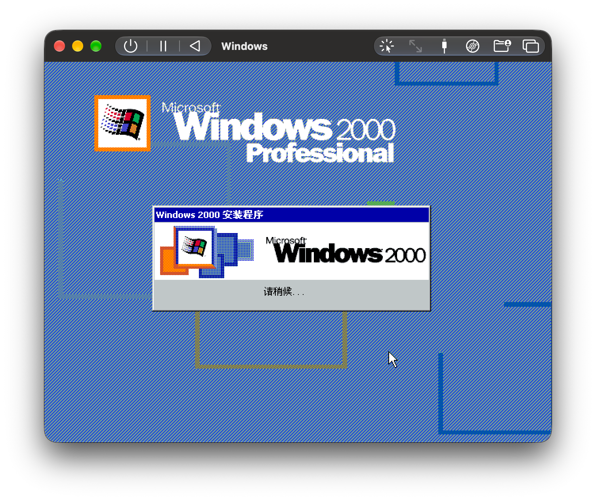

问题出在最后一步之后：系统重启，屏幕上又出现那个安装向导，和第一次开机一模一样。把光盘 eject 掉重启，还是它。再 eject，再重启，还是它。

那个阶段今天有个正式名字叫 OOBE，2000 年的时候它还没有名字，就是安装程序的最后几屏。循环的成因我到现在也没完全弄明白，但让系统过去的配方我摸出来了：给 QEMU 加一条 `-global ide-device.win2k-install-hack=on`，CPU 换成 qemu32，核心数降到 1，显卡换成 cirrus。三样一起上，它就老老实实进了桌面。装完把 CPU 切回 pentium3，显卡换成 VGA，那条参数按字面意思撤掉。

后来翻 [QEMU 手册](https://www.qemu.org/docs/master/system/qemu-manpage.html)，才发现这两个名字是同一个东西。手册在 `-win2k-hack` 底下写着它是 `-global ide-device.win2k-install-hack=on` 的同义词，用途是安装时绕开 Windows 2000 的磁盘写满 bug，装完就该撤掉，因为它会拖慢 IDE 传输。源码里那段注释更具体：每第 16 次 PIO 写，QEMU 不立刻发中断，而是压后 1 毫秒，原因是 Windows 2000 的安装程序 IDE 驱动在写中断来得太早时，会把磁盘塞满空日志。

换句话说，这条参数做的事情是在时序上让一步，代价是 IDE 慢一点。

Ruben Schade 2022 年写过一篇 [M1 上跑 Windows 2000 的文章](https://www.rubenerd.au/windows-2000-in-qemu-on-an-m1-mac/)，配方是 `-cpu qemu32,level=1`，他遇到的是 KMODE_EXCEPTION_NOT_HANDLED 蓝屏，而且他明确写了 `-win2k-hack` 对他没用。UTM 的 [discussion #6967](https://github.com/utmapp/UTM/discussions/6967) 里，结论是 `pentium-v1` 加 global hack，发帖的人说装完就可以把参数删掉。同一个仓库的 [#6142](https://github.com/utmapp/UTM/discussions/6142) 症状和我一模一样，填完 CD key、设完网络就重来，底下有人回这是安装程序的竞态，给的还是 `qemu32,level=1`。我自己试 pentium 的时候，机器不蓝屏，是卡死；qemu32 不加 level=1 也照样能装完。

四种说法，对应四种失败的样子。摆在一起看，唯一没有被任何人写下来的共同变量是 QEMU 的版本：Ruben 那篇写于 2022 年，那时是 7.x；UTM 讨论区里有人用 `pc-i440fx-10.0`，那是 10.x 的机型名。

所以这段我不打算写出一个原因。能确定的是它是个竞态：没有唯一正确的配置，每个配方只是把时序挪了一下，挪到自己的环境刚好掉不进去。我把自己那份也归到这一类，我不知道 pentium 为什么卡死，只知道 qemu32 在我这台机器上能过。UTM 版本我也一并记上，因为三年之后再翻出来，这篇大概也会变成一份该被怀疑的配方。

## 一张光盘只能进不能出

系统装好之后，先得想办法把东西送进去。UTM 的目录共享对 Windows 2000 没有意义，virtiofs 和 SPICE 的 WebDAV 都没有 2k 能用的客户端，所以只能退回最原始的办法：在 Mac 上把文件打成一个 ISO，挂到虚拟光驱上。第一个这么进去的就是 SolidWorks 2000 那套光盘。

安装程序也是中文的，欢迎页上写着「祝贺您选择了这一被工业界公认为标准的 Windows® 原创三维产品设计软件」，底下排着一串 1998 到 1999 年的奖章，InstallShield 的进度条在右下角慢慢爬。装的时候顺手带上了 PhotoWorks 和 Acrobat Reader 4.0。

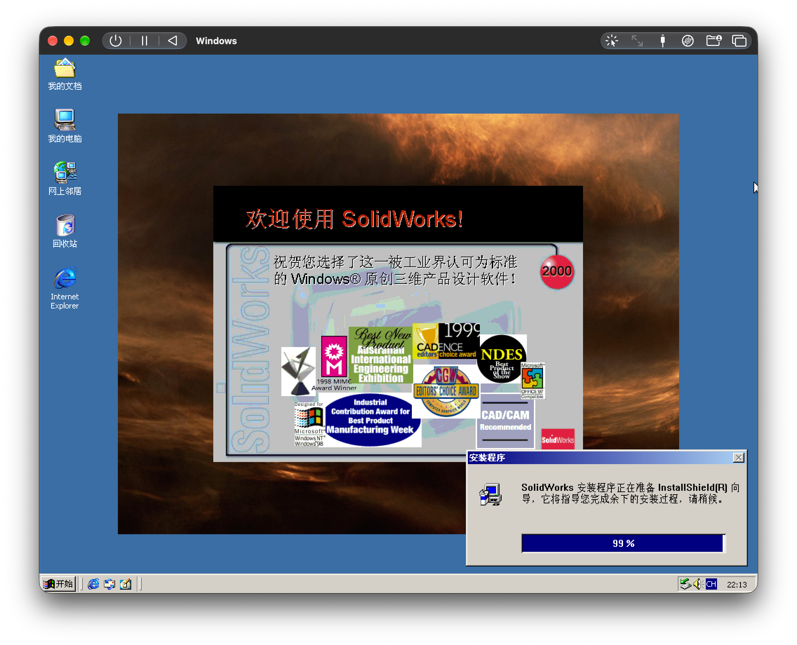

装完桌面上多了几个图标，双击能进得去。这时候系统还是 SP0 的出厂状态，SP4 和 IE6 都没打，它照样装得上，也照样能开。

到这一步我本来以为事情结束了，但 ISO 是只读的，东西进得去出不来，画好的零件拿不到 Mac 上。

## 让它看起来不像 1999 年

SP4 和 IE6 先补，两个包也是打成 ISO 挂进光驱的。补丁有个坑，语言要匹配：我这台装的是中文版 Windows 2000，SP4 就得下中文的补丁包，下错了安装程序会直接拒绝。IE6 反而不用管，它的安装向导不会因为语言问题拒绝安装。升级之前浏览器是 IE 5.0.2800.1106，随便输个网址都是「该页无法显示」。

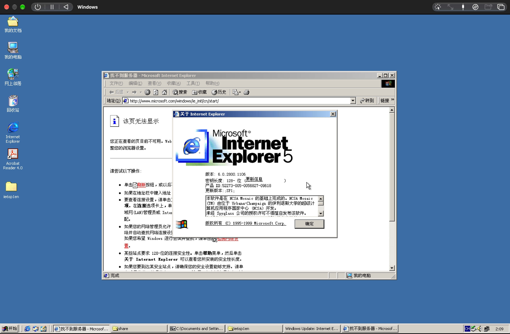

核数也得改。Windows 2000 安装时用的是单处理器 HAL，要换成多处理器的那一套，只能改驱动：设备管理器里找到「计算机」，更新驱动，从列表里选 ACPI Multiprocessor PC。这一步之前一定要做快照，HAL 换错了系统直接起不来，而且 2k 的修复选项基本没有，只能回滚。

显卡得单独处理。Cirrus 能上的模式就那几档，1440×900 想都别想。做法是把虚拟机设置里的显卡从 cirrus 换成 vga，进系统装 Universal VBE Video Display Driver，再把驱动更新到 `vbempg\VBE30\W2K\PNP`。原理上这是让 2k 用 VESA BIOS 扩展去画图，慢，但能上到 1440×900，字终于不用眯着眼看。

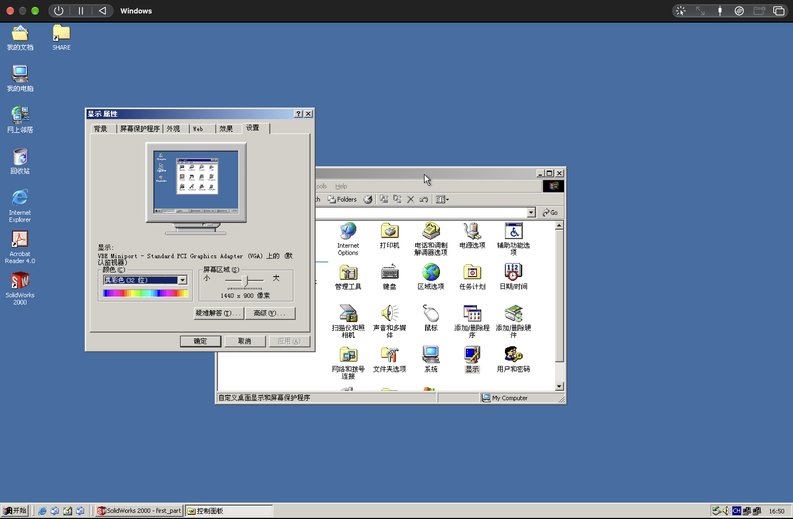

UTM 里试过开 SPICE，没成，设备管理器里留下了一个不能用的简易 PCI 控制器，一直挂着黄色感叹号。禁掉就行，它没有任何用途。

## SMB 走不通，那就 FTP

零件要拿出来，第一个想到的是共享文件夹。Windows 2000 开个共享，Mac 的 Finder 连上去，这是最自然的路径，但走不通。2k 用的是 SMB1，SMB2 要等到 Vista 之后才有，而 macOS 早就把 SMB1 客户端删干净了。网上那些改 `/etc/nsmb.conf` 打开 SMB1 的老办法，在新系统上已经不起作用。

那就换协议。Windows 组件里装上 IIS，选 FTP 服务，这一项需要安装光盘，文件都在 CD 上。装完把 FTP 站点指向桌面上那个共享文件夹，在 cmd 里 `ipconfig` 看一眼地址，Finder 里用 `ftp://` 连上去，通了。Finder 能读不能写，于是又装了个 Cyberduck，写入就正常了。权限我直接给了 Everyone，这台机器不接公网，没必要跟自己较劲。

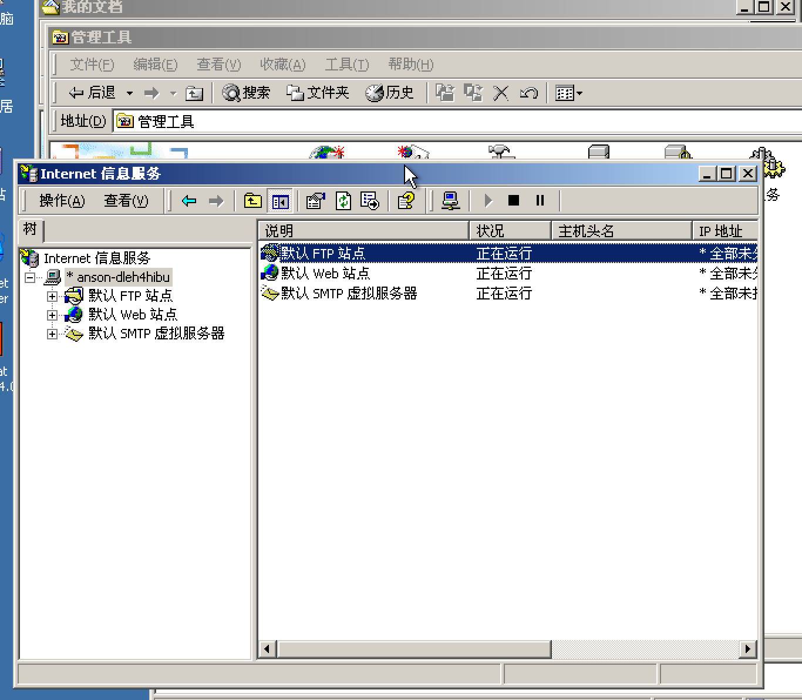

第一个从里面拉出来的东西是 SolidWorks 自带的官方 PDF 教程，4.7 MB，拖到 Mac 上直接能打开。这也算是把 ISO 那道单向门补上了。后来这个目录越堆越乱：零件的 .SLDPRT、导出的 .STL 和 .DXF，加上待会儿要用的 sdelete.exe，能动的东西都从这儿走。

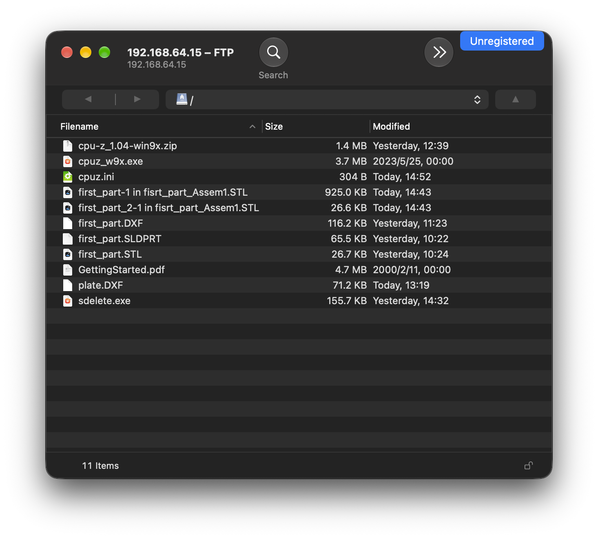

问题出在网络上。为了这个 FTP，网卡设的是 Shared 模式，主机能直接连进虚拟机，地址是 192.168.64.15，macOS 给共享网络用的就是这个网段。但 Windows 2000 在这张网卡上不了网，浏览器打不开任何页面。原因我没深究，反正再加一张网卡更省事：新网卡设成 Emulated VLAN，走 QEMU 自己的用户态网络，能出去，主机进不来。两张网卡同时挂在 2k 里，一张管 FTP，一张管互联网，各司其职。

能上网之后先补证书。2k 自带的根证书是二十多年前的，几乎所有 HTTPS 站点都会报错。GitHub 上有个仓库专门整理这些老系统的证书更新：

::card{url="https://github.com/JohnTHaller/RootCertificateUpdatesForLegacyWindows" site="GitHub" title="RootCertificateUpdatesForLegacyWindows" desc="给已经停止更新的 Windows 版本用的根证书与中间证书更新。"}

`WindowsRoot.sst` 导入受信任的根证书颁发机构，`WindowsIntermediate.sst` 导入中间证书颁发机构，两个 `.pfx` 是同一批证书的另一种打包方式。做完之后能连上的站点确实多了一些，但别指望太多：Windows 2000 最高只支持到 TLS 1.0，密码套件也是那个年代的，大部分现代站点在握手阶段就会拒绝。不过也就是聊胜于无。

## 动了不该动的地方

切到双核之后，开机偶尔会卡死。不是蓝屏，就是停在某个地方不动，重启一次又能进去。把之前撤掉的那条参数加回来，这次写的是短名字 `-win2k-hack`，就再没卡过。为什么，我不知道。它和安装时用的是同一个开关，也许开机路径上也有一个类似的时序竞争，被那 1 毫秒的让步顺带躲开了。

然后是硬盘。老 IDE 驱动的速度实在难看，网上说可以换成 UniATA (Universal ATA)，一个第三方的 ATA 驱动，能识别 AHCI 和 SATA。我的想法是先把光驱从 IDE 切到 SATA，再把驱动换掉。这一步走得很不顺，切回原驱动之后光驱直接失效了。

原因是资源。

Win2k 里的 Primary IDE Channel 没什么 PnP 的余地，它那三个资源是写死的：I/O `01F0-01F7`、`03F6-03F6`、中断 14。这不是开机时协商出来的，是 82371SB 在 legacy 模式下的固定分配，所以这个通道每次启动都得原样把三条认领回来，差一条就整个起不来。

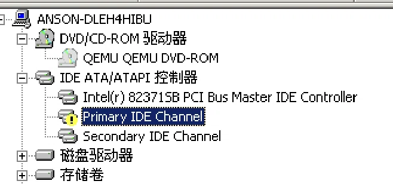

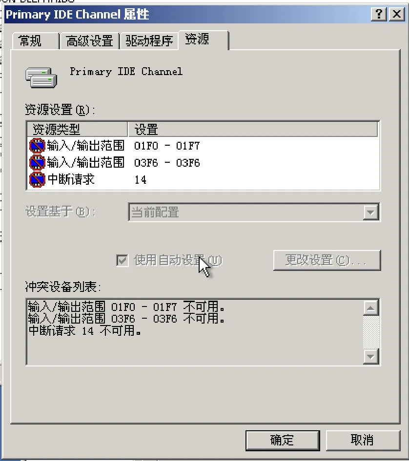

光驱在 SATA 上待过一轮再搬回来，中间发生了两件事。通道被改成没有设备的状态，但它下面的设备实例还留在注册表里，连带着那组资源的声明；而把驱动换回来时，Windows 只恢复了驱动文件和注册表项，没有重新跑一遍完整的设备枚举。旧的 CD-ROM 实例还挂在 Primary IDE Channel 底下，父设备是故障态，新实例接管不了。

所以占住那三条资源的，是已经不存在的实例。正常视图里什么都看不见，设备管理器只显示当前存在的硬件。解决办法是让它显形：设一个环境变量 `DEVMGR_SHOW_NONPRESENT_DEVICES=1`，再打开设备管理器，勾上显示隐藏设备，那个幽灵光驱就出来了，删掉，重启，资源就释放了。

这里有个不能碰的红线。不要在虚拟机设置里直接把光驱删掉。`atapi.sys` 在 boot 阶段就加载，它的设备对象就挂在 Primary IDE Channel 上，通道初始化失败，存储栈会在引导路径上崩，于是 0x7B，而且安全模式也进不去，因为安全模式照样要加载这个栈。我最后也没把 uniata 用起来，收益不值这个风险。

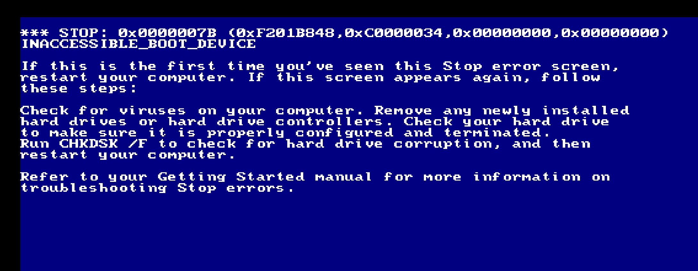

## 把它瘦回去

选老系统的一个理由是它占的地方小，但 qcow2 只会变大不会变小。这台机器里用掉的只有 2.14 GB，镜像已经长到 4.5 GB。

流程是三步。先在 2k 里对 C 盘做一次碎片整理，让已用的数据紧凑起来，腾出来的空闲空间最好是连续的。然后用 [sdelete](https://learn.microsoft.com/en-us/sysinternals/downloads/sdelete) 把空闲空间全部写成 0：`sdelete -z c:`。这里版本要注意，SDelete 1.61 是最后一个能在 Windows 2000 上跑的版本，2.x 起要求 XP 以上，直接下最新版会提示缺少系统调用。

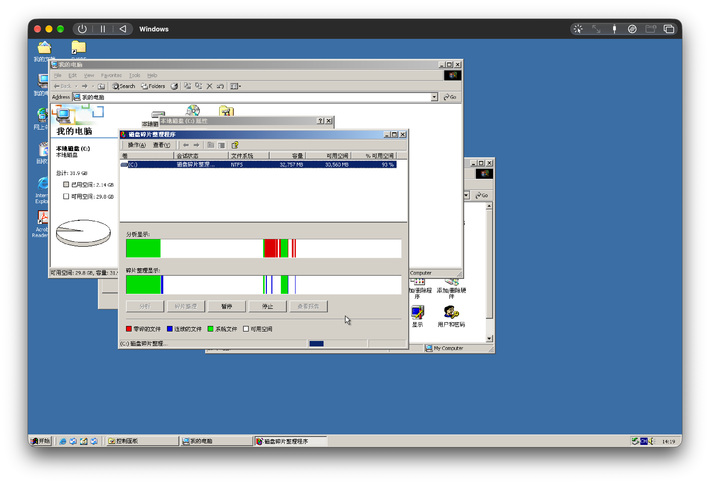

盘大、东西少，qcow2 却只记哪些簇被写过，不记哪些簇里还有用的东西。

写完 0 之后关机，不是挂起，确认 UTM 完全退出，然后在 Mac 上跑：

```sh
qemu-img convert -O qcow2 input.qcow2 output.qcow2
```

`qemu-img convert` 读取源镜像时会跳过全零区域，目标文件就不为这些簇分配空间，文件尺寸跟着掉下来。缩下来的是文件大小，虚拟磁盘的容量不变，系统里看到的还是原来那个数。

4.5 GB 进去，1.5 GB 出来。比系统里报的 2.14 GB 还小一点，因为 NTFS 算的是文件占着的空间，里面本来就有大段零，convert 一并跳过了。

有个代价要先知道：convert 只导出当前层，qcow2 里的快照会全部丢掉。我为切双核留的那个快照就是这么没的，所以顺序应该是先合并快照、再转换，或者干脆复制一份原文件留底。

---

这台虚拟机现在还在用，我拿它学 SolidWorks。

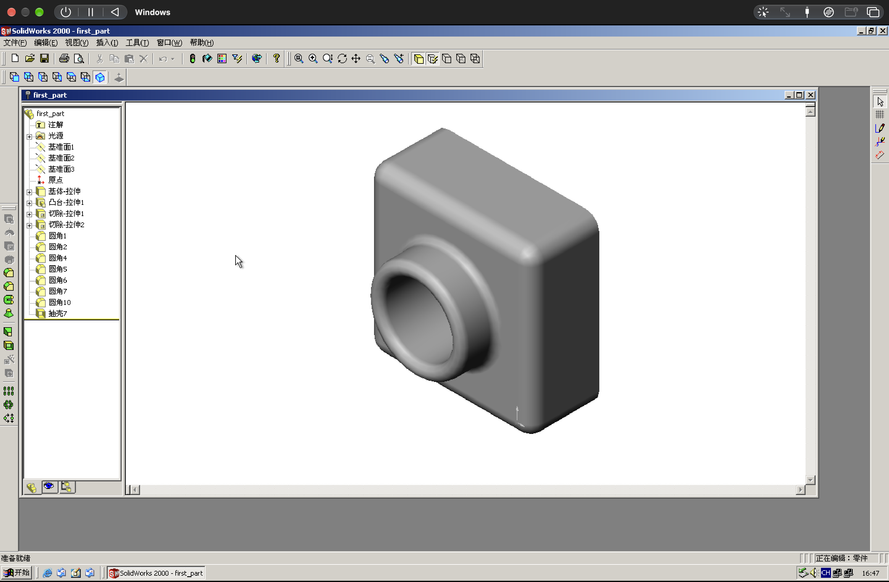

用起来比预期顺手。界面是 1999 年的布局，工具栏密密麻麻，但每一样点下去就是那个意思，不用先学怎么用。唯一的问题是画面撕裂，拖动模型的时候屏幕上会出现横条。VBEMP 是直接往显存里画，没有垂直同步，QEMU 什么时候来取帧就什么时候取。这个基本无解，除非把整条显示方案换掉，而 SPICE 在这台机器上起不来。

后来我用 CPU-Z 看了一下它被认成什么。QEMU 给的是 `-cpu pentium3`，CPUID 报 family 6 model 7 stepping 3，CPU-Z 照表一查，认成一颗 Intel Pentium III Xeon 333 MHz，代号 Tanner，0.25 微米，Slot 1 接口。缓存那栏写着 2 MB 二级、16 MB 三级，那是 QEMU 填进去的值。

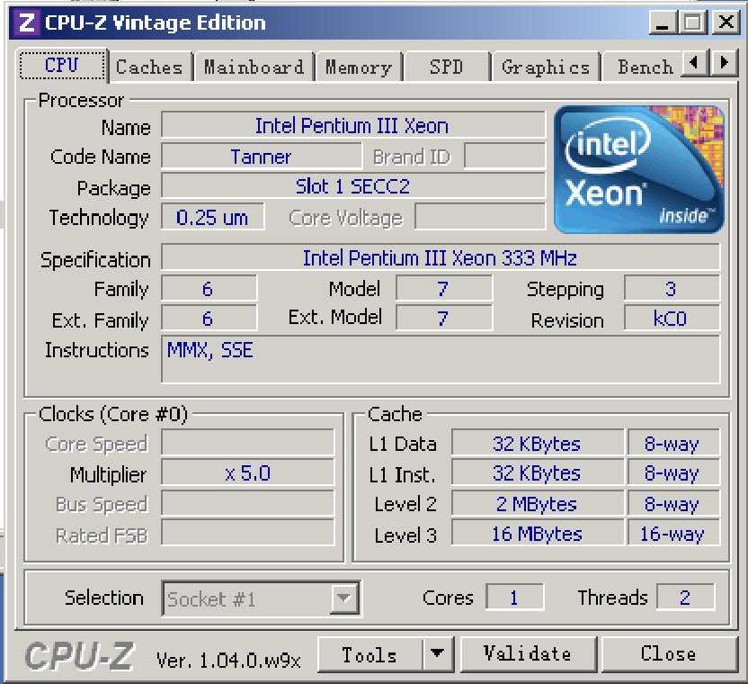

跑分更直观。参照只能选 AMD K6-2 CXT 500，这是 vintage 版基准库里能选到的最快一颗，再往上就没有了：CPU 项 14927 对 856，FPU 项 20640 对 3194，差了十七倍和六倍。一块真的 333 MHz 芯片跑不出这个差距。

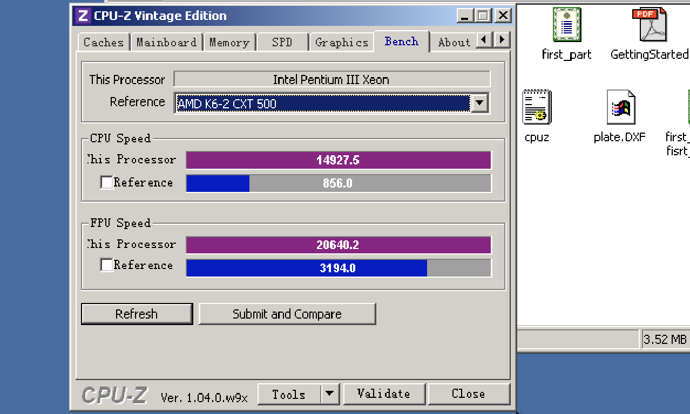

Windows 眼里这是一台 333 MHz 的 Pentium III Xeon，实际执行指令的是一颗 M3，中间隔着一层翻译。跑分高出来的那十几倍是 M3 的功劳，跟 1999 年没关系。

装系统反而是最省事的。把它调到 1440×900、能从 Mac 上取文件、开机别偶发死机，这些花掉的时间比装机本身多得多。二十多年前的软件确实够用，麻烦在于它依赖的那层东西已经不在了：驱动得换，幽灵设备得删，时序上还得让一步。下次再装一遍，这些配方大概又得重来。

## 附录

最终配置：

| 项 | 值 |
|---|---|
| 架构 / 机型 | i386 / pc（i440FX + PIIX, 1996） |
| CPU | pentium3，2 核 |
| 内存 | 1024 MB |
| 显卡 | VGA，64 MB 显存 |
| 磁盘 | qcow2，IDE |
| 光驱 | IDE，只读 |
| 网卡 | ne2k_pci（Emulated VLAN）+ rtl8139（Shared） |
| 声卡 | sb16 |
| 额外参数 | `-win2k-hack` |
| 其他 | PS/2 控制器开启，UEFI 关闭，RTC 用本地时间；USB 全程没用到 |

装系统时的临时配置：CPU 用 qemu32 单核，显卡用 cirrus，参数用 `-global ide-device.win2k-install-hack=on`。

症状速查：

| 症状 | 处理 |
|---|---|
| 装完重启又回到 OOBE | 单核 qemu32 + cirrus + install hack |
| 切双核后偶发开机卡死 | 加 `-win2k-hack` |
| 光驱报资源不足或失效 | `DEVMGR_SHOW_NONPRESENT_DEVICES=1` 后删掉幽灵设备 |
| 分辨率上不去 | cirrus 换 vga，装 VBEMP |
| Finder 连 FTP 只能读 | 换 Cyberduck |
| Shared 网卡上不了网 | 另加一张 Emulated VLAN 网卡 |
| qcow2 越来越大 | defrag + `sdelete -z` + `qemu-img convert` |
